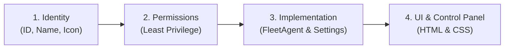

# Create Agent Skill & Workflow

This skill guides you through creating, sandboxing, implementing, and registering a new plug-and-play agent in **Personal Agentic Fleet**.

Agents are self-contained packages housed either in `fleet/agents/<agent_id>/` (built-in) or `fleet/data/user/custom_agents/<agent_id>/` (user-customized). Every agent declares its own manifest contract, lifecycle methods, sandboxed permissions, settings schema, and interactive web control panel.

---

## 4-Step Creation Workflow



### Step 1: Define Identity & Metadata
- **`id`**: Unique lowercase alphanumeric slug with underscores (e.g. `crypto_trader`, `home_assistant`, `weather_guard`).
- **`name`**: Human-readable display title (e.g. `Crypto Trader`, `Home Assistant`).
- **`icon`**: Single emoji or SVG icon (e.g. `📈`, `🏠`, `🌤️`, `⚡`).
- **`description`**: 1-2 sentence summary of what the agent does.
- **`author`**: Contributor or operator name.

### Step 2: Sandboxed Capabilities & Permissions
Declare only the capabilities strictly required by your agent:

| Permission | Description | Use When |
| :--- | :--- | :--- |
| `ui:render` | Render HTML/CSS control panel in dashboard | Agent provides visual controls or status panels |
| `db:read` | Read task memory, logs, and settings from SQLite | Agent needs access to saved records or schedules |
| `db:write` | Insert/update tasks, activity logs, and habits | Agent records automated actions or findings |
| `notifications:send` | Dispatch native desktop toast alerts | Agent triggers alerts on conditions/events |
| `network:http` | Make external HTTP requests to APIs / web | Agent fetches external market or weather feeds |
| `system:exec` | Execute sandboxed local system utilities | Agent runs diagnostic scripts or system tools |

### Step 3: Implement Python Agent (`agent.py`)
Subclass `fleet.core.base_agent.FleetAgent` and override properties and lifecycle hooks:

```python
"""
Example Agent Implementation.
"""
from typing import Any, Dict, List, Optional
from fleet.core.base_agent import FleetAgent


class MyCustomAgent(FleetAgent):
    @property
    def id(self) -> str:
        return "my_custom"

    @property
    def name(self) -> str:
        return "My Custom Agent"

    @property
    def icon(self) -> str:
        return "⚡"

    @property
    def order(self) -> int:
        return 75

    def get_agent_settings_schema(self) -> List[Dict[str, Any]]:
        """Declare agent-specific settings editable in the browser Settings modal."""
        return [
            {
                "id": "refresh_interval_sec",
                "label": "Sync Interval (Seconds)",
                "type": "number",
                "default": 60,
                "description": "How often to poll external services."
            },
            {
                "id": "enable_desktop_notifications",
                "label": "Enable Desktop Notifications",
                "type": "boolean",
                "default": True,
                "description": "Send alerts when tasks complete."
            }
        ]

    def execute_task(self, task: str, payload: Optional[Dict[str, Any]] = None) -> Dict[str, Any]:
        """Execute scheduled recurring tasks or ad-hoc tasks."""
        interval = self.get_setting("refresh_interval_sec", 60)
        return {
            "status": "success",
            "message": f"Ran task '{task}' with interval {interval}s.",
            "agent": self.id,
            "task": task
        }
```

### Step 4: Craft the UI Panel (`ui/panel.html`)
The agent's control panel is rendered inside the main dashboard view:

```html
<div class="agent-panel" id="panel_my_custom" style="padding: 16px;">
  <div class="card" style="background: var(--card-bg); border: 1px solid var(--card-border); border-radius: var(--radius); padding: 20px;">
    <div style="display: flex; justify-content: space-between; align-items: center;">
      <div style="display: flex; align-items: center; gap: 8px;">
        <span style="font-size: 20px;">⚡</span>
        <strong style="font-size: 16px; color: var(--text);">My Custom Agent Control</strong>
      </div>
      <button class="btn btn-primary" onclick="runAgentTask('my_custom', 'poll')">▶ Run Task</button>
    </div>
    <div id="myCustomOutput" style="margin-top: 14px; font-size: 13px; color: var(--text-muted);">
      Ready.
    </div>
  </div>
</div>
```

---

## How to Create an Agent

### Method 1: In the Browser (Workstation Dashboard `➕` Button)
1. Launch the Workstation Control Center (`python -m fleet.app` or `http://localhost:8000`).
2. Click the **`➕`** icon button directly beside the Settings **`⚙️`** icon in the header.
3. Follow the 4-step guided wizard:
   - **Step 1**: Enter Name, Icon, Description.
   - **Step 2**: Select Capabilities preset or customize permissions.
   - **Step 3**: Configure settings schema and routine task.
   - **Step 4**: Preview code and click **"🚀 Scaffold & Activate Agent"**.
4. The agent is immediately scaffolded into `fleet/data/user/custom_agents/` and hot-loaded into the running fleet without restarting the server!

### Method 2: Via Command Line (Scaffolder CLI)
```bash
python -m fleet.tools.create_agent --id crypto_tracker --name "Crypto Tracker" --icon "📈" --permissions "db:read,ui:render,network:http"
```

### Method 3: Via REST API
```http
POST /api/settings/agents/create
Content-Type: application/json

{
  "name": "Server Monitor",
  "id": "server_monitor",
  "icon": "🖥️",
  "description": "Monitors CPU and memory metrics.",
  "permissions": ["db:read", "db:write", "ui:render", "system:exec"],
  "settings": {
    "poll_interval_sec": 30
  }
}
```

---

## Quality Invariants & Verification Checklist
Before committing or publishing an agent:
1. **Manifest Contract**: `manifest.json` must be valid JSON with `id`, `name`, `version`, `icon`, `permissions`.
2. **Zero Syntax Errors**: Run `python -m py_compile fleet/agents/<id>/agent.py`.
3. **Security Audit**: Run `python -m fleet.tools.security_scanner` (Score must remain 100/100).
4. **Preflight Gate**: Run `python -m fleet.tools.preflight_gate`.
