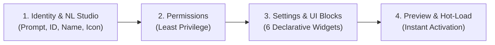

# Create Agent Skill & Zero-Code Studio Workflow (`UX-01`)

This skill guides you through creating, sandboxing, implementing, and registering a new plug-and-play agent in **Personal Agentic Fleet**.

Agents are self-contained packages housed either in `fleet/agents/<agent_id>/` (built-in) or `fleet/data/user/custom_agents/<agent_id>/` (user-customized). Every agent declares its own manifest contract, lifecycle methods, sandboxed permissions, settings schema, and interactive web control panel.

---

## Method 0: Zero-Code Natural-Language Agent Studio (`UX-01` — Fastest)

You can synthesize a complete, sandbox-verified agent from a single plain-English sentence in `< 5ms` at `$0.00` token cost:

```bash
# Synthesize full specification (manifest.json, agent.py, declarative panel.html, schedule)
python -m fleet.core.agent_studio "Check my local git repos every evening at 6 PM and alert me if uncommitted changes exist"
```

Or via REST API (`POST /api/studio/synthesize` or `POST /api/settings/agents/create` with `nl_prompt`):
```json
{
  "nl_prompt": "Track my daily reading list and summarize notes at 9 PM",
  "ui_blocks": ["alert_banner", "kpi_row", "quick_capture_bar", "habit_checklist", "history_table"]
}
```

### The 6 Declarative UI Widget Blocks (`fleet/core/agent_studio.py`)
| Block ID | Component Name | Purpose |
| :--- | :--- | :--- |
| `alert_banner` | **Threshold & Health Alert Banner** | Status callout showing active schedule and `$0.00` mode |
| `kpi_row` | **KPI Stat Pills Row** | 3–4 responsive metric cards (Status, Cadence, Capabilities) |
| `quick_capture_bar` | **Quick Capture & Action Bar** | Input box + `▶ Run` trigger button wired to the scheduler |
| `habit_checklist` | **Interactive Daily Checklist** | Daily interactive checkboxes for routine verification |
| `history_table` | **History & Records Table** | Structured execution and activity log panel |
| `status_timeline` | **Live Execution Timeline** | Monospace autonomic event feed |

---

## 4-Step Creation Workflow



### Step 1: Define Identity & Metadata
- **`id`**: Unique lowercase alphanumeric slug with underscores (e.g. `crypto_trader`, `home_assistant`, `weather_guard`).
- **`name`**: Human-readable display title (e.g. `Crypto Trader`, `Home Assistant`).
- **`icon`**: Single emoji or SVG icon (e.g. `📈`, `🏠`, `🌤️`, `⚡`).
- **`description`**: 1-2 sentence summary of what the agent does.

### Step 2: Sandboxed Capabilities & Permissions
Declare only the capabilities strictly required by your agent:

| Permission | Description | Use When |
| :--- | :--- | :--- |
| `ui:render` | Render HTML/CSS control panel in dashboard | Agent provides visual controls or status panels |
| `db:read` | Read task memory, logs, and settings from SQLite | Agent needs access to saved records or schedules |
| `db:write` | Insert/update tasks, activity logs, and habits | Agent records automated actions or findings |
| `event_bus:publish` | Dispatch events & native desktop toast alerts | Agent triggers alerts on conditions/events |
| `network:outbound` | Make external HTTP requests to APIs / web | Agent fetches external market or weather feeds |
| `system:diagnostics` | Execute sandboxed local system telemetry | Agent runs diagnostic scripts or system tools |

### Step 3: Implement Python Agent (`agent.py`)
Subclass `fleet.core.base_agent.FleetAgent` and override properties and lifecycle hooks.

### Step 4: Craft or Generate the UI Panel (`ui/panel.html`)
Use `render_declarative_ui_blocks()` in `fleet.core.agent_studio` or custom scoped HTML inside `ui/panel.html`.

---

## Quality Invariants & Verification Checklist
Before committing or publishing an agent:
1. **Manifest Contract**: `manifest.json` must be valid JSON with `id`, `name`, `version`, `icon`, `permissions`.
2. **Zero Syntax Errors**: Run `python -m py_compile fleet/agents/<id>/agent.py`.
3. **Security Audit**: Run `python -m fleet.tools.security_scanner` (Score must remain 100/100).
4. **Preflight Gate**: Run `python -m fleet.tools.preflight_gate`.
