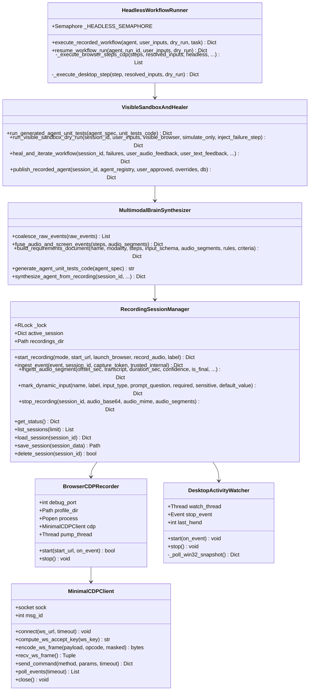
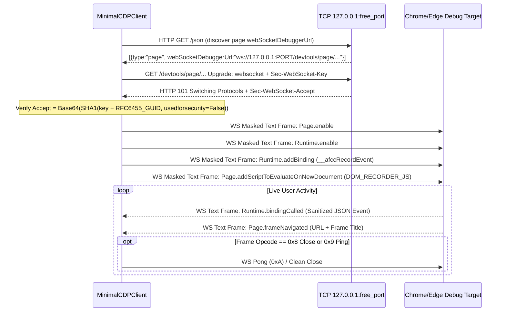
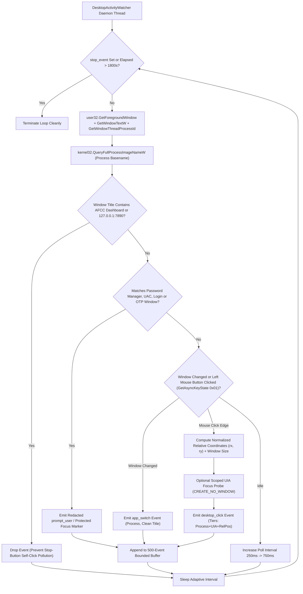
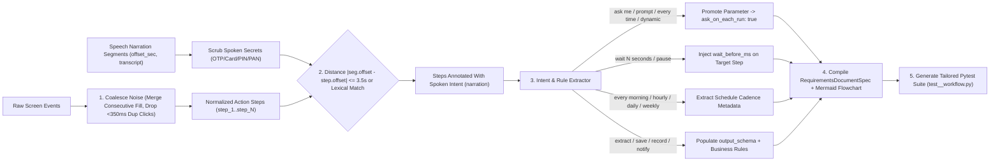
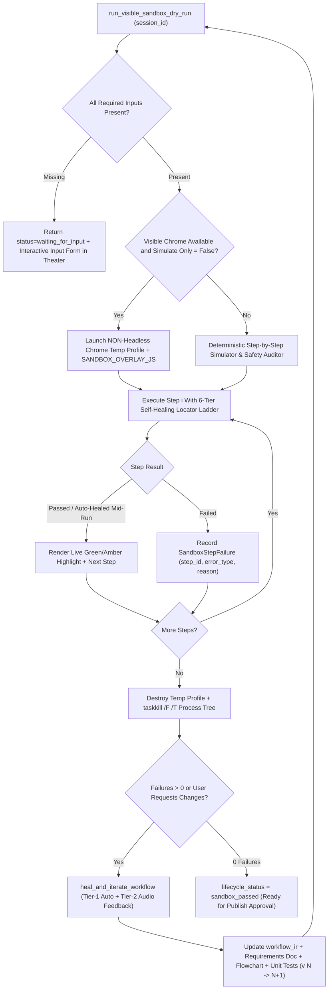
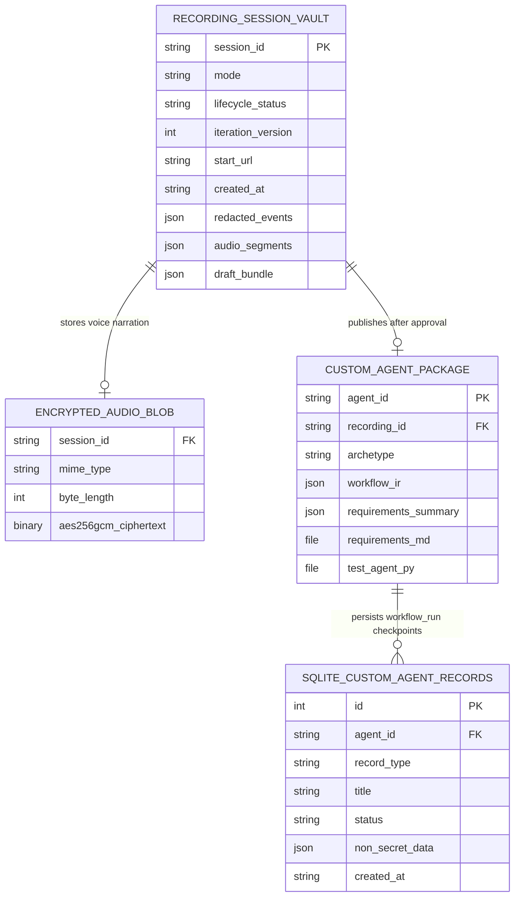
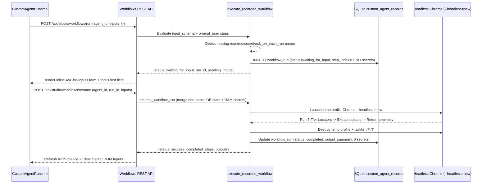

# 🔧 Low-Level Design (LLD): Multimodal Activity & Audio Recorder, Requirements Compiler, Visible Sandbox, Self-Healer & Headless Workflow Runtime

> **Version Target**: `v2.21.0` | **Primary Implementation Module**: [`fleet/core/activity_recorder.py`](../fleet/core/activity_recorder.py) • [`fleet/api/recorder_api.py`](../fleet/api/recorder_api.py)  
> **Companion Document**: [High-Level Design (`docs/ACTIVITY_RECORDER_AGENT_HLD.md`)](ACTIVITY_RECORDER_AGENT_HLD.md)

---

## 1. Module & Class Architecture (`classDiagram`)



---

## 2. Canonical JSON Schemas

### 2.1 `RawRecordedEvent` (Captured by Browser CDP/Bookmarklet or Desktop Watcher)
```json
{
  "event_id": "evt_00012",
  "offset_sec": 14.28,
  "timestamp": "2026-11-22T18:45:10.120000",
  "channel": "browser",
  "action": "change",
  "url": "https://portal.example.com/renewals",
  "title": "Policy Renewal Search",
  "locators": {
    "data_testid": "policy-number-input",
    "id": "policyNo",
    "aria_label": "Policy Number",
    "name": "policy_number",
    "role": "textbox",
    "placeholder": "Enter policy number",
    "label_text": "Policy Number",
    "text": "",
    "css_path": "#policyNo",
    "xpath": "//*[@id='policyNo']"
  },
  "value": "POL-98412",
  "input_type": "text",
  "sensitive": false,
  "param_hint": "policy_number",
  "source": "cdp_dom"
}
```
> **Edge Secret Rule**: Whenever `input_type == "password"`, `autocomplete in ("one-time-code", "current-password", "new-password", "cc-number", "cc-csc")`, or `SENSITIVE_FIELD_RE` matches field/window metadata, `"value"` is immediately replaced at capture edge with `"{{secret:<param_hint>}}"` and `"sensitive": true`.

### 2.2 `AudioNarrationSegment` (Timestamped Voice Narration)
```json
{
  "segment_id": "aud_00004",
  "offset_sec": 15.10,
  "duration_sec": 2.8,
  "timestamp": "2026-11-22T18:45:11.020000",
  "transcript": "Here ask me for the policy number every time, wait 2 seconds after submitting, and extract the renewal status.",
  "confidence": 0.94,
  "is_final": true,
  "linked_step_index": 2
}
```

### 2.3 `InputFieldSpec` (Runtime Parameter Prompt Schema)
```json
{
  "key": "policy_number",
  "label": "Policy Number",
  "type": "text",
  "prompt": "Enter the Policy Number for this run:",
  "required": true,
  "ask_on_each_run": true,
  "sensitive": false,
  "default": "POL-98412",
  "options": [],
  "source": "audio_and_dom_fusion"
}
```
Supported `type` values: `"text"`, `"secret"`, `"number"`, `"date"`, `"url"`, `"select"`, `"file"`. For `"secret"` fields, `"default"` is ALWAYS forced to `""` and `"sensitive"` to `true`.

### 2.4 `ParameterizedWorkflowIR` (`schema_version: "1.0"`)
```json
{
  "schema_version": "1.0",
  "recording_id": "rec_20261122_184500_a1b2c3",
  "modality": "browser",
  "execution_mode": "headless",
  "start_url": "https://portal.example.com/renewals",
  "input_schema": [],
  "steps": [
    {
      "step_id": "step_1",
      "index": 0,
      "channel": "browser",
      "action": "navigate",
      "description": "Open Policy Renewal Search page",
      "url": "https://portal.example.com/renewals",
      "locators": {},
      "value_template": "",
      "input_key": "",
      "wait_before_ms": 0,
      "timeout_sec": 15,
      "retries": 2,
      "on_error": "retry_then_prompt",
      "narration": "Open the policy renewal portal"
    }
  ],
  "output_schema": {
    "summary_field": "result_summary",
    "extract_keys": ["page_title", "extracted_text"]
  }
}
```

### 2.5 `RequirementsDocumentSpec` (`requirements_doc`)
Contains: `doc_id`, `version`, `title`, `summary`, `modality`, `mermaid_process_flow` (valid `flowchart TD`), `functional_requirements` (`FR-01`..), `non_functional_requirements` (`NFR-01`..), `business_rules` (`[]`), `input_schema`, `trace_matrix` (mapping `step_id` -> `screen_action` -> `audio_narration` -> `locator_summary`), `acceptance_criteria`, and `markdown`.

### 2.6 `WorkflowRunCheckpoint` (SQLite `custom_agent_records` `record_type="workflow_run"`)
Stored in existing `custom_agent_records` table (zero schema breaking migrations required!):
- `agent_id`: `<custom_agent_id>`
- `record_type`: `"workflow_run"`
- `title`: `"Run <run_id> (Paused at step 2/5)"`
- `status`: `"waiting_for_input"` | `"completed"` | `"failed"`
- `data` (JSON): `run_id`, `step_index`, `total_steps`, `pending_inputs`, `non_secret_inputs` (strictly filtered so ZERO `sensitive: true` keys are written to SQLite!), `completed_steps`, `dry_run`, `modality`, `updated_at`.

---

## 3. Pure-Stdlib RFC 6455 WebSocket + CDP Sequence (`sequenceDiagram`)



### RFC 6455 Framing Byte Layout
- Outgoing client frames MUST set `MASK = 1` (`0x80`) with a 4-byte `secrets.token_bytes(4)` masking key XORed across the UTF-8 JSON payload.
- Extended payload headers: `<126` (7-bit), `126` (16-bit big-endian `>H`), `127` (64-bit big-endian `>Q`).
- Incoming server frames from local Chrome are unmasked (`MASK = 0`) and parsed safely via bounded socket `recv` loops.
- `hashlib.sha1(..., usedforsecurity=False)` is strictly compliant with AFCC's 12-Layer SAST security scanner.

---

## 4. Desktop Win32 / UIA Adaptive Polling & Noise Filtering (`flowchart TD`)



---

## 5. Multimodal Temporal Fusion & Requirements Compiler (`flowchart LR`)



---

## 6. Visible Sandbox Dry-Run & Iterative Self-Healing Loop (`flowchart TD`)



---

## 7. Multi-Tier Self-Healing Selector Resolution Algorithm

### Browser 6-Tier Resolution (`execute_recorded_workflow` / `run_visible_sandbox_dry_run`)
Executed inside target page via CDP `Runtime.evaluate(expression, returnByValue=True)`:
1. **Tier 1 (`data_testid`)**: `document.querySelector('[data-testid="..."]')`
2. **Tier 2 (`id`)**: `document.getElementById('...')` (ignoring volatile UUIDs containing `>= 8` hex digits)
3. **Tier 3 (`aria_label` / `placeholder` / `name`)**: Attribute match on interactive tags (`input, button, a, select, textarea`)
4. **Tier 4 (`role` + visible `text` / `label_text`)**: Case-insensitive normalized text lookup across interactive elements & `<label for=...>` associations
5. **Tier 5 (`css_path`)**: Recorded structural CSS path
6. **Tier 6 (`xpath`)**: `document.evaluate(..., XPathResult.FIRST_ORDERED_NODE_TYPE)`

### Desktop 4-Tier Resolution
1. **Tier 1 (`headless_adapter`)**: If action compiled to safe HTTP check or local CLI/file probe, execute headlessly with `shell=False` and zero GUI dependency.
2. **Tier 2 (`uia_automation_id`)**: Focused PowerShell `.NET` `System.Windows.Automation` lookup by `AutomationId` + `ProcessName`.
3. **Tier 3 (`uia_control_name`)**: Window title + control `Name` match.
4. **Tier 4 (`relative_coords`)**: Fallback normalized `(rx, ry)` fraction inside foreground client rectangle.

---

## 8. Encrypted Storage & SQLite Checkpoint Entity-Relationship Schema (`erDiagram`)



---

## 9. Live Headless Checkpoint & Human-in-the-Loop Resume Sequence (`sequenceDiagram`)



---

## 10. REST API Contract Table (15 Endpoints)

| Method & Endpoint | Request Payload | Response Summary | Module Handler |
| :--- | :--- | :--- | :--- |
| `POST /api/studio/recorder/recommend_modality` | `{requirement, start_url, target_apps, needs_strict_headless, needs_existing_login}` | `{recommended_mode, recommended_browser_strategy, headless_feasibility_score, rationale, warnings, auto_config, tradeoff_comparison}` | `recorder_api.py` |
| `POST /api/studio/recorder/start` | `{mode, start_url, launch_browser, record_audio, label}` | `{session_id, capture_token, bookmarklet_js, browser_launched}` | `recorder_api.py` |
| `POST /api/studio/recorder/stop` | `{session_id, audio_base64, audio_mime, audio_segments}` | `{session, events_count, audio_segments_count, audio_saved}` | `recorder_api.py` |
| `GET /api/studio/recorder/status` | `?limit=25` | `{active, session_id, elapsed_sec, events_count, recent_events, audio_segments}` | `recorder_api.py` |
| `POST /api/studio/recorder/event` | `{session_id, capture_token, action, locators, value, ...}` | `{status, event_id, redacted, events_count}` | `recorder_api.py` |
| `POST /api/studio/recorder/audio_segment` | `{session_id, capture_token, offset_sec, transcript, ...}` | `{status, segment_id, scrubbed_transcript}` | `recorder_api.py` |
| `POST /api/studio/recorder/mark_input` | `{session_id, name, label, input_type, prompt, sensitive, required}` | `{status, field, event_id}` | `recorder_api.py` |
| `GET /api/studio/recorder/sessions` | `?limit=25` | `{sessions: [{session_id, mode, lifecycle_status, ...}]}` | `recorder_api.py` |
| `POST /api/studio/recorder/convert` | `{session_id, label, use_llm, auto_run_tests}` | `{spec, workflow_ir, requirements_doc, unit_tests_code, unit_test_report}` | `recorder_api.py` |
| `POST /api/studio/recorder/run_tests` | `{session_id}` | `{status, passed, failed, errors, total, duration_ms, output}` | `recorder_api.py` |
| `POST /api/studio/recorder/sandbox_run` | `{session_id, inputs, visible_browser, simulate_only, inject_failure_step}` | `{status, steps, failures, healed_count, pending_inputs, lifecycle_status}` | `recorder_api.py` |
| `POST /api/studio/recorder/heal` | `{session_id, failures, user_audio_feedback, user_text_feedback, rerun_tests}` | `{status, iteration_version, healing_actions, requirements_doc, workflow_ir, unit_test_report}` | `recorder_api.py` |
| `POST /api/studio/recorder/publish` | `{session_id, user_approved, overrides}` | `{status, agent_id, manifest, requirements_path, tests_path}` | `recorder_api.py` |
| `POST /api/studio/workflows/run` | `{agent_id, inputs, dry_run}` | `{status: "completed" \| "waiting_for_input", run_id, pending_inputs, state}` | `recorder_api.py` |
| `POST /api/studio/workflows/resume` | `{agent_id, run_id, inputs, dry_run}` | `{status, run_id, completed_steps, outputs, state}` | `recorder_api.py` |

---

## 11. Failure, Timeout & Retry Matrix

| Failure Mode | Detection Trigger | Automatic Recovery / Fallback | Security / Laptop Guard |
| :--- | :--- | :--- | :--- |
| **Missing Chromium Binary** | Neither `chrome.exe` nor `msedge.exe` found | Safe HTTP GET probe fallback (for read/extract flows) + clear diagnostics | Blocks `file://` and internal cloud metadata URLs (`169.254.169.254`) |
| **External Token Spoof** | Invalid `capture_token` on `/recorder/event` or `/audio_segment` | Reject immediately with `HTTP 403 Forbidden` | Constant-time `hmac.compare_digest` check |
| **Selector Changed on Portal** | Tier 1 (`data_testid`) & Tier 2 (`id`) return `null` | Walk Tiers 3..6 (`aria_label` -> `text` -> `css` -> `xpath`) and record `healed` tier | Never persists sensitive field DOM values |
| **Step Timeout (`15s`)** | Navigation or DOM render stalls | Retry up to `2` times with bounded jitter, inject `wait_before_ms` in Self-Healer | Strict process-tree kill in `finally:` prevents Chrome RAM leak |
| **Dynamic / Secret Input Needed** | Parameter missing, `ask_on_each_run=true`, or `sensitive=true` | Pause run cleanly (`waiting_for_input`), save SQLite checkpoint, notify user | Secret values are NEVER persisted to disk/SQLite |
| **Unapproved Publish Attempt** | `POST /recorder/publish` without `user_approved: true` | Reject cleanly with `HTTP 400` requiring explicit user sign-off | Enforces human-in-the-loop approval before scheduling |

---

## 12. Smart Modality Advisor & Headless-First Desktop Adapter Compiler (`[REC-13]`)

- `recommend_recording_modality(requirement_text, start_url, target_apps, needs_strict_headless, needs_existing_login)`:
  - Classifies `$0.00` regex signals across Web/Portal (`_WEB_SIGNAL_RE` + validated `start_url`), Desktop Apps/Files (`_DESKTOP_SIGNAL_RE`), and Existing SSO/MFA Sessions (`_EXISTING_LOGIN_SIGNAL_RE`).
  - Outputs `recommended_mode` (`"browser"` | `"desktop"` | `"hybrid"`), `recommended_browser_strategy` (`"isolated_cdp"` | `"active_tab_bookmarklet"` | `"none"`), `headless_feasibility_score` (`0..100`), `warnings`, `auto_config`, and a scored `tradeoff_comparison` across Browser, Desktop, and Hybrid.
- `compile_desktop_step_headless_capability(step)`:
  - Annotates every captured step in `synthesize_agent_from_recording()` with `headless_capability` (`"true_headless"` | `"headless_adapter"` | `"requires_unlocked_desktop"`) and `headless_adapter` (`cdp_headless`, `hitl_checkpoint`, `file_system_adapter`, `tabular_file_adapter`, `powershell_readonly_adapter`, `browser_cdp_upgrade_recommended`, `http_native`, or `desktop_uia_gui`).
  - Populates `workflow_ir["headless_readiness_pct"]`, `workflow_ir["requires_unlocked_desktop"]`, and renders the readiness summary directly inside `requirements_doc["markdown"]`.
