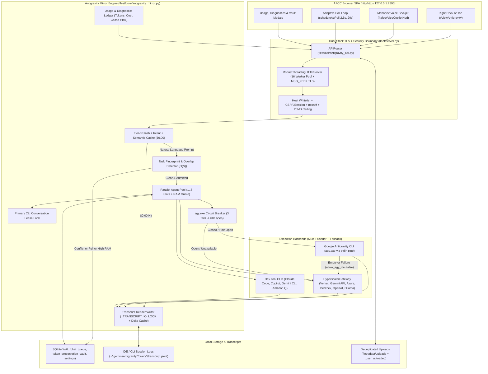
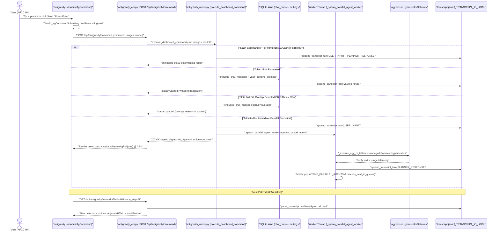
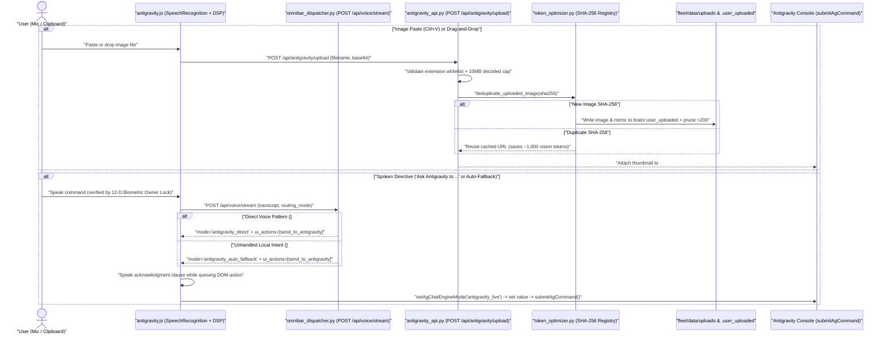
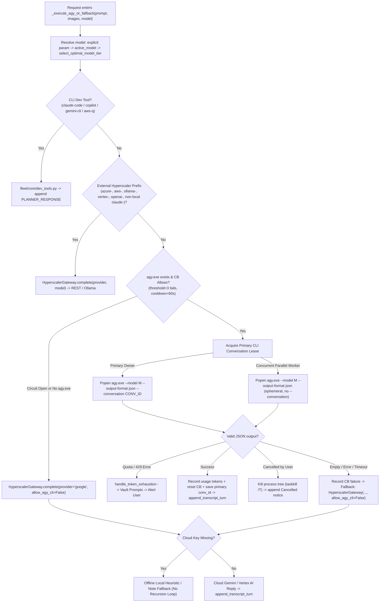
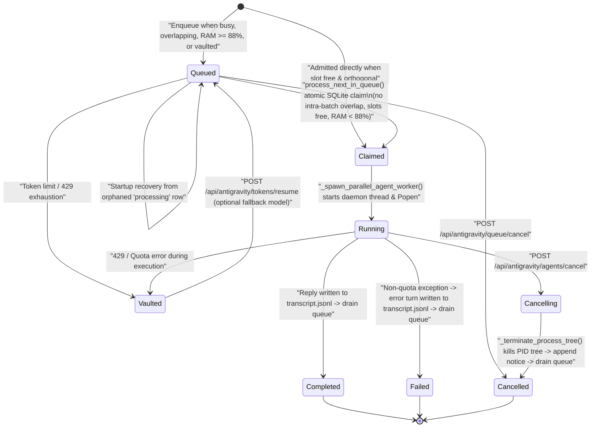
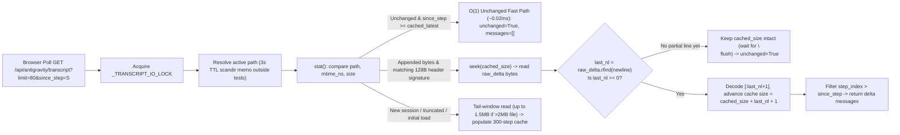
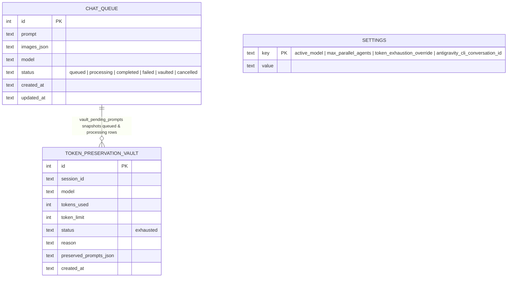

# ⚡ Antigravity Live via AFCC — Deep Technical Architecture & Principal Architect Review

This document provides an exhaustive engineering reference for **Antigravity Live via AFCC (Agentic Fleet Control Center)**: what happens on every millisecond from keystroke, image paste, or spoken wake word to local Tier-0 resolution, parallel worker dispatch, CLI/hyperscaler execution, delta transcript streaming, and crash recovery.

It also presents a **Top-1% Principal Systems Architect Critique** tuned specifically to the operating envelope of a **personal Windows laptop**, followed by the 10 remediation backlog items (`[AGL-01]`–`[AGL-10]`) executed to harden the engine.

---

## 1. Personal Laptop Operating Envelope & Design Constraints

Unlike stateless multi-node cloud clusters, **Antigravity Live via AFCC** executes as a **single-user, single-host microkernel** on a personal laptop (`127.0.0.1:7890`). Every architectural decision must honor six hardware and OS realities:

| Constraint Dimension | Personal Laptop Reality | Design Implication |
| :--- | :--- | :--- |
| **Shared RAM Ceiling** | IDE (`Code.exe` / Antigravity LS), browser tabs, Python server, and child `agy.exe` Node/Electron CLI processes share `16–32 GB` physical RAM. | Must enforce bounded HTTP worker pools, capped DOM & transcript caches, SHA-256 media deduplication, and RAM-pressure admission control before spawning extra subagents. |
| **Shared CPU & Thermals** | Background timer loops and regex scans steal cores from interactive IDE typing and trigger laptop fans/thermal throttling. | Polling must be visibility-aware (`document.hidden`), adaptive (`2.5s` active vs `12–20s` idle), delta-indexed (`since_step`), and O(N) non-backtracking (`extract_task_fingerprint`). |
| **Windows Process Cost** | `CreateProcessW` + Node.js runtime bootstrap for `agy.exe` is heavier than POSIX `fork` (`~150–400ms` & `80–250MB` RSS per child). | Never recursively re-spawn `agy.exe` inside fallbacks; kill full process trees (`taskkill /F /T`) on cancel/timeout so orphaned Node workers never leak RAM. |
| **Single-Writer SQLite WAL** | All parallel threads share local SQLite WAL (`fleet/data/user/fleet.db` in production). | Short connection scopes, atomic `UPDATE ... WHERE status='queued'` claims, startup orphan recovery, and zero uncommitted long transactions. |
| **Browser Battery & Layout Cost** | Left/right docked chat stream stays open alongside agent tabs. | Incremental appends (`insertAdjacentHTML`), `MAX_TRANSCRIPT_DOM_MESSAGES = 80`, single-flight fetch guards, and payload signature diffing (`_afccHasPayloadChanged`). |
| **Zero-Cloud Privacy Firewall** | No user prompts, transcripts, screenshots, or voiceprints may leave local disk except explicitly selected LLM calls. | Transcript `brain/*/transcript.jsonl`, `fleet/data/uploads`, and AES-256-GCM encrypted SQLite settings stay gitignored and local; media served with `X-Content-Type-Options: nosniff`. |

---

## 2. Architecture Diagrams

### 2.1 High-Level System Architecture & Process / Trust Topology

### 2.2 Typed Prompt & Natural Language End-to-End Dispatch Sequence

### 2.3 Voice-to-Antigravity Escalation & Image Upload Pipeline

### 2.4 Multi-Provider Model Routing & Non-Recursive Fallback Decision Tree

### 2.5 Parallel Agent Pool, Overlap Detection, Cancellation, Vault & Recovery State Machine

### 2.6 Incremental Transcript Sync, Newline-Aligned Delta Cache & SQLite Schema

---

## 3. Step-by-Step User Interaction Walkthroughs

1. **Dashboard Boot & Initial Hydration**:
   - `dashboard.html` renders `#viewAntigravity` (default docked in `#agRightDockSlot`, resizable via `#agRightDockResizeHandle`).
   - `app.js` `DOMContentLoaded` calls `openAntigravityRightDock()`, which performs a single initial burst: `fetchTranscript(true)` -> `GET /api/antigravity/transcript?limit=80`, `fetchModels()` -> `GET /api/antigravity/models` (triggers non-blocking background `agy.exe models` refresh every 30 min via `sync_antigravity_cli_models`), and `fetchAgentQueue()` -> `GET /api/antigravity/queue` + `fetchTokenHealth()` -> `GET /api/antigravity/tokens`.
   - On backend startup (`AntigravityAgent.on_startup`), `recover_orphaned_queue_on_startup()` resets any `'processing'` rows left behind by a prior crash back to `'queued'`.
2. **Typing & Submitting a Prompt (`Enter` or Send Button)**:
   - `submitAgCommand()` checks `_agCommandSubmitting` to prevent double submissions. If `window.agChatEngineMode === 'fleet_zero_token'` and there are no image attachments, it routes locally via `FleetNavigator.executeOmnibarInput(q)`.
   - Otherwise it posts `{ command, images, model }` to `POST /api/antigravity/command`.
   - `execute_dashboard_command()` evaluates slash commands (`/sync`, `/briefing`, `/task`, `/notify`, `/providers`, `/copilot`, `/claude`, `/gemini`, `/vertex`, `/azure`, `/aws`, `/bedrock`, `/ollama`), Tier-0 Extended Intent Router, and Semantic Prompt Cache (`$0.00`).
3. **Pasting (`Ctrl+V`) or Dragging-and-Dropping Images**:
   - `uploadImageBlob()` converts image files via `FileReader.readAsDataURL` and posts to `POST /api/antigravity/upload`.
   - `antigravity_api.py` validates safe image extensions and decoded byte size (`<= 10 MB`), then `save_uploaded_image()` runs `deduplicate_uploaded_image()` (SHA-256 hash) so repeated screenshots reuse existing URLs (`/api/antigravity/media/<file>`) and avoid duplicate vision token spend.
4. **Switching Models (`#agModelDropdownBtn`)**:
   - Clicking an item in `#agModelOptionsList` calls `selectModel(modelId)` -> `POST /api/antigravity/models` -> `set_active_model()`, persisting `active_model` in SQLite `settings`.
5. **Parallel Execution, Overlap Detection & Laptop RAM Guard**:
   - For natural-language prompts requiring an LLM, `execute_dashboard_command` checks token health, slot capacity (`get_max_parallel_agents()`, 1–8, default 4), laptop RAM admission (`_is_ram_admission_blocked()`, queuing extra concurrent workers above 88% host RAM), and O(N) semantic overlap (`detect_agent_task_overlap()` checking `@agent` targets, filenames, domain keywords, and >=3 content words).
   - Non-conflicting prompts immediately spawn `Agent-N` in `_spawn_parallel_agent_worker()` and return HTTP 200 in `<10ms` while executing asynchronously. Conflicting or saturated prompts persist in `chat_queue`.
6. **Cancelling a Queued or Running Agent**:
   - Queued items cancel via `POST /api/antigravity/queue/cancel`.
   - Running agents expose a 1-click **Stop** action in `#agLiveWorkingIndicator` and `#agActiveSlotsRow` calling `POST /api/antigravity/agents/cancel` -> `cancel_running_agent(agent_id)`, which signals `cancel_event`, terminates the entire child `agy.exe` process tree (`taskkill /F /T /PID` on Windows), marks any linked queue row `'cancelled'`, appends a cancellation message to `transcript.jsonl`, and drains the next eligible queued item.
7. **Token Exhaustion Vaulting & Automatic Fallback Resume**:
   - When quota/429 occurs or token usage hits exhaustion, `handle_token_exhaustion()` snapshots `'queued'` and `'processing'` rows into `token_preservation_vault`, updates queue rows to `'vaulted'`, sets `AGENT_STATE["status"] = "paused_token_limit"`, and triggers a Windows toast.
   - Clicking **Resume with Fallback Model** calls `POST /api/antigravity/tokens/resume` -> `resume_token_exhaustion()`, switches `active_model`, restores `'vaulted'` rows to `'queued'`, and drains pending tasks cleanly.
8. **Incremental Transcript Delta Sync**:
   - Adaptive polling (`scheduleAgPoll`: `2.5s` when active/queued, `12s -> 20s` when idle, paused when `document.hidden`) hits `/api/antigravity/transcript?limit=80&since_step=S`.
   - Backend checks `_TRANSCRIPT_IO_LOCK` + `(path, mtime_ns, size)` cache and returns `unchanged: true` if no new newline-terminated records arrived, avoiding JSON reparsing and client DOM reflows.
9. **Voice-to-Antigravity Escalation**:
   - Mahadev cockpit (`"Ask Antigravity to ..."` or automatic Tier-0 fallback `#12`) returns `ui_actions: [{"type": "send_to_antigravity", "command": "..."}]`. `antigravity.js` switches mode to `antigravity_live`, populates `#agCommandInput`, and triggers `submitAgCommand()`.
10. **Host Crash, Refresh & Server Shutdown Recovery**:
    - On server shutdown (`AntigravityAgent.on_shutdown` / `atexit`), `shutdown_all_parallel_agents()` terminates any active child subprocess trees. On next startup (`AntigravityAgent.on_startup`), `recover_orphaned_queue_on_startup()` requeues interrupted `'processing'` items automatically.

---

## 4. Top-1% Systems Architect Critique & Remediations (`[AGL-01]`–`[AGL-10]`)

Reviewing the pre-hardening implementation as a systems architect optimizing for a constrained personal Windows laptop exposed 10 concrete failure modes across concurrency, process lifecycle, accounting accuracy, UI churn, and failure recovery:

| ID | Category | Finding in Original Architecture | Laptop & Reliability Impact | Implemented Fix |
| :--- | :--- | :--- | :--- | :--- |
| **`[AGL-01]`** | Concurrency & I/O | `append_transcript_turn()` and `parse_transcript()` accessed `transcript.jsonl` and `_TRANSCRIPT_MEM_CACHE` without a mutex, and incremental `seek(cached_size)` advanced cache offsets over partial unflushed bytes if an external writer was mid-line. | Concurrent parallel workers could collide on step indices, mutate cache unsafely, or silently skip a half-written JSONL line forever. | Added `_TRANSCRIPT_IO_LOCK` (`threading.RLock`) guarding both read and append paths, explicit `f.flush()`, and newline-aligned byte scanning (`rfind(b"\n")`) that never advances `cached_size` past incomplete lines. |
| **`[AGL-02]`** | Process & RAM Governance | `_execute_agy_or_fallback()` used blocking `subprocess.run(timeout=600)` with no child PID handle tracking, no cancellation endpoint, and zero host-RAM admission control before spawning additional 100–250MB CLI subagents. | Hung or unwanted prompts burned laptop CPU/battery for up to 10 minutes with no UI stop button; 4 concurrent CLI processes on >88% RAM laptops caused heavy paging. | Replaced live CLI dispatch with `_run_agy_subprocess_managed()` (`Popen` + cancel polling + Windows `taskkill /F /T` tree kill), `POST /api/antigravity/agents/cancel`, `shutdown_all_parallel_agents()`, and >88% RAM graceful queueing. |
| **`[AGL-03]`** | Queue Consistency | Interrupted `'processing'` rows in `chat_queue` stayed stuck forever across server restarts; `process_next_in_queue()` had no lock, non-atomic claim, and checked overlap only against pre-loop `running_now`. | Server crash stranded tasks indefinitely; concurrent `process_next_in_queue` callers could double-claim a task; intra-batch conflicting items could launch together. | Added `recover_orphaned_queue_on_startup()`, atomic `db.claim_queued_chat_message()` (`WHERE id = ? AND status = 'queued'`), `_QUEUE_DRAIN_LOCK`, and live in-batch append to `running_now`. |
| **`[AGL-04]`** | Conversation State Isolation | Module-global `_AFCC_CLI_CONVERSATION_ID` was shared unsafely across parallel threads and lost on every AFCC restart. | Parallel workers corrupted each other's CLI conversation context (`--conversation`), causing erratic replies or stale session errors. | Added `_CLI_CONV_LOCK` and primary conversation lease (`_acquire_cli_conversation_lease` / `_release_cli_conversation_lease`): primary worker persists `antigravity_cli_conversation_id` in SQLite; concurrent workers run isolated ephemeral turns. |
| **`[AGL-05]`** | Token & Cost Truthfulness | `get_llm_usage_details()` hardcoded `cost_usd: "$0.00"` even for cloud API calls, and `get_token_health()` divided raw JSONL file size (including metadata/compacted history) by 4, causing premature false exhaustion on long sessions. | Users saw misleading `"$0.00"` during real paid cloud calls and false `"Token Limit Reached"` vaulting on active multi-step IDE transcripts. | Added `_SESSION_USAGE_TELEMETRY` tracking real LLM vs Tier-0 turns, input/output tokens, and estimated USD cost, plus post-`<CONTEXT_SUMMARY>` tail estimation in `get_token_health()`. |
| **`[AGL-06]`** | Client CPU & Battery | `antigravity.js` polled `/transcript` and `/queue` every `6000ms` constantly even when completely idle, `app.js` duplicated initial queue/health calls, and `fetchAgentQueue()` rebuilt DOM HTML every tick. | Unnecessary idle wakeups, HTTP requests, and V8 DOM churn on laptop battery. | Built adaptive `scheduleAgPoll()` (`2.5s` active -> `12s`/`20s` idle), payload signature diffing (`window._afccHasPayloadChanged`), startup burst deduplication in `app.js`, and shared single-flight fetch locks. |
| **`[AGL-07]`** | Error Visibility & UX | Failed `agy.exe`/worker turns or quota errors when queued only updated internal logs/badges without posting to the visible chat stream; no double-submit guard or in-flight cancel bar existed. | Prompts could appear to vanish silently; double-pressing Enter spawned duplicate workers; users had no Stop button for running workers. | Added visible error/cancellation transcript turns, `_agCommandSubmitting` double-submit guard, `#agLiveWorkingIndicator` active-agent bar with elapsed timer & Stop buttons, and selective UI refreshes. |
| **`[AGL-08]`** | Disk Scans & Upload Safety | `get_active_transcript_path()` rescanned `.gemini/*/brain` on every request; `/upload` accepted arbitrary sizes/extensions (up to 20MB global limit including `.svg`/`.html`) with unbounded growth in `fleet/data/uploads`; `/media/` omitted `nosniff`. | Continuous polling did unnecessary filesystem stats; uploads lacked per-image caps, extension hygiene, and disk pruning. | Added `3s` TTL `os.scandir` path memoization, `10 MB` + allowed-extension upload guard (`400`/`413`), `_prune_old_uploads()` retention cap (`200` files / `250 MB`), and `X-Content-Type-Options: nosniff` + `Cache-Control` on `/media/`. |
| **`[AGL-09]`** | Recursion & Fault Containment | `_execute_agy_or_fallback()` invoked `agy.exe`, and on failure called `HyperscalerGateway().complete(provider="google")`, which re-invoked `_call_antigravity_cli()` if no API key existed — running the failing CLI twice (`180s+` hang) with arbitrary `Path.cwd()`. | Hanging CLI doubled timeout latency on laptops and could read unintended directories depending on launch CWD. | Added `allow_agy_cli=False` to prevent recursive re-invocation, `_AGY_CIRCUIT_BREAKER` (`3` failures -> `60s` fast-bypass), and deterministic repository root `cwd`. |
| **`[AGL-10]`** | Unified Engine Observability | Telemetry was split across 4 separate endpoints with no view of transcript cache hit ratios, circuit-breaker state, orphan recoveries, or host RAM admission status. | Debugging slow polls, fallback trips, or queued tasks required tailing raw log files. | Exposed `GET /api/antigravity/diagnostics` (`get_antigravity_live_diagnostics()`) and integrated an **Engine Health & Laptop Guardrails** panel into `#usageModal`. |

---

## 5. Before vs. After Architecture Scorecard

| Architectural Metric | Before Hardening | After `[AGL-01]`–`[AGL-10]` |
| :--- | :--- | :--- |
| **Transcript Read/Write Safety** | Unsynchronized file append vs tail-seek (partial-line skip risk) | RLock-serialized (`_TRANSCRIPT_IO_LOCK`) + newline-aligned byte cursor |
| **Running Agent Stop / Process Hygiene** | Blocking `subprocess.run(timeout=600)` — unkillable from UI | Managed `Popen` + `POST /api/antigravity/agents/cancel` + Win32 `/T` tree kill |
| **Crash Recovery & Queue Determinism** | `'processing'` rows orphaned forever; intra-batch overlap gap | Startup orphan recovery + atomic SQLite claim + intra-batch overlap check |
| **Parallel Context Integrity** | Global `_AFCC_CLI_CONVERSATION_ID` race across threads | Exclusive primary lease persisted in SQLite; isolated ephemeral siblings |
| **Fallback Recursion & Failure Latency** | Double `agy.exe` invocation (`~90–180s` stall) + silent failures | Non-recursive `allow_agy_cli=False` + 60s circuit breaker + visible error turns |
| **Idle Browser Poll Overhead** | Fixed `6s` polls + redundant DOM innerHTML rebuilds | Adaptive `2.5s -> 20s` backoff + payload diffing + startup dedup |
| **Host Resource & Upload Guardrails** | No RAM admission gate; unbounded `uploads/`; no `nosniff` | `88%` RAM admission queue + `10MB`/ext guard + `200`-file LRU prune + `nosniff` |
| **Diagnostics Observability** | Scattered raw logs | Single `$0.00` endpoint `GET /api/antigravity/diagnostics` + Usage modal card |
