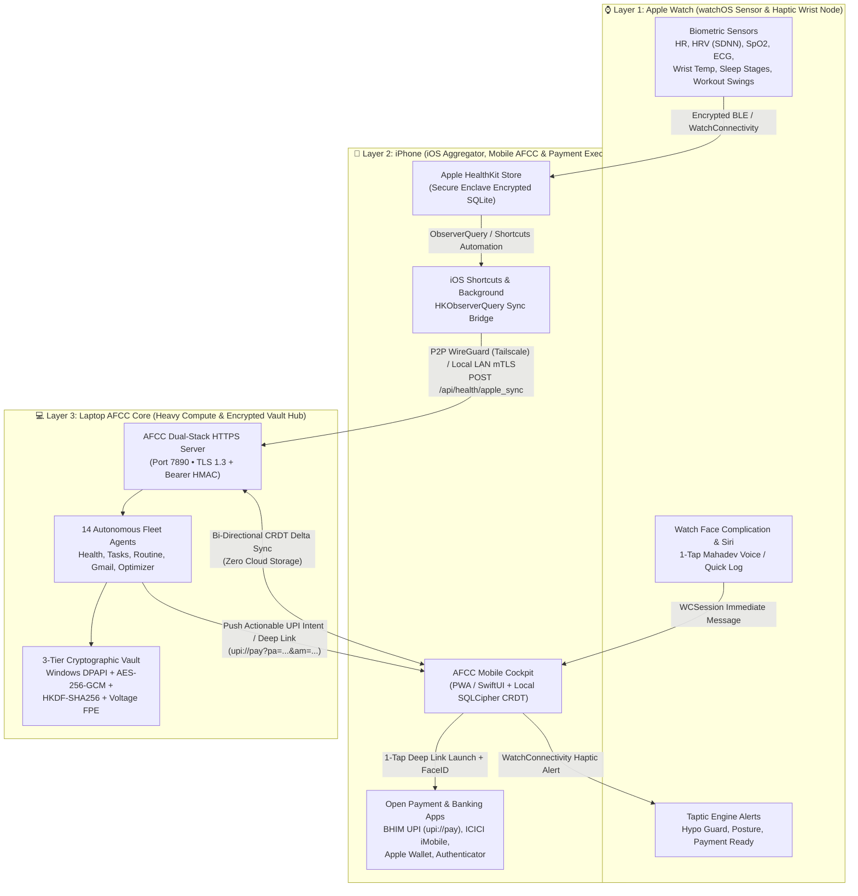
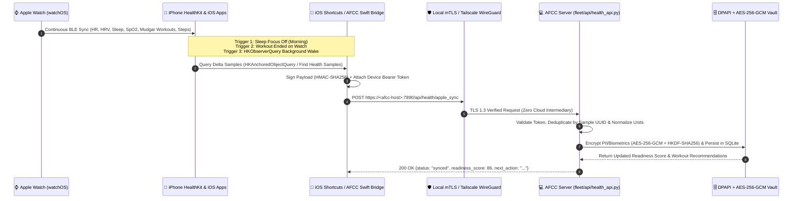
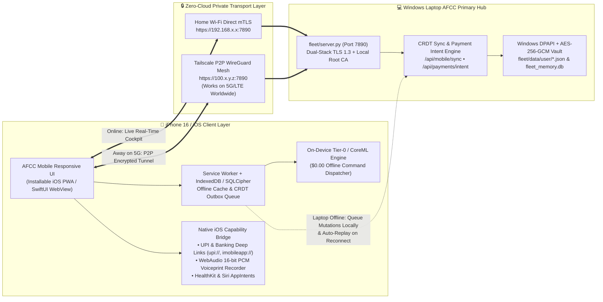
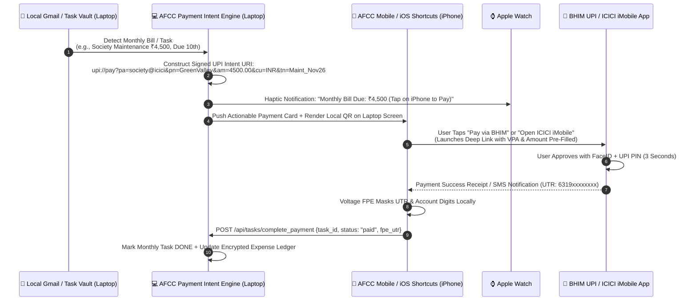

# AFCC Tri-Device Continuum Architecture: Apple Watch, iPhone & Laptop Personal Fleet

> **Document Scope**: End-to-end reference architecture for integrating **Apple Watch (watchOS)** and **iPhone (iOS)** telemetry, app events, and payment workflows into the **Antigravity Fleet Command Center (AFCC)**, running AFCC natively/hybridly on an iPhone, and solving high-value daily life, health, and financial problem statements across the **Laptop ↔ iPhone ↔ Apple Watch** continuum—while strictly preserving **Zero-Cloud Data Sovereignty** and **AES-256-GCM + DPAPI / Secure Enclave Encryption**.

---

## 1. Executive Summary: The Tri-Device Personal Fleet Continuum

A single device cannot optimally serve every human context:
- **The Laptop (Windows/macOS Workstation)** excels at heavy compute, multi-window deep work, local LLM inference, automated web/email scraping, IDE/Git orchestration, and large-screen analytics—but it stays on a desk, lacks physiological sensors, and cannot execute SIM-bound UPI/bank app authentications.
- **The iPhone (iOS Mobile Hub)** is always in your pocket with 5G connectivity, GPS, camera/QR scanner, iOS HealthKit database aggregation, and **hardware SIM-bound financial apps (BHIM UPI, ICICI iMobile Pay, Google Pay)** secured by FaceID and the Apple Secure Enclave.
- **The Apple Watch (watchOS Wearable)** is strapped to your wrist 22+ hours a day, continuously sampling photoplethysmography (HR, HRV, $\text{SpO}_2$), ECG, wrist temperature, sleep stages, and 3-axis accelerometry (Mudgar/Samtola/Bhim Gadha swings, steps, falls), while offering 2-second haptic micro-interactions and wrist microphone input.

By uniting all three into a **Zero-Cloud Personal Mesh**, AFCC transforms from a desktop dashboard into an **ambient, physiological- and financial-aware Personal Operating System**.



### 1.5 Real-World Environmental Constraints (`EC-01` – `EC-10`) & Practical Architecture Matrix

Every deliverable (`TD-01`..`TD-12`) in the Tri-Device Ecosystem Hub is engineered around **10 verified hardware, OS, and cryptographic boundaries** so that 100% of the architecture is practically executable without macOS, Xcode, or cloud telemetry:

| ID | Layer | Environmental Constraint | Practical AFCC Engineering Solution |
| :--- | :--- | :--- | :--- |
| **`EC-01`** | `⌚ Watch ↔ 📱 iPhone ↔ 💻 Windows` | **Apple Watch (`watchOS`) Exclusive iPhone Pairing Rule**: Apple Watch cannot pair directly with a Windows laptop via Bluetooth for HealthKit, notifications, or control. | **3-Tier Companion Relay**: Apple Watch syncs to **iPhone (`iOS 26.3.1`)** via `WatchConnectivity`, and the iPhone relays telemetry and commands to the Windows Laptop Hub (`tri_device` agent) over local Wi-Fi LAN / Tailscale. |
| **`EC-02`** | `💻 Windows 10 Home ↔ 📱 iPhone` | **Windows 10 Home Lacks Microsoft Phone Link for iPhone**: Phone Link for iOS (Bluetooth ANCS/HFP/MAP) requires Windows 11 and is unavailable on Windows 10 Home (`Build 19045`). | **Zero-Phone-Link Wi-Fi + Bot Bridge**: Use AFCC's Native HTTP/HTTPS Wi-Fi LAN Bridge (`/mobile-pair`), iOS 26.3.1 Share Sheet / Shortcuts Webhooks, and the Telegram/WhatsApp Bot Bridge (`remote_chat`) for bi-directional alerts. |
| **`EC-03`** | `📱 iOS 26.3.1 & ⌚ watchOS` | **No macOS / Xcode & No \$99/yr Apple Developer Program**: Sideloaded iOS apps expire every 7 days and free Apple IDs lack the `HealthKit` entitlement. | **100% Zero-Xcode Stack**: Use iOS Safari Standalone PWA (`/manifest.json` + `/sw.js` + `/mobile-pair`) + Native iOS Shortcuts (`Find Health Samples` + `Get Contents of URL`) + Native watchOS Shortcuts (`Show on Apple Watch`). |
| **`EC-04`** | `📱 iOS 26.3.1 Secure Enclave` | **iOS 26.3.1 HealthKit Lock-Screen Encryption Barrier**: iOS encrypts `HKHealthStore` (`NSFileProtectionComplete`) when the iPhone is locked, causing background `Find Health Samples` shortcuts to fail while locked. | **FaceID-Unlocked Trigger Strategy**: Bind iOS Personal Automations to **Unlocked-State Events** (*When Wake-Up Alarm Is Stopped*, *When Apple Watch Workout Ends*, *When Opening Safari/Health*, or 1-Tap Back-Tap / Control Center). |
| **`EC-05`** | `💻 Dual-Core Laptop CPU Budget` | **Low-Power Dual-Core Laptop CPU & Integrated Graphics**: Heavy background polling or local neural STT/TTS loops cause thermal throttling and audio stutter. | **Ultra-Low-CPU Tier-0 Architecture**: `<2ms` Python `winreg` (`BTHENUM`) Bluetooth registry checks, `<3%` CPU WebAudio FFT 6D voiceprint math, and `$0.00` `<5ms` Tier-0 regex intent routing. |
| **`EC-06`** | `📱 iOS 26.3.1 Safari & UPI Apps` | **iOS Safari UPI Deep-Link Sandboxing**: Safari blocks silent background `upi://pay` redirects and `canOpenURL` probing without an explicit user tap. | **Dual-Mode UPI Payment Bridge**: **(A)** Render dynamic NPCI `upi://pay` QR Code on the Laptop Hub for 2-second iPhone BHIM/ICICI/GPay camera scan; **(B)** Explicit user-gesture buttons (`bhim://`, `imobileapp://`, `tez://`, `phonepe://`) + 1-Tap Copy VPA on `/mobile-pair`. |
| **`EC-07`** | `📱 iOS 26.3.1 WebKit Security` | **WebKit Microphone Policy on Plain LAN HTTP**: iOS Safari blocks `navigator.mediaDevices.getUserMedia` over plain `http://192.168.x.x` unless local Root CA HTTPS is trusted. | **Zero-Cert Native iOS Dictation + Optional Root CA**: Support native iOS Keyboard Microphone Dictation & Siri Shortcuts voice input (`POST /api/voice/converse`) over plain HTTP immediately, plus optional 1-tap Root CA (`/api/security/ca.crt`). |
| **`EC-08`** | `🌐 Home Wi-Fi LAN` | **Zero-Config Home Wi-Fi LAN Default**: Tailscale VPN is optional and may not be installed by default. | **Wi-Fi LAN Primary + Offline Outbox Spooler**: Auto-detect active LAN IPv4 (`:7890`) as primary zero-install transport, backed by client-side `localStorage` / Shortcuts offline outbox spooling when away from home Wi-Fi. |
| **`EC-09`** | `🎧 Multi-Peripheral Bluetooth` | **Concurrent Bluetooth Audio & Input Peripherals**: Headset microphones and external party speakers have different acoustic profiles. | **Split Acoustic Routing**: Route **Mahadev Biometric Voice Cockpit** via headset microphone (`85–3800 Hz` DSP + 12s 3-phase voiceprint lock) while routing **6-Day Akhada Workout Playlists** to external Bluetooth speakers. |
| **`EC-10`** | `🔒 Zero-Cloud Hardware Privacy` | **Strict User Hardware & PII Sovereignty**: Specific workstation serials, device hostnames, Bluetooth MACs, and personal inventories must never be committed to GitHub. | **Gitignored Encrypted Hardware Registry**: Store personal hardware specs exclusively in `fleet/data/user/personal_hardware_inventory.md` and AES-256-GCM encrypted `fleet/data/user/hardware_inventory_vault.json` (100% excluded by `.gitignore`). |

---

## 2. Problem Statements Solved Across Laptop ↔ iPhone ↔ Apple Watch

Below are the **7 core problem statements** that are impossible (or high-friction) on a laptop alone, but are solved seamlessly by the Tri-Device Architecture:

### Problem 1: Frictionless Monthly Bill & Recurring Payment Execution (BHIM UPI & ICICI Bank)
- **The Problem**: Monthly recurring obligations—electricity, broadband, society maintenance, credit card bills, mutual fund SIPs, domestic help salaries, and vendor invoices—arrive via **Gmail statements** or sit in **AFCC Monthly Tasks** on the laptop. However, Indian payment rails (**NPCI UPI via BHIM** and **ICICI Bank iMobile Pay**) require **hardware SIM-binding + FaceID / UPI PIN** on the iPhone. Typing UPI IDs (`pa`), exact invoice amounts (`am`), and reference numbers (`tr`) manually from a laptop screen into a phone causes procrastination, typos, or missed due dates.
- **How the Tri-Device Architecture Solves It**:
  1. **Laptop (Discovery & Verification)**: AFCC's Gmail & Personal Tasks agents parse incoming bill PDFs/emails and monthly task checklists (e.g., *"Pay Electricity Bill"*, *"Transfer House Help Salary"*, *"ICICI Credit Card Due"*), extracting the payee VPA/account, exact amount, due date, and bill reference.
  2. **Laptop $\rightarrow$ iPhone/Watch (Actionable Handoff)**: On the scheduled payment morning (or when clicked in the Laptop dashboard), AFCC generates a signed **NPCI UPI Deep-Link URI** (`upi://pay?pa=merchant@upi&pn=Utility&am=2450.00&cu=INR&tn=Bill_Nov2026&tr=INV99281`) or an **ICICI iMobile Pay launch intent**, pushes a rich notification to the iPhone (with a subtle tap on the Apple Watch), and renders a dynamic **Encrypted Local QR Code** on the laptop screen.
  3. **iPhone (1-Tap Biometric Execution)**: You tap the notification on your iPhone (or scan the laptop QR code). iOS immediately launches **BHIM** or **ICICI iMobile** with the payee, exact amount, and remark pre-filled. You authenticate with **FaceID + UPI PIN** in 3 seconds.
  4. **iPhone $\rightarrow$ Laptop (Closed-Loop Reconciliation)**: An iOS Shortcut automation (triggered by the payment confirmation notification/SMS or share-sheet receipt) posts `{status: "paid", utr_fpe: "FPE:v1:...", task_id: 42}` back to AFCC, which automatically marks the monthly task **Completed** and archives the Voltage-FPE masked transaction reference in the encrypted vault.

### Problem 2: Closed-Loop Biometric Health & Traditional Strength Training (Mudgar, Samtola, Bhim Gadha & Hypoglycemia Guard)
- **The Problem**: AFCC's Health & Diet Agent manages your 6-day traditional strength training plan (Monday Mudgar, Wednesday Samtola, Friday Bhim Gadha, mandatory warm-up) and hypoglycemia safety rules, while you watch training videos on the laptop. However, the laptop has no visibility into your **real-time heart rate, caloric burn, post-workout recovery HR, or nocturnal glucose/HRV dips**.
- **How the Tri-Device Architecture Solves It**:
  1. **Pre-Workout**: Before launching a Mudgar or Bhim Gadha video on the laptop, AFCC checks your latest Apple Watch **Resting HR, HRV (SDNN), and Last Night's Sleep Score** synced from HealthKit. If HRV is severely depressed or sleep was `< 5.5 hours`, AFCC proactively recommends scaling back from heavy Bhim Gadha to mobility/recovery warm-up.
  2. **During Workout**: Starting a workout video on the AFCC Laptop Dashboard sends a local signal to your iPhone/Watch to start an `HKWorkoutSession` (`FunctionalStrengthTraining`). Live heart rate zones stream to a corner HUD overlay on the laptop video player.
  3. **Hypoglycemia & Cardiac Safety Guard**: If the Apple Watch detects an abnormal heart rate spike (`> 165 BPM` sustained) or rapid HR variability drop indicative of exercise-induced hypoglycemia, AFCC automatically **pauses the workout video on the laptop**, triggers a high-priority Apple Watch haptic alert, and displays the **15-15 Fast-Acting Glucose Protocol** on both screens.

### Problem 3: Physiological Cognitive-Load Routing (HRV + Sleep $\rightarrow$ Dynamic Workday Scheduling)
- **The Problem**: Task managers treat every human day as having identical energy capacity. In reality, your cognitive stamina varies wildly based on REM/Deep sleep duration, nocturnal respiratory rate, and morning Heart Rate Variability (HRV).
- **How the Tri-Device Architecture Solves It**:
  1. Every morning when you wake up and disable Sleep Focus on your Apple Watch/iPhone, an iOS Shortcut automatically pushes your overnight sleep stages (Deep, Core, REM, Awake), Resting HR, and morning HRV to AFCC (`POST /api/health/apple_sync`).
  2. AFCC computes a deterministic **Readiness Score (0–100)** at `$0.00` token cost.
  3. On **High Readiness Days ($\ge 80$)**, the Daily Briefing Engine schedules complex architecture/coding and P0 deep-work backlog items for the morning block. On **Low Readiness Days ($< 55$)**, AFCC automatically defers non-urgent heavy tasks, inserts a 20-minute afternoon NSDR/recovery block, and tightens late-evening screen-time cutoffs.

### Problem 4: Zero-Friction Ubiquitous Capture & Wrist Mahadev Voice Control
- **The Problem**: High-value ideas, urgent tasks, or quick status queries happen while walking, commuting, cooking, or working out—when your laptop is closed and even pulling out a phone is inconvenient.
- **How the Tri-Device Architecture Solves It**:
  1. Raise your wrist and tap the **AFCC Mahadev Watch Complication** (or press the iPhone Action Button).
  2. Speak naturally in English, Hindi, Telugu, or Marathi (e.g., *"Mahadev, add task renew car insurance next Friday"* or *"Mahadev, what are my pending P1 tasks?"*).
  3. The audio/transcript is sent over the encrypted WireGuard mesh to AFCC's Tier-0 Omnibar Dispatcher (`POST /api/omnibar/voice`), verified against your enrolled biometric voiceprint, executed at `$0.00`, and spoken back on your Apple Watch / AirPods.

### Problem 5: Context-Aware Sedentary, Posture & Hydration Micro-Interventions
- **The Problem**: Static timers on a laptop ("Drink water every hour") are ignored because they fire during deep coding flow or when you are already away from your desk.
- **How the Tri-Device Architecture Solves It**:
  1. By fusing **Laptop IDE/Keyboard Activity** (PC Optimizer Agent) with **Apple Watch Stand Minutes & Step Count** (HealthKit), AFCC knows whether you have genuinely been sitting motionless in front of the laptop for 90+ minutes.
  2. Only when both conditions are true (high laptop keyboard activity + zero Apple Watch movement) does AFCC trigger a gentle **Apple Watch wrist tap** + a 2-minute mobility warm-up video prompt. Once the Apple Watch accelerometer confirms 60 seconds of movement, the alert auto-dismisses.

### Problem 6: Banking SMS / Financial Alert & OTP Triage Without Distraction
- **The Problem**: Checking your phone during deep work to verify a credit card debit alert, mutual fund allotment, or bill auto-debit pulls you into social media/notifications for 15 minutes.
- **How the Tri-Device Architecture Solves It**:
  1. iOS Shortcuts (`When Message Received containing "debited" / "credited" / "ICICI" / "UPI"`) locally scrubs account numbers using **Voltage-style Format-Preserving Encryption (FPE)** and forwards only the structured transaction metadata to your local AFCC vault.
  2. Your Laptop Dashboard shows a silent, non-intrusive ledger update in the Daily Briefing without you ever unlocking your phone.

### Problem 7: Offline-Resilient Field & Travel Continuity
- **The Problem**: When traveling or away from home Wi-Fi with the laptop asleep in your bag, you still need access to your encrypted tasks, routines, workout videos, and personal profile.
- **How the Tri-Device Architecture Solves It**:
  1. The iPhone AFCC Mobile App maintains an encrypted local replica (`SQLCipher` in iOS Secure Enclave storage) of your active tasks, routines, and workout playlists.
  2. Changes made on the iPhone while offline merge deterministically (via CRDT timestamps) with the Laptop Hub the instant the laptop wakes up.

---

## 3. Detailed Architecture Part 1: Ingesting Apple Watch & iPhone Data into AFCC

Because Apple's privacy model prohibits third-party cloud servers from directly polling your Apple Watch or iPhone HealthKit database, all Apple Watch sensor data first flows into the **iPhone HealthKit Store (`healthd`)** via encrypted Bluetooth Low Energy (BLE). From the iPhone, AFCC provides **three complementary, 100% local/private ingestion pipelines**:



### 3.1 Data Domains Extracted from Apple Watch & iPhone

| Source Device | Apple Framework / Source | Metrics & Data Extracted | AFCC Target Agent & Table | Sync Cadence |
| :--- | :--- | :--- | :--- | :--- |
| **Apple Watch** | `HealthKit` (`HKQuantityType`) | Resting HR, Live HR, HRV (`SDNN` ms), Blood Oxygen ($\text{SpO}_2$ %), Respiratory Rate, $\text{VO}_2\text{Max}$, Wrist Temperature $\Delta$, Active/Basal Calories, Steps, Stand Hours | **Health & Diet Agent** (`health_metrics` + `apple_health_vault.json`) | Morning wake-up + Post-workout + Hourly delta |
| **Apple Watch** | `HealthKit` (`HKCategoryType`) | Sleep Stages (`InBed`, `AsleepDeep`, `AsleepCore`, `AsleepREM`, `Awake`), Mindful Minutes, High/Low HR Notifications | **Health & Diet Agent** & **Daily Briefing Engine** | Every morning upon disabling Sleep Focus |
| **Apple Watch** | `HealthKit` (`HKWorkout`) | Workout Type (Strength/Mudgar, Walking, Yoga, HIIT), Duration, Total kcal, Avg/Max HR, Route/Distance | **Health & Diet Agent** (`exercise_logs`) | Immediately upon ending a Watch workout |
| **iPhone** | `EventKit` (`EKReminder` / `EKEvent`) | iOS Reminders, Apple Calendar meetings, travel time blocks | **Personal Tasks Agent** (`tasks` & `schedules`) | Bi-directional webhook on Reminder change |
| **iPhone** | `DeviceActivity` / `Shortcuts` | Battery Level %, Charging State, Current Focus Mode (`Work`, `Sleep`, `Fitness`), Wi-Fi SSID / Geofence state (`Home`, `Office`, `Gym`) | **Routine & Orchestrator Agent** | On Focus Mode or Location transition |
| **iPhone** | `Shortcuts` Transaction Trigger | Bank/UPI SMS & Notification metadata (Amount, Merchant, Last-4 masked via Voltage FPE) | **Personal Tasks & Finance Vault** | Real-time on payment event |

### 3.2 Pipeline A: Zero-Code iOS Shortcuts Automation Bridge (Immediate Deployment)
You can deploy this pipeline in **5 minutes without Xcode or an Apple Developer paid account** using the built-in iOS **Shortcuts** app:
1. **Health Sample Extraction**: Create an iOS Shortcut using:
   - `Find Health Samples` $\rightarrow$ Type: `Heart Rate Variability`, `Resting Heart Rate`, `Steps`, `Active Energy`, `Sleep Analysis`, `Workouts` (Filter: `Start Date is in the last 24 hours`).
   - `Get Battery Status` & `Get Current Focus`.
2. **Authenticated Local Webhook**:
   - Action: `Get Contents of URL` $\rightarrow$ `https://<laptop-tailscale-or-lan-ip>:7890/api/health/apple_sync`
   - Method: `POST`
   - Headers: `Authorization: Bearer <AFCC_MOBILE_SYNC_TOKEN>`, `X-AFCC-Signature: <HMAC-SHA256>`
   - Request Body (JSON):
     ```json
     {
       "device_id": "FPE:v1:iphone-16-pro",
       "captured_at": "2026-11-14T07:30:00+05:30",
       "metrics": {
         "resting_hr_bpm": 58,
         "hrv_sdnn_ms": 64.2,
         "spo2_pct": 98,
         "steps_today": 8420,
         "active_kcal": 485,
         "sleep_hours": 7.4,
         "sleep_deep_min": 68,
         "sleep_rem_min": 95
       },
       "workouts": [
         {
           "uuid": "hk-workout-9921",
           "activity_type": "FunctionalStrengthTraining",
           "title": "Mudgar & Bhim Gadha Conditioning",
           "duration_min": 35,
           "active_kcal": 290,
           "avg_hr_bpm": 132,
           "max_hr_bpm": 158
         }
       ]
     }
     ```
3. **Zero-Touch Personal Automations**: Bind the Shortcut to run silently (`Run Immediately` = ON, `Notify When Run` = OFF) on:
   - **When Waking Up** (Sleep Focus turns off)
   - **When Any Workout Ends** on Apple Watch
   - **When Connecting to Home Wi-Fi**

### 3.3 Pipeline B: Native Swift / SwiftUI Companion App (`AFCC-Bridge` for iOS + watchOS)
For continuous, sub-minute background telemetry:
- **`HKHealthStore.enableBackgroundDelivery`**: Registers background observers for `stepCount`, `heartRate`, `heartRateVariabilitySDNN`, `oxygenSaturation`, and `workoutType()`.
- **`HKAnchoredObjectQuery`**: Persists an encrypted `HKQueryAnchor` in iOS `UserDefaults` so only newly recorded Apple Watch samples since the last successful sync are transmitted (minimizing battery impact to `< 0.5%` per day).
- **`WatchConnectivity` (`WCSession`)**: Provides a direct bi-directional channel between the Apple Watch wrist app (`AFCCWatchApp`) and the iPhone so wrist voice commands and haptic alerts operate with `< 150ms` latency.

---

## 4. Detailed Architecture Part 2: Running AFCC on the iPhone (Mobile Architecture)

To make AFCC available on your iPhone 24/7—both when your laptop is running at home and when your laptop is powered off while you are traveling—the mobile architecture uses a **3-Layer Hybrid Design**:



### 4.1 Mode 1: Installable iOS Progressive Web App (PWA) over P2P WireGuard
1. **Local Root CA Trust on iOS**: Install `fleet/data/certs/afcc_root_ca.crt` on the iPhone (*Settings $\rightarrow$ General $\rightarrow$ VPN & Device Management $\rightarrow$ Install Profile*, then enable full trust in *Settings $\rightarrow$ General $\rightarrow$ About $\rightarrow$ Certificate Trust Settings*). This gives iOS Safari and the Home Screen Web App full green-padlock `HTTPS` trust, unlocking **secure-context Web APIs** on the iPhone (`navigator.mediaDevices.getUserMedia` for Mahadev microphone voiceprints, `WebCrypto`, and Service Workers).
2. **Zero-Cloud Global Connectivity via Tailscale (Peer-to-Peer WireGuard)**:
   - Install **Tailscale** on both the Windows Laptop and the iPhone using your private identity.
   - Tailscale assigns a stable private IP (`100.x.y.z`) and MagicDNS hostname (`https://laptop-afcc:7890`) to your laptop using direct peer-to-peer NAT traversal encrypted with **WireGuard (`ChaCha20-Poly1305`)**.
   - **Zero cloud relay of data, zero open router ports, and zero exposure to the public internet.** Whether you are on home Wi-Fi or on 5G in another city, opening the AFCC icon on your iPhone connects directly to your laptop.

### 4.2 Mode 2: Offline-First Mobile Autonomy (When Laptop is Asleep or Powered Off)
What happens when your laptop is shut down and you open AFCC on your iPhone?
1. **Encrypted Local State Snapshot (`IndexedDB` + WebCrypto AES-256-GCM / iOS `SQLCipher`)**:
   - Whenever the iPhone is connected to the Laptop Hub, the AFCC Service Worker caches an encrypted snapshot of:
     - Active & Monthly Tasks (`personal_tasks_vault`)
     - Daily Routines & Habit Checklists
     - 6-Day Workout Plan & Curated YouTube Playlist Metadata (`video_playlists.json`)
     - Pending Monthly Payment Intents (Payee VPAs, amounts, due dates)
     - Tier-0 Deterministic Omnibar Rules
2. **Offline Mutation Outbox (CRDT Queue)**:
   - If you mark a task complete, log a workout, record a voice note, or complete a BHIM UPI payment while the laptop is off, the mutation is appended to a local **CRDT Outbox Queue** stamped with `{hlc_timestamp, device_id, operation, payload_aes256gcm}`.
   - The moment the laptop wakes up and reconnects over Wi-Fi or Tailscale, the iPhone flushes its outbox to `POST /api/mobile/sync`, deterministically merging all offline actions into `fleet_memory.db` and the DPAPI vault.

---

## 5. Deep Dive: Monthly Payments Architecture via iPhone Open Payment Apps (BHIM UPI, ICICI Bank iMobile)

### 5.1 Why Laptop-to-iPhone Payment Handoff is Essential
In India's digital payment ecosystem:
- **NPCI UPI (BHIM, GPay, PhonePe)** and **Bank Apps (ICICI iMobile Pay)** mandate **hardware SIM-card binding** and **on-device biometric / MPIN verification**.
- Meanwhile, **bill discovery, invoice verification, tax categorization, and monthly budgeting** happen naturally on the Laptop (where Gmail PDFs, spreadsheets, and AFCC's Monthly Task checklists live).

### 5.2 End-to-End Monthly Payment Workflow (Laptop + iPhone + Apple Watch)



### 5.3 Supported iOS Payment Deep-Link Schemes & Fallback Matrix

| Payment Channel | Primary iOS URI Scheme / Universal Link | Pre-Filled Parameters Supported | Fallback Mechanism |
| :--- | :--- | :--- | :--- |
| **BHIM (NPCI Official)** | `bhim://upi/pay?pa=...&pn=...&am=...&cu=INR&tn=...` or standard `upi://pay?...` | Payee VPA (`pa`), Payee Name (`pn`), Exact Amount (`am`), Note (`tn`), Ref ID (`tr`) | Dynamic **NPCI EMVCo QR Code** rendered on Laptop Dashboard for 1-second BHIM camera scan |
| **ICICI Bank iMobile Pay** | `imobileapp://` or `upi://pay?...` (routed to iMobile) | UPI VPA transfers, Scan & Pay QR, or pre-copied NEFT/IMPS beneficiary reference + amount on iOS Clipboard | Copies exact amount + remark to encrypted iOS local clipboard (auto-expiring in 60s) & launches `imobileapp://` |
| **Google Pay / PhonePe** | `tez://upi/pay?...` / `phonepe://pay?...` | Full UPI 2.0 specification parameters (`pa`, `pn`, `am`, `tn`, `tr`) | Standard `upi://pay` chooser or Laptop QR scan |
| **Credit Card / Utility Billers (BBPS)** | Bharat BillPay UPI Intent / Biller Deep Link | Biller ID, Consumer Number (decrypted in-memory from Voltage FPE), Exact Bill Amount | Pre-fills Consumer ID & opens ICICI BillPay / BHIM BillPay section |

> [!IMPORTANT]
> **Strict Security Guardrail for Payments**: AFCC **never** stores or asks for your UPI PIN, ICICI NetBanking password, CVV, or OTP, and **never** executes an automated background money transfer without your explicit physical biometric approval (FaceID / TouchID + UPI PIN) inside the official BHIM or ICICI iMobile app on your iPhone. AFCC eliminates 100% of the *preparation, data-entry, reminder, and post-payment bookkeeping friction* while keeping final cryptographic payment authorization in your hands.

---

## 6. End-to-End Security, Encryption & Zero-Cloud Privacy Model

Every byte flowing between the Apple Watch, iPhone, and Laptop adheres to the **Zero-Cloud & Defense-in-Depth Encryption Standard**:

| Security Layer | Apple Watch (watchOS) | iPhone (iOS) | Transit (Watch ↔ iPhone ↔ Laptop) | Laptop Hub (Windows AFCC) |
| :--- | :--- | :--- | :--- | :--- |
| **Hardware Root of Trust** | Apple S-Series Secure Enclave | Apple A-Series Secure Enclave (FaceID bound) | Ephemeral ECDHE Key Exchange (`X25519`) | Windows Kernel DPAPI (`crypt32.dll` `CryptProtectData`) |
| **Data-At-Rest Cipher** | HealthKit `NSFileProtectionCompleteUnlessOpen` | iOS Keychain + `SQLCipher` AES-256-GCM | N/A (In-flight only) | **AES-256-GCM** + **HKDF-SHA256** (`_encrypted_vault: true`) |
| **Identifier Masking** | Anonymized Sample UUIDs | Voltage-Style **FF1 Feistel FPE** (`FPE:v1:`) on UTRs/Account IDs | Payload encrypted inside TLS 1.3 + WireGuard | **Voltage-Style 10-Round HMAC-SHA256 Feistel FPE** |
| **Transport Encryption** | Bluetooth LE Link-Layer Encryption | Local mTLS (`TLS 1.3`) + **Tailscale P2P WireGuard** | Double-encrypted: `TLS 1.3` inside `WireGuard` | `RobustThreadingHTTPServer` (`TLS 1.3` + `AFCC Local Root CA`) |
| **Cloud / Git Exposure** | **0 Bytes** (iCloud Health backup optional/disabled) | **0 Bytes** (Direct P2P to Laptop; no cloud relay) | **0 Bytes** (Peer-to-peer LAN / WireGuard) | **0 Bytes** (Enforced by Pre-Commit/Pre-Push Zero-Cloud Firewall) |

---

## 7. Phased Implementation Roadmap in AFCC

### Phase 1: Apple Watch & iPhone HealthKit Ingestion API + PWA Mobile Manifest (Immediate / Zero-App-Store)
1. **Backend Endpoint (`POST /api/health/apple_sync` in `fleet/api/health_api.py`)**:
   - Accepts batch JSON payloads of Apple Watch HealthKit metrics (`resting_hr_bpm`, `hrv_sdnn_ms`, `spo2_pct`, `sleep_hours`, `steps_today`, `active_kcal`, `workouts`).
   - Validates the device-specific `Authorization: Bearer <token>` and HMAC signature.
   - Computes the deterministic **Daily Readiness Score** and persists all records inside the DPAPI + AES-256-GCM encrypted vault (`fleet/data/user/apple_health_vault.json` and `fleet_memory.db`).
2. **Historical Apple Health XML Importer (`POST /api/health/import_apple_xml`)**:
   - Streaming parser for iPhone `export.xml` dumps so historical workouts and vitals can be imported in one click.
3. **iOS PWA Manifest & Mobile Viewport Polish (`fleet/web/static/manifest.json`)**:
   - Adds `apple-mobile-web-app-capable`, `apple-mobile-web-app-status-bar-style: black-translucent`, and dedicated mobile bottom-navigation bar for 1-thumb iPhone operation.

### Phase 2: Monthly Payment Intent Generator & QR/Deep-Link Handoff (BHIM UPI & ICICI Bank)
1. **Payment Intent API (`POST /api/payments/upi_intent` & `GET /api/payments/pending`)**:
   - Links any monthly recurring task in `personal_tasks_vault.json` (e.g., utility bills, society maintenance, subscriptions) to a payee VPA (`pa`) or ICICI beneficiary metadata (encrypted at rest with AES-256-GCM + Voltage FPE).
   - Generates RFC-compliant `upi://pay`, `bhim://upi/pay`, and `imobileapp://` deep links on the iPhone UI, plus an instant scannable SVG QR code on the Laptop Dashboard.
   - Adds 1-tap **"Mark Paid & Log UTR"** confirmation that auto-masks the transaction reference with `fpe_encrypt_identifier()` and completes the monthly task.

### Phase 3: Native Swift / WatchOS Companion (`AFCC-Bridge`) & Offline CRDT Sync
1. **Lightweight SwiftUI iOS + watchOS Target**:
   - Background `HKObserverQuery` delivery for real-time Apple Watch workout & heart-rate streaming during Mudgar/Samtola/Bhim Gadha sessions.
   - Apple Watch complication for 1-tap Mahadev voice commands (`WCSession` $\rightarrow$ `/api/omnibar/voice`).
   - Offline `SQLCipher` CRDT store on iPhone with automatic delta sync (`POST /api/mobile/sync`).
