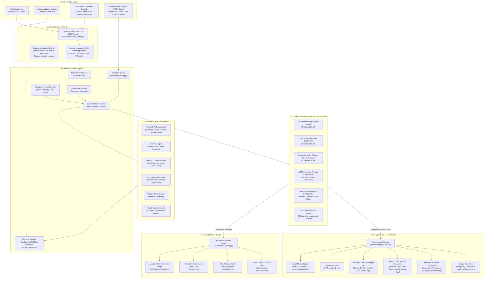

# 🏛️ Personal Agentic Fleet — System Architecture & Design Manual

Welcome to the comprehensive technical architecture manual for **Personal Agentic Fleet**. This document provides an in-depth breakdown of the system design, microkernel subsystems, deterministic event-driven bus, Tier 0 token conservation mechanics, multi-hyperscaler LLM gateway, and AI developer tools bridge.

---

## 1. High-Level System Architecture

Personal Agentic Fleet is designed as a **local-first, plug-and-play agentic microkernel**. It strictly enforces **Fleet Rule 1: Tier 0 Deterministic Governance ($0.00 / 0 Tokens Default)** while providing seamless on-demand bridges to all major cloud hyperscalers (Google, Microsoft, AWS, Anthropic, OpenAI) and AI developer tools (GitHub Copilot, Claude Code, Gemini CLI, Amazon Q).

---

## 2. Core Microkernel Subsystems

### 2.1 Deterministic Event Bus (`fleet/core/event_bus.py`)
All inter-agent communication, background tasks, and MCP tool invocations route through the centralized `DeterministicEventBus`.
- **Decoupled Messaging**: Components emit `FleetEvent` objects containing `sender`, `target`, `action`, and `payload`.
- **Zero-Token Local Handlers**: Handlers for `agenda`, `files`, `notification`, `email`, and `system` execute pure Python logic without contacting external servers.
- **Parallel Dispatching**: Supports `bus.dispatch_parallel([events])` utilizing `ThreadPoolExecutor` for concurrent operations.

### 2.2 Scoped Agent Sandbox (`fleet/core/plugin_sandbox.py`)
Every agent in `fleet/agents/` is an isolated package with a strict `manifest.json`.
- **Least-Privilege Capabilities**: Agents declare required permissions (e.g., `db:read`, `db:write`, `ui:render`).
- **`ScopedDatabaseProxy`**: Wraps the database layer to block unauthorized table mutations or unauthorized reads.
- **Environment Sanitization**: When spawning subprocesses, `get_sanitized_plugin_env()` strips sensitive credentials and API tokens.

### 2.3 Tier 0 Token & Cost Governance Engine (`fleet/core/token_optimizer.py`)
Personal Agentic Fleet operates at **`$0.00` / 0 Cloud Tokens** by default using an 8-layer optimization pipeline:
1. **Deterministic Intent Router**: Evaluates input against known command patterns (`/task`, `/sync`, `/briefing`, `/notify`, `/security`, `/optimizer`).
2. **Offline BM25 Knowledge RAG**: Answers health, metabolic reversal, and workout questions using an indexed local corpus.
3. **Fuzzy Jaccard + Trigram Semantic Cache**: Reuses previous high-confidence answers for paraphrased queries.
4. **AST/Tokenizer Code Compressor**: Removes comments, redundant whitespace, and docstrings from code blocks passed in prompts.
5. **Prompt Batch Coalescer**: Groups consecutive user inputs to reduce LLM roundtrips.
6. **SHA-256 Vision Image Deduplicator**: Hashes uploaded screenshots and images, avoiding re-uploading and duplicate vision token billing.
7. **MCP Delta Response Cache**: Emits delta updates rather than full multi-kilobyte payloads when MCP data has not changed.
8. **Automated Tier Selection**: Routes unavoidable cloud LLM calls to the most cost-efficient tier (`flash_lite` -> `flash` -> `pro`).

---

## 3. Multi-Hyperscaler LLM Gateway (`fleet/core/hyperscalers.py`)

The fleet unifies inference across all major cloud hyperscalers through a standardized Python standard-library gateway:

| Hyperscaler | Supported Methods | Supported Models | Authentication |
| :--- | :--- | :--- | :--- |
| **Google** | Antigravity CLI (`agy`), Gemini REST API (AI Studio), Google Cloud Vertex AI, Gemini CLI (`gemini`) | `gemini-3.8-flash-high`, `gemini-2.5-pro`, `gemini-2.0-flash`, `gemini-1.5-pro` | `GEMINI_API_KEY`, `GOOGLE_API_KEY`, `GOOGLE_CLOUD_PROJECT` + `VERTEX_AI_TOKEN` or `gcloud` ADC |
| **Microsoft & GitHub** | Azure OpenAI Service, Azure AI Foundry Serverless, GitHub Models Inference API | `gpt-4o`, `gpt-4o-mini`, `o1`, `o3-mini`, `Phi-4`, `DeepSeek-R1` | `AZURE_OPENAI_API_KEY` + `AZURE_OPENAI_ENDPOINT`, `AZURE_AI_FOUNDRY_KEY`, `GITHUB_TOKEN` |
| **Amazon Web Services (AWS)** | Amazon Bedrock Runtime (SigV4 IAM & Bearer), Amazon Q Developer CLI (`q`) | `anthropic.claude-3-7-sonnet`, `anthropic.claude-3-5-sonnet`, `amazon.nova-pro-v1:0`, `amazon.titan-text-express-v1`, `meta.llama3-3-70b` | Stdlib AWS SigV4 HMAC-SHA256 (`AWS_ACCESS_KEY_ID`, `AWS_SECRET_ACCESS_KEY`, `AWS_REGION`) or `AWS_BEARER_TOKEN` |
| **Anthropic** | Anthropic Direct Messages REST API, Claude Code CLI (`claude`) | `claude-3-7-sonnet-latest`, `claude-3-5-sonnet-latest`, `claude-3-5-haiku-latest`, `claude-3-opus-latest` | `ANTHROPIC_API_KEY` |
| **OpenAI Direct** | OpenAI Chat Completions API | `gpt-4o`, `gpt-4o-mini`, `o1`, `o3-mini` | `OPENAI_API_KEY` |
| **Local / Offline** | Local Ollama REST Daemon | `llama3.2`, `qwen2.5-coder`, `deepseek-r1`, `phi4`, `mistral` | `http://localhost:11434` (0 Cloud Tokens) |

### AWS SigV4 Pure-Stdlib Implementation
To eliminate heavy external SDK dependencies (`boto3`, `botocore`), [`_sign_aws_sigv4_headers`](../fleet/core/hyperscalers.py#L160-L236) implements the full AWS Signature Version 4 protocol in standard Python using `hmac` and `hashlib.sha256`. It computes canonical request hashes, string-to-sign scopes, and derived signing keys dynamically.

---

## 4. AI Developer Tools Bridge (`fleet/core/dev_tools.py`)

Personal Agentic Fleet acts as a bidirectional bridge with modern developer AI tools:
- **Detection & Introspection**: `detect_developer_tools()` probes for installed CLIs (`agy`, `gemini`, `claude`, `gh copilot`, `q`, `code`, `cursor`, `ollama`).
- **Execution Bridges with Automatic Cloud Fallback**:
  - `execute_claude_code()`: Invokes Anthropic's Claude Code CLI (`claude -p`), falling back to the Anthropic Direct API if the CLI is absent.
  - `execute_github_copilot_command()`: Invokes GitHub CLI Copilot (`gh copilot suggest/explain`), falling back to Azure OpenAI / GitHub Models.
  - `execute_google_gemini_cli()`: Invokes Google Gemini CLI (`gemini -p`), falling back to Google AI Studio / Vertex AI.
  - `execute_aws_q_developer()`: Invokes Amazon Q CLI (`q chat`), falling back to Amazon Bedrock.
- **Instruction Synchronization**:
  - Automatically generates and keeps in sync:
    - `.github/copilot-instructions.md` for GitHub Copilot in VS Code and GitHub CLI.
    - `CLAUDE.md` in repository root for Anthropic Claude Code.
    - `GEMINI.md` in repository root for Google Gemini CLI & Antigravity.

---

## 5. Control Center Web Dashboard & Server (`fleet/server.py`)

- **Robust Threading HTTP Server**: Implements `RobustThreadingHTTPServer` to handle concurrent UI requests, video byte-range streaming, and real-time polling.
- **Security Headers**: Injects Strict Content-Security-Policy (CSP), Permissions-Policy, Cross-Origin-Opener-Policy (COOP), Cross-Origin-Resource-Policy (CORP), and `X-Content-Type-Options: nosniff` on every HTTP response.
- **Domain API Dispatching**: Dynamically registers endpoints from all discovered agents.
- **Video Byte-Range Streaming (HTTP 206)**: Streams local workout and health MP4/MKV videos with seeking and fast scrubbing.

---

## 6. Background Routine Daemon & Scheduling Engine (`fleet/daemon.py`, `fleet/core/scheduler.py`)

The `FleetDaemon` executes silently in the background on a periodic loop, orchestrating background maintenance and driving the **Agent Scheduling Engine**:
- **Zero-Dependency YAML Configuration**: The scheduler parses schedules from `schedules.yaml`, `fleet/data/user/schedules.yaml`, or the root `fleet.yaml` using pure Python stdlib via `fleet/core/yaml_helper.py`.
- **Pre-Configured Default Agent Schedules**: Pre-wires all 7 agents (`overview` morning/evening briefings, `health` smoothie/medication/sleep reminders, `optimizer` RAM/DNS sweeps, `gmail` sync, `antigravity` queue monitoring, and `backlog` grooming).
- **Flexible Timing Rules**:
  - Exact time of day (`time: "08:30"` or `times: ["08:30", "20:00"]`).
  - Recurring intervals (`interval_hours: 6`, `interval_minutes: 15`, `every: "2h"`).
  - Standard 5-field cron syntax (`cron: "0 9 * * 1-5"`, `*/15 * * * *`).
  - Conditional filters: `days`, `weekdays_only`, and `active_hours: "08:00-18:00"`.
- **Direct Agent Task Dispatching**: Schedules invoke each agent package's `execute_task(task, payload)` directly within their declared manifest boundary.
- **Runtime Overrides & Control**: Dynamic runtime enabling/disabling persists to `fleet/data/user/schedule_overrides.json`, controllable via REST API (`/api/schedules`) and MCP tools (`fleet_list_schedules`, `fleet_toggle_schedule`, `fleet_run_scheduled_task`).
- **60-Minute Security Audit Pulse**: Runs the 12-layer security scanner and alerts the user if any finding is detected.
- **Scheduled CI Test Pulse**: Runs isolated pytest suites and records test health in SQLite.

---

## 7. Platform Abstraction Layer (Windows, macOS, Linux)

Personal Agentic Fleet provides native OS parity across modern desktop operating systems through its zero-dependency platform abstraction layer:

| Subsystem | Windows 10 / 11 Native | macOS (Apple Silicon & Intel) Native | Linux (Ubuntu 20.04+, Debian 11+, Fedora 38+, Arch) |
| :--- | :--- | :--- | :--- |
| **Notifications** | WinRT Toast Notification Manager via PowerShell | AppleScript Notification Center (`osascript`) | FreeDesktop `notify-send` (libnotify) / Zenity / KDialog |
| **Secret Vault** | Windows DPAPI (`crypt32.dll`) | Apple Keychain Services CLI (`/usr/bin/security`) | FreeDesktop SecretService (`secret-tool` / libsecret) + POSIX `chmod 0700` |
| **RAM & Diagnostics** | In-process Win32 `PSAPI` & `GlobalMemoryStatusEx` | Native `sysctl` (`hw.memsize`) & `vm_stat` | In-process `/proc/meminfo` & `/proc/<pid>/status` (`VmRSS`) |
| **DNS Resolver Flush** | `ipconfig /flushdns` | `dscacheutil -flushcache` + `killall -HUP mDNSResponder` | `resolvectl flush-caches` / `systemd-resolve` |
| **Memory Purge** | In-process `EmptyWorkingSet` | Native macOS `purge` command | Python `gc.collect()` & POSIX `rlimit` sweep |
| **Startup Services** | Registry Run keys (`HKCU` & `HKLM`) | `~/Library/LaunchAgents` & `/Library/LaunchAgents` | systemd user services (`~/.config/systemd/user`) & XDG autostart |
| **CLI Tool Paths** | `%LOCALAPPDATA%\Programs`, `%APPDATA%\npm` | `/opt/homebrew/bin`, `/usr/local/bin`, `/Applications` | `/usr/bin`, `/usr/local/bin`, `~/.local/bin` |

---

## 8. Data & Storage Architecture

- **SQLite Engine**: Embedded database with Write-Ahead Logging (`PRAGMA journal_mode = WAL`) and synchronous checkpointing.
- **Secure Delete**: `PRAGMA secure_delete = ON` guarantees deleted task or memory rows are physically zeroed out from disk immediately.
- **At-Rest Hardware Encryption**: High-security settings, credentials, and notes are encrypted via Windows Data Protection API (`crypt32.dll`) and stored in `fleet/data/user/master.dpapi`.
- **Database Path Routing**: Enforces strict test-mode isolation; all unit test suites redirect SQLite access to `fleet_test_memory.db` so production data in `fleet_memory.db` is never modified during tests.

---

## 9. The 4-Layer Cognitive Fleet Mind Architecture (`fleet/core/mind/`)

To evolve the fleet from a set of reactive micro-services into an organic, self-healing, self-improving, and self-critiquing intelligence, the architecture implements a unified 4-layer cognitive gestalt (`CognitiveFleetMind` / `fleet_mind`):

```mermaid
flowchart TD
    subgraph MindGestalt["Cognitive Fleet Mind Gestalt (fleet_mind)"]
        subgraph Layer1["Layer 1: Brain (Physical & Neurological Substrate)"]
            SynapticBus["Synaptic Impulse Dispatcher\n(Event Bus Interceptor)"]
            DualMem["Dual Memory Architecture\n(Working RAM & Epistemic SQLite)"]
            AutonomicReflex["Autonomic Self-Healing Reflex Arc\n(Proactive AutoHealer & WAL Optimization)"]
        end

        subgraph Layer2["Layer 2: Consciousness (Executive Focus & Meta-Critique)"]
            ExecutiveWindow["Executive Attention Focus\n(Active Agent, Goal, Context Keys)"]
            SelfCritique["Deterministic Self-Critique Engine\n(Soundness, Content, Economy, Integrity)"]
        end

        subgraph Layer3["Layer 3: Subconsciousness (Offline Dreaming & Consolidation)"]
            DreamCycle["Circadian Dream Cycle (23:00 - 06:00)\n(Episodic Memory Consolidation)"]
            PatternMining["Habit & Friction Mining\n(Latent Clustering & Productive Momentum)"]
            Immunology["Immunological Pruning\n(Transient Mental Clutter Cleanup)"]
        end

        subgraph Layer4["Layer 4: Soul (Teleological Moral Core & Compass)"]
            InviolableTenets["4 Inviolable Tenets\n(Sovereign Privacy, $0.00 Frugality, Metabolic Care, Integrity)"]
            MoralAudit["Soul Alignment Audit Engine\n(audit_alignment() -> PURE / FAITHFUL)"]
            EvolutionGen["Generational Evolutionary Ascent\n(evolve_and_improve() -> Gen N+1)"]
        end
    end

    Layer1 --> Layer2
    Layer2 --> Layer3
    Layer3 --> Layer4
    Layer4 -.->|Teleological Directives| Layer1
```

### 9.1 Layer 1: Physical Brain (`fleet/core/mind/brain.py`)
- **Neurological Synapses**: Every message or event routed through `fleet.core.event_bus` triggers an atomic synaptic firing (`record_synapse_firing()`).
- **Dual Memory Substrate**:
  - **Working RAM Memory (`WorkingMemorySnapshot`)**: High-speed ephemeral working set, active OS thread counts, and in-memory ring buffers.
  - **Epistemic SQLite Memory (`EpistemicMemoryStats`)**: Long-term persistent wisdom stored in SQLite (`activity_logs`, `tasks`, `memories`, `notes`) with automatic WAL journal tracking.
- **Autonomic Reflex Arc**: Like the human autonomic nervous system regulating heartbeat and respiration, the brainstem triggers non-blocking self-healing reflex sweeps when memory, lock contention, or error spikes exceed baseline parameters.

### 9.2 Layer 2: Conscious Executive & Meta-Critique (`fleet/core/mind/consciousness.py`)
- **Executive Attention Window**: Dynamically tracks `active_agent`, `current_goal`, and `state` (`FOCUSED`, `AWARE`, `REFLECTING`, `DELIBERATING`, `RESTING`).
- **Deterministic Multi-Axial Self-Critique Engine (`SelfCritiqueEngine`)**:
  Every agent action execution automatically triggers a conscious meta-evaluator:
  1. *Structural Soundness*: Validates return types, dictionary wrapping, status codes, and exception boundaries.
  2. *Content Depth & Completeness*: Flags empty strings, missing payload attributes, or hallucinated/null keys.
  3. *Zero-Token Economy*: Verifies zero unnecessary external calls and fast sub-millisecond execution.
  4. *Error Transparency*: Prohibits contradictory states (e.g. status "success" with error details attached).
  - Passing score: $\ge 70.0/100$. Unsound actions receive automated corrective remediation directives.

### 9.3 Layer 3: Subconscious Mind & Circadian Dreaming (`fleet/core/mind/subconsciousness.py`)
- **Nightly Dream Cycles**: During quiet hours (23:00–06:00), the fleet enters an offline consolidation state (`run_dream_cycle()`):
  1. Ingests raw episodic activity logs across all agent packages.
  2. Mines circadian habit clusters (e.g. dominant morning vs evening agent engagements).
  3. Discovers latent operational friction (e.g. repeated backoffs, transient network timeouts).
  4. Synthesizes distilled `DreamInsight` entries (`HABIT`, `FRICTION`, `OPTIMIZATION`, `SYNTHESIS`) persisted into `mind_dream_insights`.
  5. Executes immunological mental clutter pruning.

### 9.4 Layer 4: Soul & Teleological Compass (`fleet/core/mind/soul.py`)
- **4 Inviolable Tenets**:
  1. `SOVEREIGN_PRIVACY` (Weight 30%): Personal data and secrets remain strictly in local custody; DPAPI at-rest encryption enforced.
  2. `DETERMINISTIC_FRUGALITY` (Weight 25%): Default $0.00 rule and zero-token invariant.
  3. `METABOLIC_WELLBEING` (Weight 25%): Respects circadian rest windows (22:30 screen cutoff, quiet hours, FFD care protocols).
  4. `TRANSPARENT_INTEGRITY` (Weight 20%): Radical transparency, zero deception, and verifiable audit trails.
- **Soul Alignment Audits (`audit_alignment()`)**: Evaluates compliance across all 4 tenets, computing an alignment score ($0.0 - 100.0$) and classification (`PURE`, `FAITHFUL`, `DRIFTING`, `DISCORDANT`).
- **Generational Evolution (`evolve_and_improve()`)**: Ascends the fleet to generation $N+1$, calibrating critique thresholds, cache horizons, and system directives.

### 9.5 The Holistic Cognitive Harmony Index
The Gestalt computes an objective systemic harmony score ($0 - 100$):
$$\text{Harmony Score} = (\text{Brain Health} \times 0.35) + (\text{Conscious Critique Avg} \times 0.35) + (\text{Soul Alignment} \times 0.30)$$
- **`ENLIGHTENED`** ($\ge 90$): Peak operational flow, zero contention, perfect moral fidelity.
- **`COHERENT`** ($75 - 89$): Healthy, normal executive throughput.
- **`DISSONANT`** ($< 75$): Contention detected; autonomic healing arcs and immunological pruning engage immediately.

---

## 10. Proactive Log Scanner & Autonomous Self-Healing Engine (`fleet/core/auto_healer.py`)

The fleet continuously analyzes its own diagnostic telemetry and repairs anomalies without human intervention:

| Issue Category | Detection Heuristic | Autonomous Zero-Token Remediation |
| :--- | :--- | :--- |
| **Database Contention** | Repeated `sqlite3.OperationalError: database is locked` or WAL journal $> 10 \text{ MB}$ | Executes non-blocking `PRAGMA wal_checkpoint(PASSIVE)` and `PRAGMA optimize`. |
| **Log & Disk Bloat** | Disk error log $> 500 \text{ KB}$ or ring buffer overflow | Flushes transient logs, rotates disk log files, and compresses older archives. |
| **Crash Dumps Accumulation** | Crash reports directory contains $> 20$ files or entries older than 7 days | Automatically sanitizes and prunes aged crash dumps. |
| **Rate Limit / 429 Spikes** | Transient HTTP 429 errors from external providers | Triggers adaptive exponential backoff and sets cooldown timers. |
| **Task Failure Loops** | Tasks failing $\ge 3$ consecutive times | Quarantines failing tasks and applies exponential retry backoff. |
| **Memory Pressure** | Working set RAM exceeds threshold | Invokes Python garbage collection and sweeps Windows process working sets. |

---

## 11. Scalable Fleet Navigator UX & Agent Creation Wizard

### 11.1 Fleet Navigator for 100+ Concurrent Agents (`fleet/web/static/js/fleet_navigator.js`)
When running large-scale fleets with dozens or hundreds of autonomous agents, traditional tab bars become unusable. The Fleet Navigator provides:
- **Virtualized Off-Canvas Drawer**: Categorized by domain (`System`, `Productivity`, `Health`, `Finance`, `Developer`), filterable by runtime status (`Working`, `Idle`, `Disabled`).
- **Spotlight Command Palette (`Ctrl+K` / `/`)**: Fast fuzzy search with keyboard navigation (`↑` / `↓` / `Enter`) to switch active agent view instantly.
- **Dynamic Pin-to-Bar**: Pin frequently accessed agents directly to the top navigation header.

### 11.2 4-Step Agent Creation Wizard & `create-agent` Skill
Users can instantiate custom agents visually or via the Antigravity workflow:
1. **Identity & Persona**: Define Agent ID, human-readable title, emoji icon, category, and preferred LLM model.
2. **Security Capabilities**: Select granular capability permissions (`network:outbound`, `fs:read`, `fs:write`, `db:read`, `db:write`, `os:exec`, `tokens:spend`).
3. **Settings Schema & Routines**: Configure sync intervals, desktop alert triggers, and background cron schedules.
4. **Verification & Launch**: Inspect real-time generated `manifest.json`, `agent.py`, and `ui/panel.html` code before one-click deployment.

---

## 12. Native Robustness Architecture & Engineering Backlog

For deep technical specifications, design patterns, and operational runbooks covering the 6 pillars of framework robustness (Thread Supervision, Signal & WAL Traps, Connection Pooling, Online Backups, Resource Quotas, Socket Egress Gating, Circuit Breakers, Rate Limiting, and Power Awareness):
- **[Robustness Architecture & Operations Guide](ROBUSTNESS_GUIDE.md)**: Architecture, operational procedures, diagnostic REST APIs, and troubleshooting matrix.
- **[Native Robustness Engineering Backlog](ROBUSTNESS_BACKLOG.md)**: Prioritized engineering backlog, failure models, and verification tracking.
