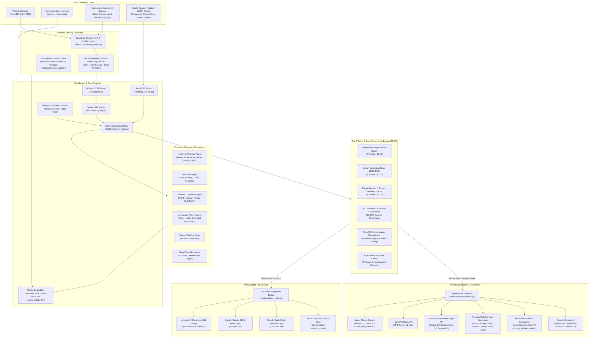

# 🏛️ Personal Agentic Fleet — System Architecture & Design Manual

Welcome to the comprehensive technical architecture manual for **Personal Agentic Fleet**. This document provides an in-depth breakdown of the system design, microkernel subsystems, deterministic event-driven bus, Tier 0 token conservation mechanics, multi-hyperscaler LLM gateway, and AI developer tools bridge.

---

## 1. High-Level System Architecture

Personal Agentic Fleet is designed as a **local-first, plug-and-play agentic microkernel**. It strictly enforces **Fleet Rule 1: Tier 0 Deterministic Governance ($0.00 / 0 Tokens Default)** while providing seamless on-demand bridges to all major cloud hyperscalers (Google, Microsoft, AWS, Anthropic, OpenAI) and AI developer tools (GitHub Copilot, Claude Code, Gemini CLI, Amazon Q).

---

## 2. Core Microkernel Subsystems

### 2.1 Deterministic Event Bus (`fleet/core/event_bus.py`)
All inter-agent communication, background tasks, and MCP tool invocations route through the centralized `DeterministicEventBus`.
- **Decoupled Messaging**: Components emit `FleetEvent` objects containing `sender`, `target`, `action`, and `payload`.
- **Zero-Token Local Handlers**: Handlers for `agenda`, `files`, `notification`, `email`, and `system` execute pure Python logic without contacting external servers.
- **Parallel Dispatching**: Supports `bus.dispatch_parallel([events])` utilizing `ThreadPoolExecutor` for concurrent operations.

### 2.2 Scoped Agent Sandbox (`fleet/core/plugin_sandbox.py`)
Every agent in `fleet/agents/` is an isolated package with a strict `manifest.json`.
- **Least-Privilege Capabilities**: Agents declare required permissions (e.g., `db:read`, `db:write`, `ui:render`).
- **`ScopedDatabaseProxy`**: Wraps the database layer to block unauthorized table mutations or unauthorized reads.
- **Environment Sanitization**: When spawning subprocesses, `get_sanitized_plugin_env()` strips sensitive credentials and API tokens.

### 2.3 Tier 0 Token & Cost Governance Engine (`fleet/core/token_optimizer.py`)
Personal Agentic Fleet operates at **`$0.00` / 0 Cloud Tokens** by default using an 8-layer optimization pipeline:
1. **Deterministic Intent Router**: Evaluates input against known command patterns (`/task`, `/sync`, `/briefing`, `/notify`, `/security`, `/optimizer`).
2. **Offline BM25 Knowledge RAG**: Answers health, metabolic reversal, and workout questions using an indexed local corpus.
3. **Fuzzy Jaccard + Trigram Semantic Cache**: Reuses previous high-confidence answers for paraphrased queries.
4. **AST/Tokenizer Code Compressor**: Removes comments, redundant whitespace, and docstrings from code blocks passed in prompts.
5. **Prompt Batch Coalescer**: Groups consecutive user inputs to reduce LLM roundtrips.
6. **SHA-256 Vision Image Deduplicator**: Hashes uploaded screenshots and images, avoiding re-uploading and duplicate vision token billing.
7. **MCP Delta Response Cache**: Emits delta updates rather than full multi-kilobyte payloads when MCP data has not changed.
8. **Automated Tier Selection**: Routes unavoidable cloud LLM calls to the most cost-efficient tier (`flash_lite` -> `flash` -> `pro`).

---

## 3. Multi-Hyperscaler LLM Gateway (`fleet/core/hyperscalers.py`)

The fleet unifies inference across all major cloud hyperscalers through a standardized Python standard-library gateway:

| Hyperscaler | Supported Methods | Supported Models | Authentication |
| :--- | :--- | :--- | :--- |
| **Google** | Antigravity CLI (`agy`), Gemini REST API (AI Studio), Google Cloud Vertex AI, Gemini CLI (`gemini`) | `gemini-3.8-flash-high`, `gemini-2.5-pro`, `gemini-2.0-flash`, `gemini-1.5-pro` | `GEMINI_API_KEY`, `GOOGLE_API_KEY`, `GOOGLE_CLOUD_PROJECT` + `VERTEX_AI_TOKEN` or `gcloud` ADC |
| **Microsoft & GitHub** | Azure OpenAI Service, Azure AI Foundry Serverless, GitHub Models Inference API | `gpt-4o`, `gpt-4o-mini`, `o1`, `o3-mini`, `Phi-4`, `DeepSeek-R1` | `AZURE_OPENAI_API_KEY` + `AZURE_OPENAI_ENDPOINT`, `AZURE_AI_FOUNDRY_KEY`, `GITHUB_TOKEN` |
| **Amazon Web Services (AWS)** | Amazon Bedrock Runtime (SigV4 IAM & Bearer), Amazon Q Developer CLI (`q`) | `anthropic.claude-3-7-sonnet`, `anthropic.claude-3-5-sonnet`, `amazon.nova-pro-v1:0`, `amazon.titan-text-express-v1`, `meta.llama3-3-70b` | Stdlib AWS SigV4 HMAC-SHA256 (`AWS_ACCESS_KEY_ID`, `AWS_SECRET_ACCESS_KEY`, `AWS_REGION`) or `AWS_BEARER_TOKEN` |
| **Anthropic** | Anthropic Direct Messages REST API, Claude Code CLI (`claude`) | `claude-3-7-sonnet-latest`, `claude-3-5-sonnet-latest`, `claude-3-5-haiku-latest`, `claude-3-opus-latest` | `ANTHROPIC_API_KEY` |
| **OpenAI Direct** | OpenAI Chat Completions API | `gpt-4o`, `gpt-4o-mini`, `o1`, `o3-mini` | `OPENAI_API_KEY` |
| **Local / Offline** | Local Ollama REST Daemon | `llama3.2`, `qwen2.5-coder`, `deepseek-r1`, `phi4`, `mistral` | `http://localhost:11434` (0 Cloud Tokens) |

### AWS SigV4 Pure-Stdlib Implementation
To eliminate heavy external SDK dependencies (`boto3`, `botocore`), [`_sign_aws_sigv4_headers`](../fleet/core/hyperscalers.py#L160-L236) implements the full AWS Signature Version 4 protocol in standard Python using `hmac` and `hashlib.sha256`. It computes canonical request hashes, string-to-sign scopes, and derived signing keys dynamically.

---

## 4. AI Developer Tools Bridge (`fleet/core/dev_tools.py`)

Personal Agentic Fleet acts as a bidirectional bridge with modern developer AI tools:
- **Detection & Introspection**: `detect_developer_tools()` probes for installed CLIs (`agy`, `gemini`, `claude`, `gh copilot`, `q`, `code`, `cursor`, `ollama`).
- **Execution Bridges with Automatic Cloud Fallback**:
  - `execute_claude_code()`: Invokes Anthropic's Claude Code CLI (`claude -p`), falling back to the Anthropic Direct API if the CLI is absent.
  - `execute_github_copilot_command()`: Invokes GitHub CLI Copilot (`gh copilot suggest/explain`), falling back to Azure OpenAI / GitHub Models.
  - `execute_google_gemini_cli()`: Invokes Google Gemini CLI (`gemini -p`), falling back to Google AI Studio / Vertex AI.
  - `execute_aws_q_developer()`: Invokes Amazon Q CLI (`q chat`), falling back to Amazon Bedrock.
- **Instruction Synchronization**:
  - Automatically generates and keeps in sync:
    - `.github/copilot-instructions.md` for GitHub Copilot in VS Code and GitHub CLI.
    - `CLAUDE.md` in repository root for Anthropic Claude Code.
    - `GEMINI.md` in repository root for Google Gemini CLI & Antigravity.

---

## 5. Control Center Web Dashboard & Server (`fleet/server.py`)

- **Robust Threading HTTP Server**: Implements `RobustThreadingHTTPServer` to handle concurrent UI requests, video byte-range streaming, and real-time polling.
- **Security Headers**: Injects Strict Content-Security-Policy (CSP), Permissions-Policy, Cross-Origin-Opener-Policy (COOP), Cross-Origin-Resource-Policy (CORP), and `X-Content-Type-Options: nosniff` on every HTTP response.
- **Domain API Dispatching**: Dynamically registers endpoints from all discovered agents.
- **Video Byte-Range Streaming (HTTP 206)**: Streams local workout and health MP4/MKV videos with seeking and fast scrubbing.

---

## 6. Background Routine Daemon (`fleet/daemon.py`)

The `FleetDaemon` executes silently in the background on a periodic loop:
- **Morning Briefing Pulse (08:30 IST)**: Generates high-priority agenda summaries and upcoming meeting reminders.
- **Evening Review Pulse (20:00 IST)**: Compiles habit completion metrics and day-end status.
- **2-Hour Email Sync Pulse**: Deterministically classifies new Gmail threads into 5 folders.
- **60-Minute Security Audit Pulse**: Runs the 12-layer security scanner and alerts the user if any finding is detected.
- **Scheduled CI Test Pulse**: Runs isolated pytest suites and records test health in SQLite.

---

## 7. Platform Abstraction Layer (Windows, macOS, Linux)

Personal Agentic Fleet provides native OS parity across modern desktop operating systems through its zero-dependency platform abstraction layer:

| Subsystem | Windows 10 / 11 Native | macOS (Apple Silicon & Intel) Native | Linux (Ubuntu, Debian, Fedora) |
| :--- | :--- | :--- | :--- |
| **Notifications** | WinRT Toast Notification Manager via PowerShell | AppleScript Notification Center (`osascript`) | Desktop notification daemon (`notify-send`) |
| **Secret Vault** | Windows DPAPI (`crypt32.dll`) | Apple Keychain Services CLI (`/usr/bin/security`) | Standard POSIX user vault (`chmod 0700`) |
| **RAM & Diagnostics** | In-process Win32 `PSAPI` & `GlobalMemoryStatusEx` | Native `sysctl` (`hw.memsize`) & `vm_stat` | `/proc/meminfo` & POSIX `ps -A -o comm,rss` |
| **DNS Resolver Flush** | `ipconfig /flushdns` | `dscacheutil -flushcache` + `killall -HUP mDNSResponder` | `resolvectl flush-caches` |
| **Memory Purge** | In-process `EmptyWorkingSet` | Native macOS `purge` command | Python `gc.collect()` |
| **Startup Services** | Registry Run keys (`HKCU` & `HKLM`) | `~/Library/LaunchAgents` & `/Library/LaunchAgents` | systemd user services |
| **CLI Tool Paths** | `%LOCALAPPDATA%\Programs`, `%APPDATA%\npm` | `/opt/homebrew/bin`, `/usr/local/bin`, `/Applications` | `/usr/bin`, `/usr/local/bin`, `~/.local/bin` |

---

## 8. Data & Storage Architecture

- **SQLite Engine**: Embedded database with Write-Ahead Logging (`PRAGMA journal_mode = WAL`) and synchronous checkpointing.
- **Secure Delete**: `PRAGMA secure_delete = ON` guarantees deleted task or memory rows are physically zeroed out from disk immediately.
- **At-Rest Hardware Encryption**: High-security settings, credentials, and notes are encrypted via Windows Data Protection API (`crypt32.dll`) and stored in `fleet/data/user/master.dpapi`.
- **Database Path Routing**: Enforces strict test-mode isolation; all unit test suites redirect SQLite access to `fleet_test_memory.db` so production data in `fleet_memory.db` is never modified during tests.
