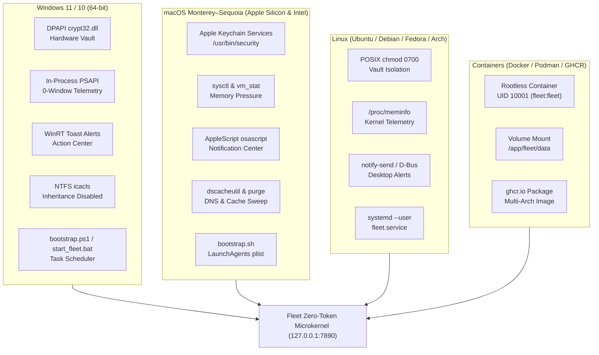
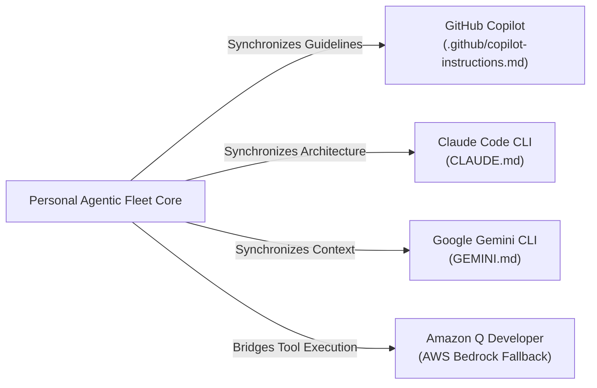

# 🌐 Multi-OS Deployment, Operational Scenarios & Administration Guide

This guide is the master technical reference for deploying, operating, and administering **Personal Agentic Fleet** across all supported operating systems (Windows 11/10, macOS Monterey–Sequoia on Apple Silicon & Intel, Linux, and Containers) and across all real-world operational scenarios.

---

## 📑 Table of Contents

- [Part I: Operating System Deployment Guides](#part-i-operating-system-deployment-guides)
  - [1. Windows 11 & Windows 10 (64-bit)](#1-windows-11--windows-10-64-bit)
  - [2. macOS (Apple Silicon M1–M4 & Intel 64-bit)](#2-macos-apple-silicon-m1m4--intel-64-bit)
  - [3. Linux (Ubuntu, Debian, Fedora, Arch, RHEL) & Headless Homelab](#3-linux-ubuntu-debian-fedora-arch-rhel--headless-homelab)
  - [4. Containerized Deployments (Docker, Docker Compose & Podman)](#4-containerized-deployments-docker-docker-compose--podman)
- [Part II: Operational Scenarios](#part-ii-operational-scenarios)
  - [Scenario 1: Zero-Token Local Workstation Mode ($0.00 / Offline)](#scenario-1-zero-token-local-workstation-mode-000--offline)
  - [Scenario 2: Multi-Hyperscaler Cloud Inference (Gemini, Azure, Bedrock, Claude, OpenAI)](#scenario-2-multi-hyperscaler-cloud-inference-gemini-azure-bedrock-claude-openai)
  - [Scenario 3: AI Developer Tools Co-Pilot Integration (Copilot, Claude Code, Gemini CLI, Amazon Q)](#scenario-3-ai-developer-tools-co-pilot-integration-copilot-claude-code-gemini-cli-amazon-q)
  - [Scenario 4: Metabolic Health & Athletic Strength Protocol Tracking](#scenario-4-metabolic-health--athletic-strength-protocol-tracking)
  - [Scenario 5: Automated Agent Scheduling & Background Daemon Workflows](#scenario-5-automated-agent-scheduling--background-daemon-workflows)
  - [Scenario 6: Custom Agent Development & 1-Command Scaffolding](#scenario-6-custom-agent-development--1-command-scaffolding)
  - [Scenario 7: FastMCP Server Integration (Google Antigravity, Cursor, Claude Desktop)](#scenario-7-fastmcp-server-integration-google-antigravity-cursor-claude-desktop)
  - [Scenario 8: Remote LAN, Mobile Access & Secure Tailscale VPN](#scenario-8-remote-lan-mobile-access--secure-tailscale-vpn)
  - [Scenario 9: Enterprise Security Auditing, Compliance & Disaster Recovery](#scenario-9-enterprise-security-auditing-compliance--disaster-recovery)
- [Part III: Cross-Platform Troubleshooting Runbook](#part-iii-cross-platform-troubleshooting-runbook)

---

# Part I: Operating System Deployment Guides



---

## 1. Windows 11 & Windows 10 (64-bit)

Windows 11 and Windows 10 (Build 18362+) are the primary development platforms for Personal Agentic Fleet. The framework integrates directly with Windows system DLLs without requiring external binary packages.

### Native Subsystems Utilized
- **Hardware-Bound DPAPI (`crypt32.dll`)**: Uses `CryptProtectData` and `CryptUnprotectData` with `CRYPTPROTECT_UI_FORBIDDEN` to encrypt master keys, tokens, and PII.
- **In-Process Memory Telemetry (`psapi.dll` & `kernel32.dll`)**: Queries WorkingSet memory via `CreateToolhelp32Snapshot` and `GetProcessMemoryInfo`, eliminating flickering command prompt windows.
- **Silent Background Execution (`CREATE_NO_WINDOW = 0x08000000`)**: Spawns background tasks with `STARTF_USESHOWWINDOW` and `SW_HIDE`.
- **WinRT Toast Notifications**: Dispatches rich notifications via PowerShell `[Windows.UI.Notifications.ToastNotificationManager]`.
- **NTFS User ACLs (`icacls`)**: Enforces inheritance removal (`/inheritance:r`) and user-exclusive full control (`/grant:r "%USERNAME%:(OI)(CI)F"`).

### Installation & Launching Options

#### Option 1: Automated 1-Command Bootstrap (Recommended)
```powershell
# In PowerShell (Run as regular user - no Administrator privileges required):
git clone https://github.com/macazaka/personal-agentic-fleet.git
cd personal-agentic-fleet

# Provisions Python >= 3.10 if needed, hardens ACLs, installs security hooks, and launches
.\bootstrap.ps1 -Launch
```

#### Option 2: Silent Windowless Background Launch
To run the fleet completely invisible in the background on startup:
```powershell
# Double-click or execute:
.\start_control_center.vbs
```
To stop the silent background process:
```powershell
.\stop_control_center.bat
```

#### Option 3: Automated Startup via Windows Task Scheduler
To automatically launch Fleet on workstation login:
```powershell
# Register Task Scheduler entry running silently on user login
$Action = New-ScheduledTaskAction -Execute "wscript.exe" -Argument "`"$PWD\start_control_center.vbs`"" -WorkingDirectory "$PWD"
$Trigger = New-ScheduledTaskTrigger -AtLogOn -User $env:USERNAME
$Settings = New-ScheduledTaskSettingsSet -AllowStartIfOnBatteries -DontStopIfGoingOnBatteries -ExecutionTimeLimit 0
Register-ScheduledTask -TaskName "PersonalAgenticFleet" -Action $Action -Trigger $Trigger -Settings $Settings -Description "Personal Agentic Fleet Background Control Center"
```

#### Windows Subsystem for Linux (WSL2) Interoperability
If you develop inside WSL2 (Ubuntu):
1. Run Fleet on the Windows host on port `7890`.
2. From inside WSL2, access the Fleet API or MCP server using the host gateway IP:
   ```bash
   HOST_IP=$(grep -m 1 nameserver /etc/resolv.conf | awk '{print $2}')
   curl "http://${HOST_IP}:7890/api/health"
   ```

---

## 2. macOS (Apple Silicon M1–M4 & Intel 64-bit)

Personal Agentic Fleet provides native macOS integration across macOS 12 (Monterey), macOS 13 (Ventura), macOS 14 (Sonoma), and macOS 15 (Sequoia).

### Native Subsystems Utilized
- **Apple Keychain Services (`/usr/bin/security`)**: Hardware-backed credential protection via Secure Enclave on Apple Silicon and Login Keychain on Intel Macs.
- **AppleScript Notification Center (`osascript`)**: Native banners with custom titles, sound alerts, and notification grouping.
- **Native Memory Telemetry (`sysctl` & `vm_stat`)**: Real-time memory diagnostics using `hw.memsize`, `vm.pagesize`, and page state counters (free, inactive, speculative, purgeable).
- **Directory Services DNS Flush (`dscacheutil`)**: Clears DNS resolution caches via `dscacheutil -flushcache` and `killall -HUP mDNSResponder`.
- **RAM Cache Optimization (`purge`)**: Purges inactive disk cache pages back to physical memory.
- **Homebrew Path Discovery**: Auto-detects developer CLIs across `/opt/homebrew/bin` (Apple Silicon) and `/usr/local/bin` (Intel).

### Installation & Launching Options

#### Option 1: Automated 1-Command Bootstrap
```bash
# Clone the repository
git clone https://github.com/macazaka/personal-agentic-fleet.git
cd personal-agentic-fleet

# Make bootstrap executable and run
chmod +x bootstrap.sh
./bootstrap.sh
```

#### Option 2: Manual Python Virtual Environment Setup
```bash
# Verify Python >= 3.10 is installed (via Homebrew: brew install python@3.12)
python3 --version

# Create virtual environment and activate
python3 -m venv .venv
source .venv/bin/activate

# Copy configuration and launch
cp fleet.yaml.example fleet.yaml
python3 -m fleet.tools.fleet_doctor
python3 -m fleet.app
```

#### Option 3: Persistent Background Service via macOS LaunchAgents
To run Personal Agentic Fleet as a native background agent that boots on Mac login:
1. Create `~/Library/LaunchAgents/com.fleet.agentic.plist`:
   ```xml
   <?xml version="1.0" encoding="UTF-8"?>
   <!DOCTYPE plist PUBLIC "-//Apple//DTD PLIST 1.0//EN" "http://www.apple.com/DTDs/PropertyList-1.0.dtd">
   <plist version="1.0">
   <dict>
       <key>Label</key>
       <string>com.fleet.agentic</string>
       <key>ProgramArguments</key>
       <array>
           <string>/usr/bin/python3</string>
           <string>-m</string>
           <string>fleet.app</string>
       </array>
       <key>WorkingDirectory</key>
       <string>/Users/YOUR_USERNAME/personal-agentic-fleet</string>
       <key>RunAtLoad</key>
       <true/>
       <key>KeepAlive</key>
       <true/>
       <key>StandardOutPath</key>
       <string>/Users/YOUR_USERNAME/personal-agentic-fleet/fleet/data/fleet_app.log</string>
       <key>StandardErrorPath</key>
       <string>/Users/YOUR_USERNAME/personal-agentic-fleet/fleet/data/fleet_app.log</string>
   </dict>
   </plist>
   ```
2. Load the LaunchAgent:
   ```bash
   launchctl bootstrap gui/$(id -u) ~/Library/LaunchAgents/com.fleet.agentic.plist
   ```
3. To stop or unload:
   ```bash
   launchctl bootout gui/$(id -u)/com.fleet.agentic
   ```

---

## 3. Linux (Ubuntu, Debian, Fedora, Arch, RHEL) & Headless Homelab

Fleet operates with cross-platform parity on modern Linux distributions (Ubuntu 20.04+, Debian 11+, Fedora 38+, Arch Linux) and headless servers (Raspberry Pi 4/5 64-bit, Proxmox, Intel NUC).

### Native Subsystems Utilized
- **POSIX Filesystem Hardening**: Restricts user data vault (`fleet/data/user/`) to `0700` (`rwx------`).
- **Kernel Memory Telemetry (`/proc/meminfo`)**: Reads `MemTotal`, `MemAvailable`, `Cached`, and `Buffers` directly.
- **Process Memory Enumeration**: Standard `ps -A -o comm,rss` sorted in-memory via Python.
- **Desktop Notifications**: Dispatches alerts via `notify-send` / FreeDesktop D-Bus notification spec.

### Installation on Linux Workstations & Servers
```bash
# 1. Install system prerequisites (Ubuntu / Debian example)
sudo apt update && sudo apt install -y python3 python3-venv git curl

# 2. Clone repository
git clone https://github.com/macazaka/personal-agentic-fleet.git
cd personal-agentic-fleet

# 3. Bootstrap environment
chmod +x bootstrap.sh
./bootstrap.sh
```

### Running as a Systemd User Service (Headless / Server Mode)
To run Fleet 24/7 on a headless home server without requiring an active SSH session:
1. Create systemd user service directory and unit file:
   ```bash
   mkdir -p ~/.config/systemd/user
   cat << 'EOF' > ~/.config/systemd/user/fleet.service
   [Unit]
   Description=Personal Agentic Fleet Microkernel Daemon
   After=network.target

   [Service]
   Type=simple
   WorkingDirectory=%h/personal-agentic-fleet
   ExecStart=/usr/bin/python3 -m fleet.app
   Restart=always
   RestartSec=5
   Environment=PYTHONUNBUFFERED=1
   Environment=FLEET_HOST=0.0.0.0

   [Install]
   WantedBy=default.target
   EOF
   ```
2. Enable and start the service:
   ```bash
   systemctl --user daemon-reload
   systemctl --user enable --now fleet.service
   ```
3. Enable lingering so the service runs even when you log out of SSH:
   ```bash
   loginctl enable-linger $USER
   ```
4. Check service status:
   ```bash
   systemctl --user status fleet.service
   journalctl --user -u fleet.service -f
   ```

---

## 4. Containerized Deployments (Docker, Docker Compose & Podman)

Personal Agentic Fleet publishes official, rootless multi-architecture container images to **GitHub Container Registry (GHCR)**: `ghcr.io/macazaka/personal-agentic-fleet`.

### Security Hardening in Docker
- Runs as unprivileged user `fleet:fleet` (UID `10001`, GID `10001`).
- Read-only root filesystem compatible (with volume mounted at `/app/fleet/data`).
- Includes integrated local HTTP health check (`/api/health`).

### Option 1: 1-Command Docker Run
```bash
# Run latest release with persistent host volume
docker run -d \
  --name personal-fleet \
  --restart unless-stopped \
  -p 7890:7890 \
  -v $(pwd)/fleet-data:/app/fleet/data \
  ghcr.io/macazaka/personal-agentic-fleet:latest
```

### Option 2: Docker Compose (`docker-compose.yml`)
Create `docker-compose.yml` in your deployment directory:
```yaml
version: '3.8'

services:
  fleet:
    image: ghcr.io/macazaka/personal-agentic-fleet:latest
    container_name: personal-fleet
    restart: unless-stopped
    ports:
      - "7890:7890"
    environment:
      - FLEET_HOST=0.0.0.0
      - FLEET_PORT=7890
      - GEMINI_API_KEY=${GEMINI_API_KEY:-}
      - ANTHROPIC_API_KEY=${ANTHROPIC_API_KEY:-}
    volumes:
      - ./fleet_data:/app/fleet/data
    healthcheck:
      test: ["CMD", "curl", "-f", "http://127.0.0.1:7890/api/health"]
      interval: 30s
      timeout: 5s
      retries: 3
      start_period: 10s
```
Launch with:
```bash
docker compose up -d
```

### Option 3: Rootless Podman
```bash
podman run -d \
  --name personal-fleet \
  --replace \
  -p 7890:7890 \
  -v ./fleet-data:/app/fleet/data:Z \
  ghcr.io/macazaka/personal-agentic-fleet:latest
```

---

# Part II: Operational Scenarios

## Scenario 1: Zero-Token Local Workstation Mode ($0.00 / Offline)

### Overview
In this scenario, Fleet runs **100% locally** on your machine with zero cloud connectivity, zero third-party packages, and zero LLM billing.

### How It Operates
- **Tier 0 Deterministic Natural-Language Intent Router**: Evaluates commands (`/task`, `/health`, `/sync`, `/optimizer`) in pure Python standard library regex.
- **Offline BM25 Knowledge RAG**: Answers health, metabolic reversal, and athletic workout inquiries using the local indexed corpus in `< 10ms` for **$0.00**.
- **Fuzzy Jaccard Semantic Cache**: Caches previous questions in SQLite; repeat queries are served instantly.
- **Silent System Optimization**: Performs in-process Win32 PSAPI / macOS memory telemetry and DNS flushes without touching any remote servers.

### Configuration
Leave `fleet.yaml` cloud API keys blank:
```yaml
hyperscalers:
  default_provider: "offline"
  gemini:
    api_key: ""
  azure_openai:
    api_key: ""
  aws_bedrock:
    access_key_id: ""
```

---

## Scenario 2: Multi-Hyperscaler Cloud Inference (Gemini, Azure, Bedrock, Claude, OpenAI)

### Overview
When deep synthesis, code generation, or multimodal tasks require frontier cloud LLMs, Fleet routes requests through its **Universal Hyperscaler Gateway** ([`fleet/core/hyperscalers.py`](../fleet/core/hyperscalers.py)).

### Configuration

#### Google Gemini & Vertex AI
```yaml
hyperscalers:
  gemini:
    enabled: true
    api_key: "AIzaSy..."          # Stored encrypted in Windows DPAPI / macOS Keychain
    default_model: "gemini-2.0-flash"
    fallback_model: "gemini-1.5-flash-8b"
```

#### Microsoft Azure OpenAI & GitHub Models
```yaml
hyperscalers:
  azure_openai:
    enabled: true
    api_key: "azure-key-..."
    endpoint: "https://your-resource.openai.azure.com"
    deployment_name: "gpt-4o"
```

#### AWS Bedrock (Pure Stdlib SigV4 — No `boto3` bloat!)
```yaml
hyperscalers:
  aws_bedrock:
    enabled: true
    access_key_id: "AKIA..."
    secret_access_key: "secret..."
    region: "us-east-1"
    model_id: "anthropic.claude-3-5-sonnet-20241022-v2:0"
```

#### Anthropic Claude Direct
```yaml
hyperscalers:
  anthropic:
    enabled: true
    api_key: "sk-ant-..."
    default_model: "claude-3-5-sonnet-latest"
```

#### Local Ollama (0 Cloud Tokens)
```yaml
hyperscalers:
  ollama:
    enabled: true
    endpoint: "http://localhost:11434"
    default_model: "llama3.2"
```

---

## Scenario 3: AI Developer Tools Co-Pilot Integration (Copilot, Claude Code, Gemini CLI, Amazon Q)

### Overview
Personal Agentic Fleet acts as a centralized bridge that coordinates modern AI developer tools:



### Instruction Synchronization
Whenever new agents or architecture features are added, Fleet synchronizes prompt guidelines across tools:
```powershell
python -c "from fleet.core.dev_tools import sync_all_developer_tool_instructions; sync_all_developer_tool_instructions()"
```
This keeps `.github/copilot-instructions.md`, `CLAUDE.md`, and `GEMINI.md` synchronized automatically.

---

## Scenario 4: Metabolic Health & Athletic Strength Protocol Tracking

### Overview
The Health & Wellness Command Center is the default tab of Personal Agentic Fleet, tracking metabolic reversal and physical conditioning.

### Features
1. **Active 3-Month Target Countdown**: Real-time progress bar to configured target HbA1c with remaining day countdown badge.
2. **Diagnostic Lab Report**: Interactive baseline biomarker panel (Fasting Blood Sugar, PPBS, HbA1c, C-Peptide, Lipid Panel, eGFR, D3, B12).
3. **Structured Daily Medication & Supplement Milestones**:
   - `08:30`: Morning supplements & breakfast regimen
   - `13:30`: Midday metabolic support
   - `20:00`: Evening recovery regimen
4. **6-Day Traditional Strength Split**:
   - **Monday**: Mudgal (Karlakattai) Indian Club training
   - **Wednesday**: Samtola (Traditional Indian Weighted Log)
   - **Friday**: Bhim Gadha (Macebell) Heavy Strength Split
   - **Tue / Thu / Sat**: Mandatory World's Best Warm-Up & FFD protocols
   - **Sunday**: Complete Rest & Active Recovery
5. **Local HTTP 206 Video Streaming**:
   - Place MP4/MKV exercise demonstration videos in `fleet/data/videos/`.
   - The dashboard streams them locally using HTTP 206 byte-range seeking with zero buffering.

---

## Scenario 5: Automated Agent Scheduling & Background Daemon Workflows

### Overview
Automate recurring agent tasks using pure-Python YAML schedules ([`fleet/core/scheduler.py`](../fleet/core/scheduler.py)).

### Configuration (`schedules.yaml`)
Create `schedules.yaml` in your repository root:
```yaml
schedules:
  # 1. Morning Briefing at 08:30 IST
  - id: morning_briefing
    agent: overview
    task: morning_briefing
    time: "08:30"
    enabled: true
    notify: true

  # 2. Trim RAM and Flush DNS every 4 hours during working hours
  - id: pc_optimizer
    agent: optimizer
    task: quick_optimize
    interval_hours: 4
    active_hours: "08:00-20:00"
    enabled: true

  # 3. Backlog Grooming on Friday afternoons via Cron
  - id: backlog_hygiene
    agent: backlog
    task: grooming
    cron: "0 17 * * 5"
    enabled: true
```

### Management via Web Dashboard
Open the **Overview** tab to view the live **Automated Agent Schedules** card:
- See active vs total schedules.
- Pause/resume schedules with 1 click.
- Execute any scheduled task immediately with the **⚡ Run** button.

---

## Scenario 6: Custom Agent Development & 1-Command Scaffolding

### Overview
Bootstrap a brand-new, isolated plug-and-play agent in 1 command:
```powershell
python -m fleet.tools.create_agent --id home_automation --name "Home Automation" --icon "🏠" --permissions "db:read,ui:render" --description "Smart home IoT control center."
```

### What It Generates
- `fleet/agents/home_automation/manifest.json`: Least-privilege capability contract.
- `fleet/agents/home_automation/agent.py`: Subclasses `FleetAgent` with scheduled `execute_task()` handler.
- `fleet/agents/home_automation/ui/panel.html`: Responsive dashboard UI panel.

Fleet auto-discovers the new agent on startup and adds its navigation tab dynamically!

---

## Scenario 7: FastMCP Server Integration (Google Antigravity, Cursor, Claude Desktop)

### Overview
Personal Agentic Fleet includes a built-in FastMCP server ([`fleet/mcp_server.py`](../fleet/mcp_server.py)) that exposes local tools to AI agents.

### Connecting to Google Antigravity IDE
In your Antigravity MCP settings (`mcp_config.json`):
```json
{
  "mcpServers": {
    "personal-fleet": {
      "command": "python",
      "args": ["-m", "fleet.mcp_server"]
    }
  }
}
```

### Connecting to Claude Desktop
In `~/Library/Application Support/Claude/claude_desktop_config.json` (macOS) or `%APPDATA%\Claude\claude_desktop_config.json` (Windows):
```json
{
  "mcpServers": {
    "personal-fleet": {
      "command": "python",
      "args": ["-m", "fleet.mcp_server"]
    }
  }
}
```

### Exposed FastMCP Tools
- `fleet_get_daily_briefing`: Fetches morning/evening agenda rollup.
- `fleet_list_tasks` & `fleet_add_task`: Manages tasks in SQLite.
- `fleet_list_schedules` & `fleet_run_scheduled_task`: Inspects and triggers schedules.
- `fleet_scan_directory`: Zero-token AST security inspection.

---

## Scenario 8: Remote LAN, Mobile Access & Secure Tailscale VPN

### Overview
Run Fleet on your primary workstation and access the full web dashboard from your iPad, iPhone, Android device, or laptop.

### Local Network (LAN) Access
1. Start Fleet bound to `0.0.0.0`:
   ```powershell
   $env:FLEET_HOST = "0.0.0.0"
   python -m fleet.app
   ```
2. Note your workstation's local IP (e.g. `192.168.1.50`).
3. Open `http://192.168.1.50:7890` from any device connected to the same WiFi network.

### Encrypted Remote Access via Tailscale VPN
For secure remote access from anywhere in the world without exposing ports to the public internet:
1. Install [Tailscale](https://tailscale.com) on your workstation and mobile device.
2. Connect both devices to your private Tailscale Tailnet.
3. Access Fleet from your mobile browser using your workstation's Tailscale IP:
   `http://100.x.y.z:7890`

---

## Scenario 9: Enterprise Security Auditing, Compliance & Disaster Recovery

### 12-Layer Automated Security Scanner
Fleet includes an automated security audit pipeline ([`fleet/tools/security_scanner.py`](../fleet/tools/security_scanner.py)) that verifies 12 defense layers:
```powershell
# Run deterministic 12-layer security scan ($0.00 token cost)
python -m fleet.tools.security_scanner
```

### Continuous Quality Invariants
Run the complete preflight quality gate before pushing changes:
```powershell
python -m fleet.tools.preflight_gate
```
Verifies:
1. Fleet Doctor invariants.
2. 12-Layer security scan (Score: 100/100).
3. Agent package isolation contracts (`manifest.json`).
4. Documentation link integrity across all 13 guides.
5. Full pytest test suite (163+ unit tests).

---

# Part III: Cross-Platform Troubleshooting Runbook

### Issue 1: Port `7890` is Already in Use
- **Symptom**: `OSError: [WinError 10048] Only one usage of each socket address is normally permitted` or `Address already in use`.
- **Solution**:
  - Check for existing running instance:
    - **Windows**: `netstat -ano | findstr 7890` then `taskkill /F /PID <PID>`
    - **macOS / Linux**: `lsof -i :7890` then `kill -9 <PID>`
  - Or specify an alternate port:
    ```bash
    FLEET_PORT=7895 python -m fleet.app
    ```

### Issue 2: Python Version Error (`< 3.10`)
- **Symptom**: `RuntimeError: Personal Agentic Fleet requires Python 3.10+`.
- **Solution**:
  - Run `python --version`.
  - Windows: Run `.\bootstrap.ps1` to automatically install Python 3.12 in user scope.
  - macOS: Run `brew install python@3.12`.
  - Linux: Run `sudo apt install python3.12`.

### Issue 3: WinRT Toast Notifications Not Appearing (Windows)
- **Symptom**: Notifications execute without error but no toast displays.
- **Solution**:
  - Check Windows **Focus Assist / Do Not Disturb** mode in the Windows Action Center.
  - Ensure notifications are enabled for PowerShell in Windows Settings $\rightarrow$ System $\rightarrow$ Notifications.

### Issue 4: AppleScript Notification Permissions (macOS)
- **Symptom**: macOS suppresses notification banners from Terminal or iTerm2.
- **Solution**:
  - Open **System Settings $\rightarrow$ Notifications $\rightarrow$ Terminal** (or your shell app).
  - Ensure "Allow Notifications" and "Banners / Alerts" are checked.

### Issue 5: SQLite Database Locked Error
- **Symptom**: `sqlite3.OperationalError: database is locked`.
- **Solution**:
  - Fleet uses WAL mode (`PRAGMA journal_mode = WAL`). Ensure no third-party SQLite viewer has an open uncommitted exclusive write transaction on `fleet/data/fleet_memory.db`.
  - Check that permissions on `fleet/data/` allow read/write access for your user account.

