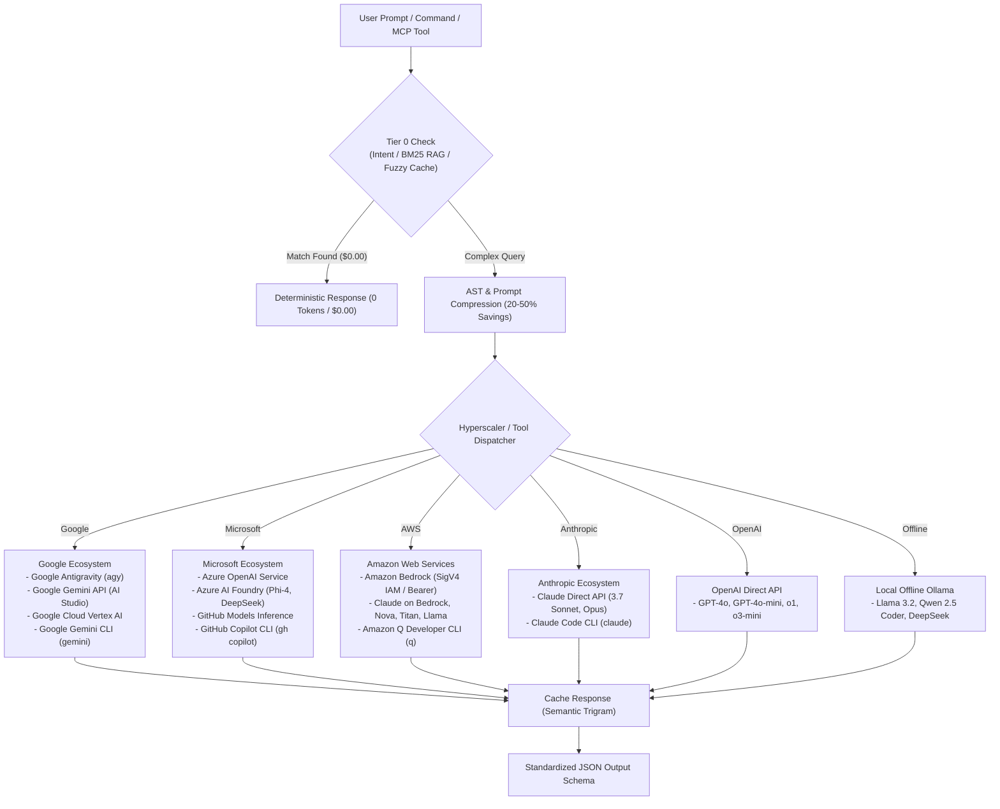

# ☁️ Multi-Hyperscaler LLM Gateway & AI Developer Tools Integration Guide

Personal Agentic Fleet provides out-of-the-box interoperability across all major cloud hyperscalers (**Google**, **Microsoft**, **Amazon Web Services**, **Anthropic**, **OpenAI**, and **Local Offline Ollama**) as well as modern AI developer CLI tools (**GitHub Copilot**, **Anthropic Claude Code**, **Google Gemini CLI**, and **Amazon Q Developer**).

This document serves as the comprehensive configuration, architectural, and operational reference for multi-hyperscaler inference and developer tooling.

---

## 1. Multi-Hyperscaler Architecture Overview

The Fleet Multi-Hyperscaler architecture is anchored by [`HyperscalerGateway`](../fleet/core/hyperscalers.py#L239-L729) in `fleet/core/hyperscalers.py` and [`DeveloperToolsBridge`](../fleet/core/dev_tools.py) in `fleet/core/dev_tools.py`.



---

## 2. Hyperscaler Catalog & Configuration

### 2.1 Google Methods

| Method | Endpoint / Command | Default Models | Credential Keys |
| :--- | :--- | :--- | :--- |
| **Google Antigravity CLI** | `agy -p <prompt>` | `gemini-3.8-flash-high`, `gemini-2.5-pro` | Auto-detected from `~/.gemini/` |
| **Google Gemini Direct REST API** | `https://generativelanguage.googleapis.com/v1beta/models/{model}:generateContent` | `gemini-2.5-pro`, `gemini-2.0-flash`, `gemini-1.5-flash` | `GEMINI_API_KEY` or `GOOGLE_API_KEY` |
| **Google Cloud Vertex AI** | `https://{location}-aiplatform.googleapis.com/v1/projects/{project}/locations/{location}/publishers/google/models/{model}:generateContent` | `gemini-2.5-pro`, `gemini-2.0-flash`, `claude-3-7-sonnet@20250219` | `GOOGLE_CLOUD_PROJECT`, `GOOGLE_CLOUD_LOCATION`, and `VERTEX_AI_TOKEN` (or `gcloud auth print-access-token` fallback) |
| **Google Gemini CLI** | `gemini -p <prompt>` | `gemini-2.5-pro` | Auto-detected from npm global or Cloud SDK |

**Configuration**:
```powershell
# Set via environment or securely store in Fleet DPAPI Vault
$env:GEMINI_API_KEY = "your-google-ai-studio-key"
# Or for Google Cloud Vertex AI:
$env:GOOGLE_CLOUD_PROJECT = "your-gcp-project-id"
$env:GOOGLE_CLOUD_LOCATION = "us-central1"
```

---

### 2.2 Microsoft & GitHub Methods

| Method | Endpoint / Command | Default Models | Credential Keys |
| :--- | :--- | :--- | :--- |
| **Azure OpenAI Service** | `{endpoint}/openai/deployments/{model}/chat/completions?api-version=...` | `gpt-4o`, `gpt-4o-mini`, `o1`, `o3-mini` | `AZURE_OPENAI_API_KEY` + `AZURE_OPENAI_ENDPOINT` |
| **Azure AI Foundry Serverless** | `{endpoint}/chat/completions` | `Phi-4`, `DeepSeek-R1` | `AZURE_AI_FOUNDRY_KEY` + `AZURE_AI_FOUNDRY_ENDPOINT` |
| **GitHub Models API** | `https://models.inference.ai.azure.com/chat/completions` | `gpt-4o`, `gpt-4o-mini`, `Phi-4` | `GITHUB_TOKEN` |
| **GitHub Copilot CLI** | `gh copilot suggest/explain` | Co-pilot Assistant | Auto-detected from `gh auth status` |

**Configuration**:
```powershell
# Azure OpenAI:
$env:AZURE_OPENAI_API_KEY = "your-azure-key"
$env:AZURE_OPENAI_ENDPOINT = "https://your-resource.openai.azure.com"

# Or GitHub Models (free with GitHub token):
$env:GITHUB_TOKEN = "your-github-pat"
```

---

### 2.3 Amazon Web Services (AWS) Methods

Personal Agentic Fleet features a pure Python stdlib **AWS Signature Version 4 (SigV4) HMAC-SHA256 engine** ([`_sign_aws_sigv4_headers`](../fleet/core/hyperscalers.py#L160-L236)) eliminating the need for `boto3`.

| Method | Endpoint / Command | Default Models | Credential Keys |
| :--- | :--- | :--- | :--- |
| **Bedrock Runtime (SigV4 IAM)** | `https://bedrock-runtime.{region}.amazonaws.com/model/{model}/invoke` | `anthropic.claude-3-7-sonnet-20250219-v1:0`, `anthropic.claude-3-5-sonnet-20241022-v2:0`, `amazon.nova-pro-v1:0`, `amazon.titan-text-express-v1`, `meta.llama3-3-70b-instruct-v1:0` | `AWS_ACCESS_KEY_ID`, `AWS_SECRET_ACCESS_KEY`, `AWS_REGION` |
| **Bedrock Runtime (Bearer Token)** | `{endpoint}/model/{model}/invoke` | Same as above | `AWS_BEARER_TOKEN`, `AWS_BEDROCK_ENDPOINT` |
| **Amazon Q Developer CLI** | `q chat --no-interactive <prompt>` | Amazon Q Developer | Auto-detected from `q` or AWS CLI |

**Configuration**:
```powershell
$env:AWS_ACCESS_KEY_ID = "your-aws-access-key-id"
$env:AWS_SECRET_ACCESS_KEY = "your-aws-secret-access-key"
$env:AWS_REGION = "us-east-1"
```

---

### 2.4 Anthropic, OpenAI & Local Ollama

| Method | Endpoint | Default Models | Credential Keys |
| :--- | :--- | :--- | :--- |
| **Anthropic Direct API** | `https://api.anthropic.com/v1/messages` | `claude-3-7-sonnet-latest`, `claude-3-5-sonnet-latest`, `claude-3-opus-latest` | `ANTHROPIC_API_KEY` |
| **Anthropic Claude Code CLI** | `claude -p <prompt>` | Claude Code Agent | Auto-detected from npm global |
| **OpenAI Direct API** | `https://api.openai.com/v1/chat/completions` | `gpt-4o`, `gpt-4o-mini`, `o1`, `o3-mini` | `OPENAI_API_KEY` |
| **Local Offline Ollama** | `http://localhost:11434/api/generate` | `llama3.2`, `qwen2.5-coder`, `deepseek-r1` | `OLLAMA_BASE_URL` (optional) |

---

## 3. AI Developer Tools Integration Bridge

[`fleet/core/dev_tools.py`](../fleet/core/dev_tools.py) connects Fleet with your everyday terminal and IDE coding assistants:

### 3.1 Automatic Instruction Synchronization
Fleet synchronizes its architectural standards, Tier 0 token rules, and test commands across all AI coding assistants in one command:
```powershell
python -c "from fleet.core.dev_tools import sync_all_developer_tool_instructions; print(sync_all_developer_tool_instructions())"
```
This generates and updates:
- [`.github/copilot-instructions.md`](../.github/copilot-instructions.md) — Loaded automatically by GitHub Copilot in VS Code and GitHub CLI.
- [`CLAUDE.md`](../CLAUDE.md) — Loaded automatically by Anthropic Claude Code CLI (`claude`).
- [`GEMINI.md`](../GEMINI.md) — Loaded automatically by Google Gemini CLI and Antigravity.

### 3.2 Execution Bridges with Transparent Fallbacks
When you invoke a developer tool via Fleet:
- `execute_claude_code(prompt)`: Runs `claude -p "<prompt>"` if installed; falls back to the Anthropic Claude Direct API if not.
- `execute_github_copilot_command(prompt)`: Runs `gh copilot suggest "<prompt>"` if installed; falls back to Azure OpenAI / GitHub Models if not.
- `execute_google_gemini_cli(prompt)`: Runs `gemini -p "<prompt>"` if installed; falls back to Google AI Studio / Vertex AI if not.
- `execute_aws_q_developer(prompt)`: Runs `q chat --no-interactive "<prompt>"` if installed; falls back to Amazon Bedrock if not.

---

## 4. Web Dashboard Console & Slash Commands

From the Web Dashboard Command Console ([http://127.0.0.1:7890](http://127.0.0.1:7890)), you can interact with any hyperscaler or tool using specialized slash commands:

- `/providers` or `/tools`: Displays live status of all 7 hyperscaler providers and 8 detected developer tools.
- `/copilot <query>`: Runs query via GitHub Copilot CLI (or Azure fallback).
- `/claude <query>`: Runs query via Anthropic Claude Code CLI (or Anthropic API fallback).
- `/gemini <query>`: Runs query via Google Gemini CLI (or AI Studio fallback).
- `/vertex <query>`: Dispatches query to Google Cloud Vertex AI.
- `/azure <query>`: Dispatches query to Microsoft Azure OpenAI / Foundry.
- `/aws <query>` or `/bedrock <query>`: Dispatches query to Amazon Bedrock Runtime.
- `/ollama <query>`: Dispatches query to offline Local Ollama (0 cloud tokens).

---

## 5. Model Context Protocol (FastMCP) Tools

When connecting Google Antigravity, Claude Code, Cursor, or GitHub Copilot to Fleet via FastMCP (`fleet/mcp_server.py`), three dedicated tools are exposed:

1. `fleet_list_hyperscalers_and_tools()`: Lists all configured hyperscalers and installed developer tools.
2. `fleet_query_hyperscaler(prompt, provider="auto", model="")`: Routes an inference request to any hyperscaler with Tier 0 local caching.
3. `fleet_run_developer_tool(tool_name, prompt)`: Executes a task via `'copilot'`, `'claude_code'`, `'gemini_cli'`, or `'aws_q'`.
