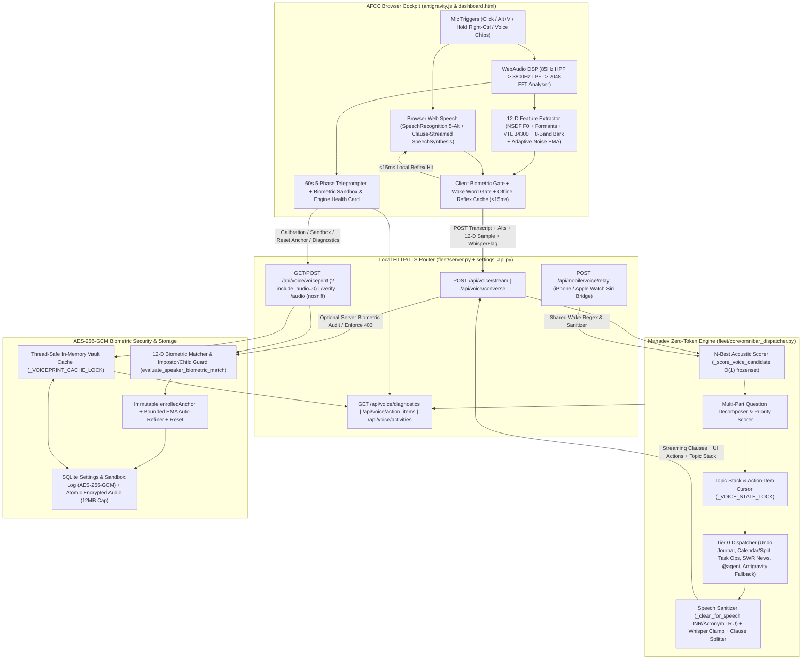
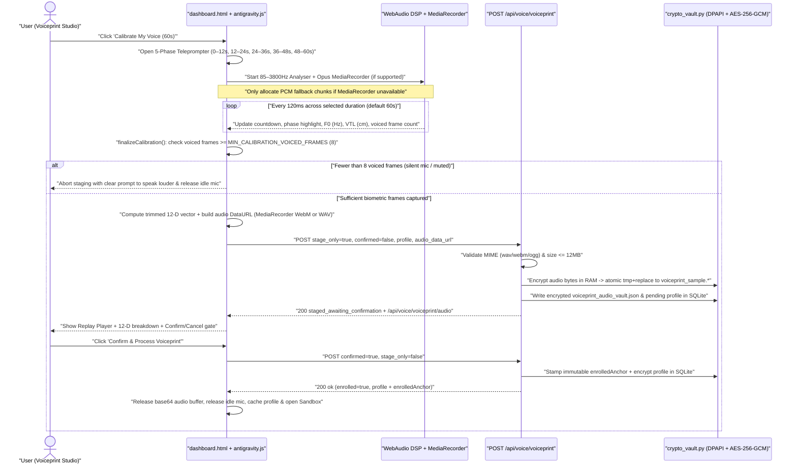
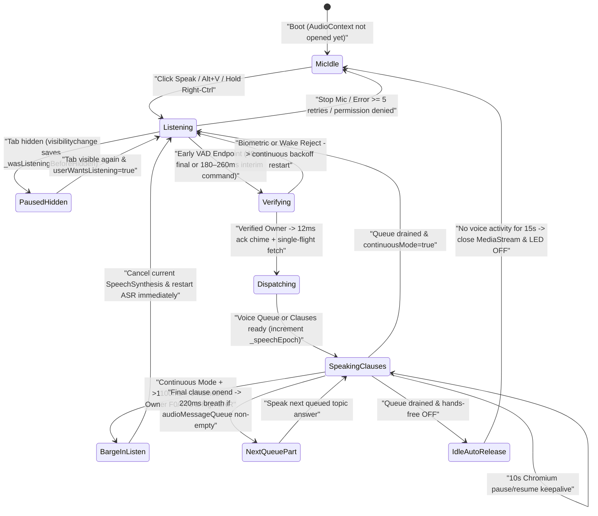
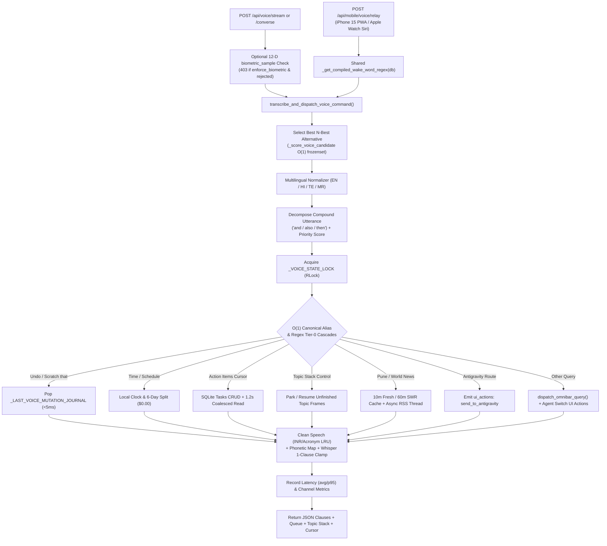
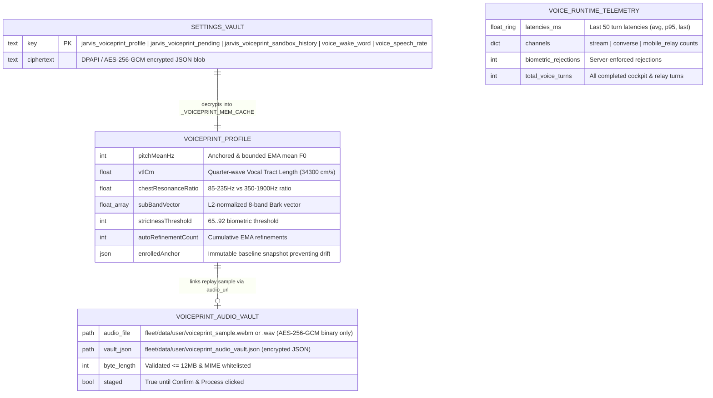

# 🔱 Mahadev Voice Command & Biometric Speaker Cockpit via AFCC — Deep Technical Architecture & Principal Architect Review

This document provides a complete engineering breakdown of the **Mahadev Voice Command & Biometric Speaker Cockpit** inside **AFCC (Agentic Fleet Control Center)**: what happens millisecond by millisecond from pressing `Alt+V` (or Hold `Right-Ctrl` / Click `Speak Now`), through WebAudio 85–3800 Hz bandpass filtering, adaptive noise-floor gating, 12-dimensional NIST biometric speaker verification, `<15 ms` zero-network reflexes, clause-streamed speech synthesis, and Apple iPhone / Watch relay.

It then presents a **Top-1% Principal Systems Architect Critique** calibrated for a **personal Windows laptop** (`127.0.0.1:7890`) and documents the 10 remediation backlog items (`[MV-01]`–`[MV-10]`) executed to make the cockpit production-hardened.

---

## 1. Personal Windows Laptop Acoustic, Thermal, Battery & Privacy Envelope

Unlike cloud voice assistants backed by GPU ASR clusters, the **Mahadev Cockpit** runs inside a local Chromium tab + Windows Python microkernel alongside an active IDE and background services:

| Constraint Dimension | Personal Windows Laptop Reality | Design Implication |
| :--- | :--- | :--- |
| **Microphone Hardware & Fan Noise** | Laptop array microphones sit centimeters from CPU fans, AC hum (`50–60 Hz`), and mechanical keyboards; holding an open `MediaStream` keeps the Windows hardware mic LED lit and prevents low-power audio sleep. | Must apply biquad bandpass filtering (`85–3800 Hz`), adaptively track an ambient noise-floor EMA (`ambientNoiseRms`), keep DSP suspended during silence (`ctx.suspend()`), and release `MediaStream` tracks automatically after `15s` idle or calibration end. |
| **Main-Thread UI & Canvas Churn** | Continuous `setInterval` DSP timers, WebAudio `<canvas>` spectrum repaints, and post-turn DOM updates compete directly with scroll smoothness and typing latency. | Must run strided `4x` RMS silence short-circuits, skip canvas redraws with 32-bit FNV bar signatures + offscreen checks (`offsetParent === null`), batch DOM mutations in `requestAnimationFrame`, and stream metadata without multi-MB base64 audio payloads on boot (`?include_audio=0`). |
| **Browser Speech APIs (Web Speech)** | Chrome `SpeechRecognition` buffers up to `1.8s` of trailing silence and throws silent `network`/`aborted` drops on flaky Wi-Fi; Chromium `speechSynthesis` stalls or self-fires stale `onerror`/`timeout` callbacks after `~14s`. | Must apply early-intent VAD endpointing (`40–260ms`), exponential backoff on recognition errors, tab-visibility pause/resume, speech epoch guards (`_speechEpoch`), and a `10s` pause/resume TTS keepalive. |
| **Acoustic Impostor & Drift Defense** | Children and household speakers share the physical room; repeated ambient noise or low-volume whispers can drift adaptive voiceprints or exploit missing voiced-frame fallbacks. | Must extract 12-D vocal tract & spectral signatures (`F0` NSDF, `VTL cm`, `F1/F2/F3`, 8-Band Bark cosine, Chest-to-Treble ratio), reject `< 8` voiced frames during calibration, fail closed when speaker lock is active with `< 2` frames, and clamp cumulative EMA drift against an immutable `enrolledAnchor`. |
| **At-Rest Biometric Privacy** | Raw voice recordings (`voiceprint_sample.wav`/`.webm`) and 12-D vocal profiles are biometric PII under the Zero-Cloud Privacy Firewall. | Must validate audio MIME/size (`<= 12 MB`), never touch plaintext bytes to disk during encryption (`_atomic_write_bytes`), serve replays with `X-Content-Type-Options: nosniff`, and keep all voiceprint artifacts local and gitignored under `fleet/data/user/`. |
| **Multi-Thread Server Concurrency** | Browser cockpit turns (`/api/voice/stream`), delayed auto-refine posts (`+1200ms`), and iPhone/Watch relay turns (`/api/mobile/voice/relay`) execute concurrently on AFCC HTTP worker threads. | Must synchronize shared topic-stack, action-item cursor, turn-task cache, news SWR state, and encrypted voiceprint cache reads/writes behind dedicated reentrant locks (`_VOICE_STATE_LOCK`, `_VOICEPRINT_CACHE_LOCK`). |

---

## 2. Architecture Diagrams

### 2.1 High-Level Mahadev Voice & Biometric System Topology



### 2.2 Live Spoken Command, `<15ms` Client Reflex & Clause-Streaming Sequence

```mermaid
sequenceDiagram
    actor Owner as "Owner Speaker"
    participant Mic as "WebAudio DSP (85–3800Hz)"
    participant ASR as "SpeechRecognition (maxAlternatives=5)"
    participant JS as "antigravity.js (BioGate + Reflex + Dedupe)"
    participant API as "settings_api.py (/api/voice/stream)"
    participant Engine as "omnibar_dispatcher.py (_VOICE_STATE_LOCK)"
    participant TTS as "SpeechSynthesis (_speechEpoch + Keepalive)"

    Owner->>Mic: "Speak command (e.g. 'Mahadev, close it and read news')"
    Mic->>Mic: "Every 110ms: update ambientNoiseRms EMA; extract F0, F1–F3, VTL, 8-Band Bark"
    ASR-->>JS: "Streaming interim/final results (<=5 N-best candidates)"
    JS->>JS: "Early VAD Endpoint (40ms final or 180–260ms interim command)"
    JS->>JS: "verifySpeakerBiometrics(): fail closed if speakerLock & <2 frames; check 12-D + wake"

    alt "Biometric or Wake Gate Rejected"
        JS-->>Owner: "Reject with score breakdown (e.g. Child/Impostor Rejected) — $0.00"
    else "Authorized Owner Utterance"
        JS->>JS: "Single-flight <150ms dedupe + AbortController + 12ms ack chime"
        alt "Simple Local Command Hit (Mic Check / Open Cache Action)"
            JS->>TTS: "Speak instantly in <15ms while optional sync runs"
        else "Dispatch to Server Engine"
            JS->>API: "POST /api/voice/stream (transcript, alts, routing_mode, whisper_mode, biometric_sample)"
            API->>API: "Optional server 12-D biometric_sample verification (HTTP 403 if enforced & rejected)"
            API->>Engine: "transcribe_and_dispatch_voice_command()"
            Engine->>Engine: "Pick N-best -> normalize language -> decompose multi-part -> acquire _VOICE_STATE_LOCK"
            Engine-->>API: "spoken_stream_clauses, voice_queue_items, ui_actions, cursor_position"
            API-->>JS: "200 OK JSON + async activity log"
            JS->>TTS: "Queue Clause #0 immediately (1 clause if Whisper Mode)"
            JS->>JS: "requestAnimationFrame: update transcript badge, activity chips, action bar & cursorIdx"
            JS->>JS: "Execute ui_actions & defer (+1200ms) bounded EMA auto-refine if >=82%"
        end
    end
```

### 2.3 60-Second 5-Phase Calibration, Atomic Encryption & Confirmation Gate



### 2.4 Real-Time 12-D WebAudio DSP, Adaptive Noise Floor & Biometric Gate Pipeline

```mermaid
flowchart LR
    RawMic["Raw Mic Stream\n(echoCancel + NS + AGC, 1ch)"] --> HPF["Biquad High-Pass\n(85 Hz, Q=0.707)"]
    HPF --> LPF["Biquad Low-Pass\n(3800 Hz, Q=0.707)"]
    LPF --> Analyser["AnalyserNode\n(fftSize=2048, smooth=0.55)"]

    Analyser -->|"Every 110ms"| StridedRMS["4x Strided RMS\n(512 samples)"]
    StridedRMS -->|"rms < max(0.013, 2.2 * ambientNoiseRms)"| Quiet["Adaptive Noise EMA\nambientNoiseRms = 0.95*prev + 0.05*rms\nZero-CPU Silence Skip"]
    StridedRMS -->|"Voiced Audio"| Spectrum["2048-bin Byte FFT + FNV Sig Canvas"]

    Analyser -->|"Voiced Time Domain"| NSDF["2x-Decimated McLeod-YIN NSDF\nFirst-Peak T0 Guard -> Pitch F0 (65–450Hz)"]
    Spectrum --> Formants["Formant Peaks F1 (250–920Hz)\nF2 (920–2350Hz) / F3 (2350–3600Hz)"]
    Formants --> VTL["Vocal Tract Length\nSpeed = 34300 cm/s -> VTL (cm)"]
    Spectrum --> Chest["Chest-to-Treble Ratio\n(85–235Hz vs 350–1900Hz)"]
    Spectrum --> Bark["L2-Normalized 8-Band Bark Vector\n+ Centroid + 85% Rolloff"]

    NSDF --> Summary["10% Trimmed Utterance Summary\n(12-D Vector)"]
    VTL --> Summary
    Chest --> Summary
    Bark --> Summary

    Summary --> FailClose{"speakerLock ON &\npitches < 2 frames?"}
    FailClose -->|"Yes (Live Mic)"| Block1["Fail-Closed Reject\n(Need voiced audio)"]
    FailClose -->|"No (>=2 frames)"| Scorer["Weighted 12-D Match:\nF0 30% + VTL/Formant 25% + Bark 25% +\nChest 10% + Timbre 10%"]
    Scorer --> ChildGuard{"High F0 > 205Hz?\nShort VTL <= 13.8cm?\nLow Chest <= 0.68x?"}
    ChildGuard -->|"Impostor / Child Flag"| CapReject["Cap Match <= 42% & Reject"]
    ChildGuard -->|"Pass & >= Threshold"| Allow["Authorized Owner Voice\n-> Bounded EMA Auto-Refine"]
```



### 2.5 Hands-Free Listening, Barge-In, Epoch-Guarded TTS & Multi-Part Queue State Machine



### 2.6 Backend Tier-0 Intent Dispatch, Topic Stack, News SWR & Tri-Device Voice Relay



### 2.7 Encrypted Local Storage, Voiceprint Anchor & Telemetry Schema



---

## 3. Step-by-Step User Interaction Walkthroughs

1. **Dashboard Boot & Lightweight Voiceprint Hydration**:
   - `antigravity.js` loads initial state from `localStorage`, enforcing the one-time `afcc_voiceprint_duration_60s_v1` migration (`60s` calibration default).
   - After `800ms`, `loadJarvisVoiceprintFromServer()` calls `GET /api/voice/voiceprint?include_audio=0`. The server reads from `_VOICEPRINT_MEM_CACHE` (guarded by `_VOICEPRINT_CACHE_LOCK`), omitting the multi-megabyte `audio_data_url` during startup and setting `<audio id="voiceprintPreviewPlayer">` to stream `/api/voice/voiceprint/audio` only on demand.
   - After `1400ms`, `refreshVoiceActionItemsClientCache()` fetches open/closed tasks via `/api/voice/action_items` to arm the `<15ms` client reflex cache.
2. **Triggering Voice Listening (`Click Speak`, `Alt+V`, or `Hold Right-Ctrl`)**:
   - `startBrowserSpeechRecognition()` cancels active TTS to prevent self-echo, initializes `ensureJarvisAudioDspPipeline()`, clears utterance feature arrays, and configures `SpeechRecognition` with `interimResults = true`, `maxAlternatives = 5`, and the active locale (`en-IN`, `hi-IN`, `te-IN`, or `mr-IN`).
3. **Real-Time WebAudio DSP, Adaptive Noise Floor & 12-D Extraction**:
   - Every `110ms`, audio flows from the microphone through an `85 Hz` High-Pass Filter and `3800 Hz` Low-Pass Filter into a `2048`-sample `AnalyserNode`.
   - When `4x`-strided `rms < max(0.013, 2.2 * ambientNoiseRms)`, the DSP loop updates the ambient noise floor EMA (`ambientNoiseRms`) and skips FFT/NSDF computations (`0%` idle CPU and `0` canvas redraws).
   - When voiced speech exceeds the noise gate, `computeAutocorrelationPitchHz()` computes fundamental pitch `F0` via 2x-decimated McLeod-YIN NSDF (first-peak `T0` anti-octave rule), and `extractFineAcousticFrameFeatures()` extracts `F1/F2/F3`, `vtlCm` (`34300 cm/s`), `chestResonanceRatio`, `85%` spectral rolloff, and the L2-normalized 8-band Bark vector.
4. **Biometric Speaker Verification & Wake-Word Gate**:
   - On `rec.onresult`, Early-Intent VAD endpointing waits `40ms` after a final chunk or `180–260ms` on recognized interim commands, then triggers `commitVoiceUtteranceNow()`.
   - `verifySpeakerBiometrics()` runs the 12-D biometric check **before** checking the wake word so saying `"Mahadev"` never bypasses owner voice identity. When Speaker Lock is enabled with a live audio context, fewer than `2` voiced frames **fail closed** (preventing whisper/drop bypasses). Children/octave impostors (`F0 > 205 Hz`, `VTL <= 13.8 cm`, `chest <= 0.68x`) are capped below `42%` and rejected.
5. **`<15ms` Client Reflex vs. `/api/voice/stream` Clause-Streaming Dispatch**:
   - `_lastDispatchedTurnSig` deduplicates duplicate triggers within `150ms`, `_activeVoiceFetchController` aborts superseded requests, and `playJarvisInstantAckChime()` emits a `12ms` WebAudio tone.
   - Simple phrases hit `tryInstantClientVoiceFastPath()` immediately; full queries hit `POST /api/voice/stream` (sending `whisper_mode` and optional `biometric_sample`). Server `transcribe_and_dispatch_voice_command()` scores N-best candidates with an O(1) frozenset index, normalizes multilingual queries, acquires `_VOICE_STATE_LOCK`, executes Tier-0 actions, records real latency (`avg`/`p95`), and returns streaming speech clauses (`spoken_stream_clauses`) with single-clause clamping if Whisper Mode is ON.
6. **Multi-Part Audio Queue & Topic Stack Interruption/Resume**:
   - Compound utterances (`"... and tell me Pune news"`) are split by `_split_chained_voice_commands()`, priority-scored, and returned in `voice_queue_items`. If the owner interrupts an active action-item review, `_VOICE_TOPIC_STACK_STATE` parks the unfinished frame and appends an auto-resume bridge item. Frontend `playJarvisSequentialAudioQueue()` speaks items sequentially with `220ms` inter-item pauses and syncs `actionItemsCache.cursorIdx` from `data.active_action_item.cursor_position`.
7. **Voice-to-Antigravity Escalation**:
   - Prompts targeting Antigravity Live (or open-ended queries when `routing_mode === 'antigravity'`) emit `ui_actions: [{type: 'switch_agent', agent_id: 'antigravity'}, {type: 'send_to_antigravity', command}]`, switching the engine selector and calling `submitAgCommand()` automatically.
8. **60-Second 5-Phase Calibration, Encrypted Replay & Confirmation Lock**:
   - Opening `#voiceprintGuidedPromptPanel` guides the owner through five equal `0–12s` .. `48–60s` vocal variation phases (`durationSec` selectable across `[10, 12, 15, 20, 25, 30, 45, 60]`, default `60s`).
   - `finalizeCalibration()` requires at least `MIN_CALIBRATION_VOICED_FRAMES = 8` voiced frames before computing the 12-D signature. Staging posts `stage_only=true` to `POST /api/voice/voiceprint`, which validates MIME/12MB limits, encrypts audio directly into `voiceprint_sample.*` via atomic temp-replace (zero plaintext bytes touched to disk), and stages the profile. After replaying via `/api/voice/voiceprint/audio` (`X-Content-Type-Options: nosniff`), clicking Confirm stamps the immutable `enrolledAnchor` and clears client base64 buffers.
9. **Biometric Sandbox, Anti-Drift EMA Auto-Refinement & Anchor Recovery**:
   - High-confidence owner turns (`>= max(82%, threshold)`) trigger a deferred (`+1200ms`) bounded EMA update (`auto_refine_voiceprint_profile`) clamped strictly within `±14 Hz` F0, `±0.9 cm` VTL, and `±0.25` chest resonance of `enrolledAnchor`.
   - Inside Settings -> Voice Sandbox (`#voiceprintSettingsSandboxCard`), the user can run simulated or live 5s benchmarks, submit positive/negative feedback, inspect the **Engine Health Card** (`#voiceEngineDiagnosticsBox`), or click **Reset to Enrolled Anchor** (`resetVoiceprintToAnchor()`) to undo cumulative drift.
10. **iPhone/Apple Watch Relay & Tab Lifecycle Cleanup**:
    - External voice turns from iPhone PWA or watchOS Siri arrive at `POST /api/mobile/voice/relay`, reusing the compiled wake-word cache and speech sanitizer and incrementing `mobile_relay_turns` telemetry.
    - Switching away from the browser tab (`document.hidden`) pauses continuous recognition without wasting battery and restores it on return; leaving Idle (`15s` with continuous/listening OFF) or closing the tab releases `MediaStream` tracks immediately so the hardware mic LED turns off.

---

## 4. Top-1% Systems Architect Critique & Remediations (`[MV-01]`–`[MV-10]`)

Auditing the pre-hardening Mahadev Voice & Biometric implementation against hardware, security, concurrency, and Chromium quirks exposed 10 concrete flaws:

| ID | Category | Finding in Original Architecture | Laptop, Accuracy & Security Impact | Implemented Fix |
| :--- | :--- | :--- | :--- | :--- |
| **`[MV-01]`** | Privacy & Boot Weight | `_save_voiceprint_audio_data_url()` wrote **plaintext audio bytes to disk first** before overwriting with AES-256-GCM ciphertext and fell back to plaintext JSON on error; had no upload size/MIME check, no `nosniff` header on replay, and downloaded multi-MB `audio_data_url` in `GET /api/voice/voiceprint` at startup. | Brief plaintext biometric audio exposure on NTFS SSD + unguarded memory spike on boot for long 60s recordings. | Encrypt-before-write via atomic `tmp` + `os.replace()` (zero plaintext disk touch), `12MB` + audio MIME whitelist (`400`/`413`), `nosniff` on `/audio`, and lightweight `?include_audio=0` startup hydration. |
| **`[MV-02]`** | Biometric Physics & Enforcement | Client VTL formula used `35000 cm/s` while server used `34300 cm/s`; calibration could still mint a fake `136 Hz / 82%` profile with `0` spoken frames; live `verifySpeakerBiometrics()` silently bypassed speaker lock when `< 2` voiced frames were captured; and server endpoints ignored biometric verification. | ~2% systematic VTL bias, silent mic could enroll a fake profile, whispers bypassed lock, and API lacked server-side biometric enforcement. | Harmonized speed of sound (`34300`), added `MIN_CALIBRATION_VOICED_FRAMES = 8` + honest quality score, fail-closed live lock (`<2` frames rejected), and added server-side `biometric_sample` verification + optional `enforce_biometric` HTTP `403`. |
| **`[MV-03]`** | Mic Hardware & Battery | `ensureJarvisAudioDspPipeline()` never released `MediaStream` tracks when idle after push-to-talk or calibration/sandbox, recorded both `MediaRecorder` WebM AND redundant raw `Float32Array` PCM copies simultaneously, and had no `visibilitychange`/`pagehide` teardown. | Laptop hardware microphone LED stayed ON indefinitely and PCM buffers wasted RAM during 60s enrollment. | Auto-release idle mic after `MIC_IDLE_RELEASE_MS` (`15s`), release after calibration/sandbox when not listening, skip PCM capture when `MediaRecorder` is recording, and add `visibilitychange`/`pagehide` cleanup. |
| **`[MV-04]`** | Chromium TTS & ASR Stability | `speakAfccVoiceText()`'s `220ms` watchdog raced when `stopAfccVoiceSpeaking()` cancelled speech cleanly, lacked Chromium's `10s` pause/resume TTS keepalive, and `rec.onend` restarted in a tight `70ms` CPU spin loop on offline `network` errors or hidden tabs. | Ghost fallback voices overlapped stopped audio, >14s replies truncated silently in Edge/Chrome, and offline tabs spun CPU on ASR retries. | Added `_speechEpoch` generation tokens guarding callbacks + `450ms` watchdog, `10s` Chromium TTS keepalive timer, hidden-tab ASR pause, and exponential backoff (`150ms..4000ms`, pausing after `5` failures). |
| **`[MV-05]`** | Server Thread Safety & Cache Coherency | `_JARVIS_PERF_TELEMETRY`, `_TURN_TASK_CACHE`, `_VOICE_TOPIC_STACK_STATE`, `_CLEAN_SPEECH_CACHE`, `_LIVE_NEWS_CACHE`, and `_VOICEPRINT_MEM_CACHE` were mutated without locks across HTTP worker threads + SWR background threads; `post_verify_voiceprint_sandbox_endpoint()` updated DB without refreshing `_VOICEPRINT_MEM_CACHE`. | Race conditions between delayed auto-refine (`+1200ms`), mobile relay, and main voice turns plus stale decrypted profile cache reads. | Added `_VOICE_STATE_LOCK` (`omnibar_dispatcher.py`) and `_VOICEPRINT_CACHE_LOCK` (`settings_api.py`), atomic cache updates on all mutation paths, and SWR background refresh counter fixes. |
| **`[MV-06]`** | Telemetry Accuracy & Cursor Sync | `/api/voice/diagnostics` returned hardcoded `0.00ms` telemetry and zero channel counters; `total_voice_turns` wasn't incremented by `/api/voice/stream`; `/api/voice/stream` skipped `db.log_activity`; and `actionItemsCache.cursorIdx` drifted out of sync with server focus navigation. | Performance report reported zeroes; streaming turns disappeared from activity logs; `<15ms` fast next/skip stepped to wrong action items. | Added sliding 50-turn dispatch latency histogram (`avg`/`p95`/`last`), per-channel counters (`stream`/`converse`/`mobile_relay`), stream activity logging, and `cursor_position -> cursorIdx` sync. |
| **`[MV-07]`** | Barge-In & Whisper Parity | Hot-mic barge-in hardcoded male F0 `65–195 Hz` (blocking enrolled higher-F0 owners from interrupting); server didn't clamp multi-clause payloads for Whisper Mode; and UI stored full base64 audio blobs in memory after upload. | Female/higher-pitch owners couldn't barge in; Whisper Mode still received multi-clause payloads; redundant JS heap usage. | Personalized barge-in F0/VTL corridor to `window.AFCCVoice.voiceprint`, added server-side `whisper_mode` 1-clause clamping, and switched preview replay to `/api/voice/voiceprint/audio` post-confirm. |
| **`[MV-08]`** | Laptop Fan Noise & Mobile Relay Parity | DSP silence gate used a rigid `rms < 0.013` and `0.002` SNR denominator even under loud laptop fan noise; `/api/mobile/voice/relay` recompiled its own wake-word regex and skipped `channel="mobile_relay"` telemetry and activity logging. | Fan/AC background floor triggered constant FFT wakeups; Watch/iPhone relay drifted from desktop wake-word & sanitation rules. | Added adaptive `ambientNoiseRms` EMA floor + relative SNR in DSP loop, and refactored `/api/mobile/voice/relay` onto `_get_compiled_wake_word_regex()`, `_clean_for_speech()`, and `channel="mobile_relay"` logging. |
| **`[MV-09]`** | Voiceprint Anchor & Anti-Drift | Repeated EMA auto-refinements had no immutable baseline anchor or cumulative drift clamp, and negative tighten could raise `strictnessThreshold` or narrow variance without a 1-click baseline reset. | Months of morning raspiness or noisy rooms could gradually walk an enrolled voiceprint away from the true 60s baseline. | Stamped immutable `enrolledAnchor` at enrollment, clamped cumulative EMA drift (`±14 Hz` F0, `±0.9 cm` VTL, `±0.25` chest ratio), and added `reset_to_anchor` endpoint + UI button. |
| **`[MV-10]`** | Unified Voice Engine Diagnostics | Neither `GET /api/voice/diagnostics` nor `#voiceprintSettingsSandboxCard` surfaced real `avg`/`p95` dispatch latency, channel split, server biometric enforcement stats, or anchor drift. | Debugging latency spikes, ASR drops, or voiceprint drift required browser devtools inspection. | Enriched `GET /api/voice/diagnostics` with `latency`, `channels`, `cache_hit_rates`, and `biometric_security`, and added the live **Voice Engine Health Card** inside `#voiceprintSettingsSandboxCard`. |

---

## 5. Before vs. After Architecture Scorecard

| Architectural Metric | Before Hardening | After `[MV-01]`–`[MV-10]` |
| :--- | :--- | :--- |
| **Biometric Audio Rest Security** | Plaintext write before AES encrypt + JSON fallback + MBs downloaded at boot | Zero plaintext disk touch + atomic write + 12MB/MIME check + `nosniff` + `?include_audio=0` |
| **Calibration & Speaker Lock Integrity** | 0-frame fake enrollment allowed; `<2` frames bypassed lock; VTL `35000` mismatch | `MIN_CALIBRATION_VOICED_FRAMES=8` gate; fail-closed live lock; harmonized `34300 cm/s` + server `403` |
| **Hardware Mic & Battery Hygiene** | Open `MediaStream` LED stayed on indefinitely; tight ASR retry loop offline | Auto-release after `15s` idle; MediaRecorder/PCM dedup; visibility pause + exponential ASR backoff |
| **Chromium TTS & Thread Safety** | Un-guarded watchdog races; `>14s` TTS stall; unlocked shared state dicts | `_speechEpoch` watchdog guard + `10s` Chromium keepalive + `_VOICE_STATE_LOCK` & `_VOICEPRINT_CACHE_LOCK` |
| **Long-Term Voiceprint Stability** | Unbounded cumulative EMA drift across sessions; no recovery control | Immutable `enrolledAnchor` + bounded `±14Hz`/`±0.9cm` clamp + 1-click `reset_to_anchor` |
| **Latency & Engine Observability** | Hardcoded `0.00ms` placeholder stats; stream turns unlogged | Real 50-sample `avg`/`p95` histogram, channel split, adaptive fan floor & Sandbox Health Card |
