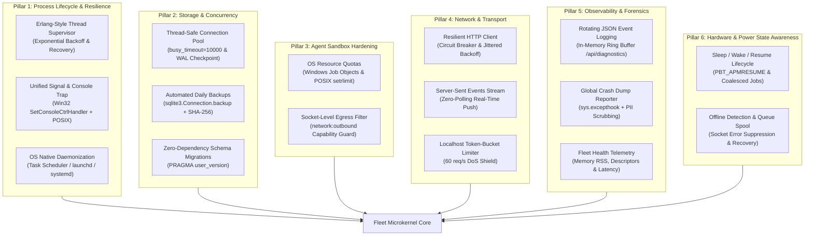

# 🛡️ Personal Agentic Fleet — Native Robustness Architecture & Engineering Backlog

This document establishes the comprehensive engineering backlog and architectural specifications required to make **Personal Agentic Fleet** natively robust, crash-resilient, and enterprise-grade across Windows, macOS, and Linux.

Every backlog item adheres to the fleet's foundational invariants:
1. **$0.00 Token Cost**: Local deterministic execution with zero unnecessary LLM roundtrips.
2. **Zero Required Third-Party Dependencies (`dependencies = []`)**: Leverages Python standard library and native OS system APIs.
3. **Multi-OS Parity**: Uniform behavior across Windows 11/10, macOS (Monterey through Sequoia), and Linux.
4. **Least-Privilege Agent Isolation**: Strict capability sandboxing and non-root execution.

---

## 🏗️ The 6 Pillars of Native Framework Robustness

---

## 📋 Prioritized Engineering Backlog

| ID | Pillar | Item Title | Priority | Target | Complexity | Primary Risk Mitigated |
| :--- | :--- | :--- | :---: | :---: | :---: | :--- |
| **ROB-01** | Lifecycle | **Thread & Task Supervision Watchdog** | `P1` | `v2.4.0` | Medium | Silent thread deaths in daemon, optimizer, or scheduler |
| **ROB-02** | Lifecycle | **Unified Signal Trap & Clean Shutdown Protocol** | `P1` | `v2.4.0` | Low | Corrupted SQLite WAL locks and orphan PID files on exit |
| **ROB-03** | Storage | **Thread-Safe SQLite Connection Pool & Busy Timeout** | `P1` | `v2.4.0` | Medium | `sqlite3.OperationalError: database is locked` concurrency conflicts |
| **ROB-04** | Storage | **Automated Daily Snapshot Backup Engine** | `P1` | `v2.4.0` | Low | Permanent database loss due to disk corruption or accidents |
| **ROB-05** | Sandbox | **OS Job Objects & POSIX Resource Quota Sandbox** | `P1` | `v2.4.0` | High | Custom agent infinite loops or unconstrained RAM leaks |
| **ROB-06** | Transport | **Resilient HTTP Client with Circuit Breaker** | `P1` | `v2.4.0` | Medium | Cascading failures and thundering herds from cloud API outages |
| **ROB-07** | Transport | **Server-Sent Events (SSE) Live Push Stream** | `P1` | `v2.4.0` | Medium | High CPU wakeups and database reads from 8-second polling |
| **ROB-08** | Lifecycle | **Workstation Service Daemonization Installers** | `P1` | `v2.4.0` | Low | Fleet stops running when user closes shell or logs out |
| **ROB-09** | Storage | **Zero-Dependency Database Schema Migration Engine** | `P2` | `v2.5.0` | Medium | Inconsistent database schema upgrades across versions |
| **ROB-10** | Sandbox | **Socket-Level Network Egress Policy Enforcer** | `P2` | `v2.5.0` | Medium | Rogue third-party agents making unauthorized external requests |
| **ROB-11** | Transport | **Localhost Token-Bucket Rate Limiter & DoS Shield** | `P2` | `v2.5.0` | Low | Accidental or malicious localhost denial-of-service flooding |
| **ROB-12** | Forensics | **Structured JSON Logging & In-Memory Ring Buffer** | `P2` | `v2.5.0` | Low | Unbounded plain-text log files and poor diagnostic parsing |
| **ROB-13** | Forensics | **Global Crash Reporter & Sanitized Dumps** | `P2` | `v2.5.0` | Low | Loss of root-cause diagnostics on unexpected microkernel crashes |
| **ROB-14** | Awareness | **System Sleep / Wake / Resume Lifecycle Handler** | `P2` | `v2.5.0` | Medium | Timer stampedes and socket errors after laptop wakes from sleep |
| **ROB-15** | Awareness | **Offline Network State Detection & Task Spooling** | `P2` | `v2.5.0` | Medium | Network timeout spam and failed API synchronizations when offline |

---

## 🔬 Detailed Technical Specifications & Implementation Designs

### 1. Process Lifecycle & Crash Resilience

#### ROB-01: Thread & Task Supervision Watchdog (`fleet/core/supervisor.py`)
- **Failure Model**: If a background task (e.g., DNS flush, memory optimization, or scheduled agent task) raises an unexpected exception (`OSError`, `TimeoutError`, `MemoryError`), the worker thread silently terminates.
- **Architectural Specification**:
  - Implement `FleetSupervisor` adopting the Erlang/OTP one-for-one supervision tree pattern.
  - Workers register with a restart strategy (`permanent`, `transient`, `temporary`).
  - Implements exponential backoff ($2^n \times 1\text{s} + \text{jitter}$) capped at 60 seconds, with a maximum restart intensity (e.g., max 5 restarts within a 60-second window before escalating to an admin alert).
  - Background health loop periodically verifies that all registered threads are alive; restarts dead workers automatically with clean state.

#### ROB-02: Unified Signal Trap & Clean Shutdown Protocol (`fleet/core/lifecycle.py`)
- **Failure Model**: Terminal termination (`SIGTERM`), user Ctrl+C (`SIGINT`), or Windows console close events kill the Python process abruptly, leaving SQLite WAL write locks intact and stale PID locks in `fleet/data/fleet.pid`.
- **Architectural Specification**:
  - Windows: Register Win32 console handler via `ctypes.windll.kernel32.SetConsoleCtrlHandler` for `CTRL_CLOSE_EVENT`, `CTRL_LOGOFF_EVENT`, `CTRL_SHUTDOWN_EVENT`.
  - POSIX: Trap `SIGINT`, `SIGTERM`, and `SIGQUIT`.
  - Execute a 3-second structured shutdown sequence:
    1. Set `shutdown_event.set()` to notify all background threads.
    2. Drain in-flight tasks on `DeterministicEventBus`.
    3. Execute SQLite WAL checkpoint: `PRAGMA wal_checkpoint(TRUNCATE)`.
    4. Remove `fleet/data/fleet.pid`.
    5. Close server socket listener gracefully.

#### ROB-08: Workstation Service Daemonization (`fleet/tools/install_service.py`)
- **Failure Model**: The user must keep a terminal window open or manually invoke `.vbs` scripts; system reboots fail to resume Fleet automatically.
- **Architectural Specification**:
  - Windows: Provision a Windows Scheduled Task (`Register-ScheduledTask` / `schtasks.exe`) configured with `RunLevel: HighestAvailable`, `LogonTrigger`, and `RestartOnFailure`.
  - macOS: Generate and install LaunchAgent property list `~/Library/LaunchAgents/com.fleet.agentic.plist` via `launchctl bootstrap gui/$(id -u)`.
  - Linux: Install `~/.config/systemd/user/fleet.service` with `Restart=always` and `WantedBy=default.target`.

---

### 2. Storage & Database Concurrency

#### ROB-03: Thread-Safe SQLite Connection Pool & Busy Timeout (`fleet/core/db/pool.py`)
- **Failure Model**: When multiple threads (FastAPI/HTTP server, scheduler, and background daemon) access SQLite simultaneously, SQLite raises `OperationalError: database is locked`.
- **Architectural Specification**:
  - Configure `PRAGMA busy_timeout = 10000` (10 seconds) on every connection so threads wait for write lock release rather than immediately failing.
  - Implement a thread-local connection cache using `threading.local()` so each OS thread reuses its own connection, avoiding cross-thread connection sharing violations.
  - Enforce `PRAGMA journal_mode = WAL` and run periodic background checkpoints.

#### ROB-04: Automated Daily Snapshot Backup Engine (`fleet/core/db/backup.py`)
- **Failure Model**: OS crash during disk write, power outage, or accidental record deletion results in data loss.
- **Architectural Specification**:
  - Leverage SQLite's native online backup API (`sqlite3.Connection.backup()`), which performs non-blocking, consistent live copies even while database writes occur.
  - Run once daily at `03:00` or upon boot if missed.
  - Save snapshots to `fleet/data/backups/fleet_backup_YYYY-MM-DD.db`.
  - Compute SHA-256 integrity hash for each snapshot (`checksums.sha256`).
  - Retain the last 7 daily snapshots and 4 weekly snapshots (automatic FIFO pruning).

#### ROB-09: Zero-Dependency Schema Migration Engine (`fleet/core/db/migrations.py`)
- **Failure Model**: Ad-hoc `CREATE TABLE IF NOT EXISTS` cannot safely add columns, rename fields, or mutate constraints when upgrading Fleet versions.
- **Architectural Specification**:
  - Track current database version using SQLite's built-in `PRAGMA user_version`.
  - Define forward migration functions: `migration_001_initial`, `migration_002_add_schedule_metadata`, etc.
  - On startup, compare `user_version` with code target; execute sequential migration steps inside a single transaction (`BEGIN IMMEDIATE TRANSACTION`).
  - Create a temporary pre-migration backup before executing any migrations, rolling back automatically on failure.

---

### 3. Agent Sandbox Hardening & Resource Containment

#### ROB-05: OS Job Objects & POSIX Resource Quota Sandbox (`fleet/core/sandbox/quota.py`)
- **Failure Model**: A custom user agent executes a computationally intensive task or experiences an unconstrained memory leak, exhausting host workstation RAM and freezing the OS.
- **Architectural Specification**:
  - Windows: Wrap agent child processes in Windows Job Objects via `ctypes.windll.kernel32.CreateJobObjectW`. Set `JobObjectExtendedLimitInformation` with `ProcessMemoryLimit: 500 MB` and `ActiveProcessLimit: 2`.
  - macOS/Linux: Apply POSIX resource limits via standard library `resource.setrlimit(resource.RLIMIT_AS, (500 * 1024 * 1024, 750 * 1024 * 1024))`.
  - Terminate offending worker cleanly and dispatch notification without impacting the main microkernel.

#### ROB-10: Socket-Level Network Egress Policy Enforcer (`fleet/core/sandbox/network.py`)
- **Failure Model**: A third-party agent that only declares `db:read` and `ui:render` permissions attempts to exfiltrate data by importing `urllib` or `requests` and contacting an external host.
- **Architectural Specification**:
  - Intercept socket creation at the standard library level (`socket.socket.connect`) within agent worker thread contexts using Python context managers.
  - Check whether the executing agent's manifest includes `"network:outbound"`.
  - If undeclared, block outbound connection and raise `PermissionError: Agent '<id>' does not possess declared 'network:outbound' capability`.

---

### 4. Network, Transport & API Robustness

#### ROB-06: Resilient HTTP Client with Circuit Breaker (`fleet/core/http_client.py`)
- **Failure Model**: When upstream cloud hyperscalers (Google AI Studio, Azure OpenAI, AWS Bedrock, Anthropic) experience partial degradation or rate limiting (HTTP 429 / 503), repeated hammering worsens outages and exhausts local thread pools.
- **Architectural Specification**:
  - Build a zero-dependency resilient HTTP client around `urllib.request`.
  - Implement a 3-state Circuit Breaker per provider endpoint:
    - `CLOSED`: Normal operation; tracks failure count.
    - `OPEN`: Trips after 5 consecutive failures or timeouts. Fast-fails immediately with `ServiceUnavailableError` for a cooldown period (default: 30s) without making network calls.
    - `HALF_OPEN`: Allows 1 probe request through. If successful, resets to `CLOSED`; if failed, resets to `OPEN`.
  - Truncated exponential backoff with full jitter: $t = \text{random}(0, \min(T_{\max}, T_{\text{base}} \times 2^{\text{attempt}}))$.

#### ROB-07: Server-Sent Events (SSE) Live Push Stream (`fleet/api/events_stream.py`)
- **Failure Model**: Frontend web dashboard issues polling HTTP requests every 8 seconds, causing battery drain on laptops, log noise, and polling latency.
- **Architectural Specification**:
  - Implement `GET /api/events/stream` conforming to the standard `text/event-stream` SSE protocol using pure standard library HTTP server.
  - Event Bus registers a subscriber queue per active client stream.
  - When background routines, schedules, or tasks update state, emit lightweight SSE payloads (`event: task_update`, `data: {...}`).
  - Dashboard frontend connects once via `EventSource('/api/events/stream')`, receiving updates instantly (0ms latency) while completely eliminating polling overhead when idle.

#### ROB-11: Localhost Token-Bucket Rate Limiter (`fleet/core/rate_limiter.py`)
- **Failure Model**: Accidental infinite loops in local scripts or misbehaving browser extensions flood `http://127.0.0.1:7890` with thousands of requests per second.
- **Architectural Specification**:
  - Pure-Python in-memory Token Bucket rate limiter.
  - Enforces 60 requests per second per IP/token, with a burst capacity of 100.
  - Returns `429 Too Many Requests` with `Retry-After: <seconds>` headers when budget is exceeded.

---

### 5. Observability, Diagnostics & Crash Forensics

#### ROB-12: Structured JSON Logging & In-Memory Ring Buffer (`fleet/core/logger.py`)
- **Failure Model**: Unformatted plain-text log files make automated parsing difficult and risk growing indefinitely until disk space is exhausted.
- **Architectural Specification**:
  - Implement structured JSON log records: `{"timestamp", "level", "logger", "agent", "action", "message", "metadata"}`.
  - Configure file rotation: max file size `5 MB`, maintaining 3 backups (`fleet_app.log.1`, etc.).
  - Maintain an in-memory ring buffer (1,000 most recent events) accessible via `GET /api/diagnostics/logs` for instant frontend rendering.

#### ROB-13: Global Crash Reporter & Sanitized Dumps (`fleet/tools/crash_reporter.py`)
- **Failure Model**: Uncaught exceptions in background threads crash without leaving actionable forensics.
- **Architectural Specification**:
  - Attach hooks to `sys.excepthook` and `threading.excepthook`.
  - When an uncaught fatal exception occurs, capture environment snapshot, active threads, memory footprint, and traceback.
  - Filter all dictionary values through `crypto_vault` sanitization to redact API keys, tokens, and PII.
  - Write crash diagnostic file to `fleet/data/crash_reports/crash_YYYYMMDD_HHMMSS.json`.

---

### 6. Hardware & Power State Awareness

#### ROB-14: System Sleep / Wake / Resume Lifecycle Handler (`fleet/core/power.py`)
- **Failure Model**: When laptops enter sleep or hibernation mode, wall-clock time jumps forward upon wake. Interval-based timers and cron jobs may fire simultaneously (stampede) or attempt immediate network connections before WiFi or VPN has re-associated.
- **Architectural Specification**:
  - Windows: Hook `RegisterPowerSettingNotification` and `WM_POWERBROADCAST` (`PBT_APMRESUMEAUTOMATIC`).
  - macOS: Monitor I/O Kit power management sleep/wake events (`IOPMScheduleNotification`).
  - On wake event:
    1. Temporarily pause scheduler execution for 5 seconds.
    2. Probe local gateway connectivity.
    3. Coalesce overdue recurring tasks into a single batch execution to avoid load spikes.

#### ROB-15: Offline Network Detection & Task Spooling (`fleet/core/network_spool.py`)
- **Failure Model**: When the workstation is disconnected from the internet, background sync jobs (email classification, cloud AI models) generate repeated timeout exceptions and fill logs with stack traces.
- **Architectural Specification**:
  - Implement lightweight network reachability check (`check_internet_reachability()`).
  - When offline:
    - Gracefully skip cloud API sync routines.
    - Route agent tasks to local zero-token fallbacks (e.g. Tier 0 natural-language intent router, local BM25 RAG, or local Ollama).
    - Spool outbound events into SQLite `offline_spool` table; flush automatically when network connectivity is restored.

---

## 📊 Backlog Implementation & Verification Status

| ID | Module / Feature | Pillar | Status | Automated Test Suite |
|:---|:---|:---|:---|:---|
| **ROB-01** | Thread & Task Supervision Watchdog | Process Lifecycle | `Completed` | `tests/test_lifecycle_supervisor.py` |
| **ROB-02** | Unified Signal Trap & Clean Shutdown | Process Lifecycle | `Completed` | `tests/test_lifecycle_supervisor.py` |
| **ROB-03** | Thread-Safe SQLite Connection Pool | Storage & Concurrency | `Completed` | `tests/test_db_robustness.py` |
| **ROB-04** | Automated Daily Snapshot Backup Engine | Storage & Concurrency | `Completed` | `tests/test_db_robustness.py` |
| **ROB-05** | OS Job Objects & POSIX Quota Sandbox | Sandbox Hardening | `Completed` | `tests/test_sandbox_quota.py` |
| **ROB-06** | Resilient HTTP Client & Circuit Breaker | Network & Transport | `Completed` | `tests/test_transport_robustness.py` |
| **ROB-07** | Server-Sent Events (SSE) Live Stream | Network & Transport | `Completed` | `tests/test_observability_robustness.py` |
| **ROB-08** | Multi-OS Service Daemon Installers | Process Lifecycle | `Completed` | `tests/test_lifecycle_supervisor.py` |
| **ROB-09** | Zero-Dependency Schema Migration Engine | Storage & Concurrency | `Completed` | `tests/test_db_robustness.py` |
| **ROB-10** | Socket Egress Capability Enforcer | Sandbox Hardening | `Completed` | `tests/test_sandbox_quota.py` |
| **ROB-11** | Localhost Token-Bucket Rate Limiter | Network & Transport | `Completed` | `tests/test_transport_robustness.py` |
| **ROB-12** | Structured JSON Logging & Ring Buffer | Observability | `Completed` | `tests/test_observability_robustness.py` |
| **ROB-13** | Global Crash Reporter & Sanitized Dumps | Observability | `Completed` | `tests/test_observability_robustness.py` |
| **ROB-14** | System Sleep / Wake / Resume Handler | Power Awareness | `Completed` | `tests/test_power_robustness.py` |
| **ROB-15** | Offline Detection & Task Spooling | Power Awareness | `Completed` | `tests/test_transport_robustness.py` |

---

## 🎯 Implementation Roadmap

---

## 🔒 Verification & Quality Invariants
All items in this backlog must pass the 5-phase quality gate prior to merging:
1. `python -m fleet.tools.fleet_doctor` -> All diagnostics pass.
2. `python -m fleet.tools.security_scanner` -> Score: strictly `100/100 (0 findings)`.
3. Strict agent package isolation contracts (`manifest.json`) verified.
4. Comprehensive documentation link verification (zero broken references).
5. 100% unit and integration test pass across Ubuntu, Windows, and macOS.

