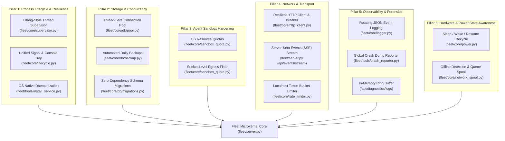

# 🛡️ Personal Agentic Fleet — Native Robustness Architecture & Operations Guide

This comprehensive guide details the **Native Robustness Architecture** of Personal Agentic Fleet. Designed for enterprise-grade, crash-resilient operation across **Windows (10/11)**, **macOS (Intel & Apple Silicon)**, and **Linux (Ubuntu, Debian, Fedora, Arch)**, the fleet achieves complete resilience without introducing heavy third-party dependencies or recurring LLM token costs.

---

## 🏛️ Foundational Robustness Invariants

Every robustness mechanism in the microkernel adheres to four foundational invariants:

1. **$0.00 Token Cost & Zero Latency**: All resilience checks, watchdogs, supervisors, circuit breakers, and sandboxes execute locally in pure Python. No external LLM queries are triggered for fault recovery.
2. **Zero Third-Party Runtime Dependencies (`dependencies = []`)**: Implemented exclusively using the Python Standard Library (`urllib`, `socket`, `sqlite3`, `threading`, `ctypes`, `resource`, `signal`, `logging`) and native OS APIs.
3. **Cross-Platform Operating System Parity**: Uniform behavior across Windows, macOS, and Linux with automatic adaptation to underlying OS mechanisms (e.g. Win32 Job Objects vs. POSIX `setrlimit`).
4. **Least-Privilege Containment**: Every agent executes within an isolated security boundary with explicit capability manifests (`manifest.json`), socket-level egress gating, and scoped database proxies.

---

## 🏗️ The 6 Pillars of Native Robustness



---

## 1. Pillar 1: Process Lifecycle & Crash Resilience

### 1.1 Erlang-Style Thread Supervision (`fleet/core/supervisor.py`)
Background worker threads (PC optimizer, scheduler, email syncer, health watchdog) are managed under an **OTP-inspired One-for-One Supervision Tree**:
- **Restart Strategies**:
  - `permanent`: Always restarted if terminated (e.g. background scheduler).
  - `transient`: Restarted only if terminated due to an unhandled exception; clean exits are respected.
  - `temporary`: Never restarted (one-shot batch jobs).
- **Restart Intensity & Backoff**: Implements exponential backoff ($2^n \times 1\text{s} + \text{jitter}$) capped at 60 seconds. If a worker crashes more than 5 times within a 60-second window, the supervisor escalates by generating an administrator alert and logging a forensic report rather than thrashing the CPU.
- **Heartbeat & Zombie Detection**: A supervisor loop checks worker liveness every 10 seconds, automatically cleaning up dead threads and spawning fresh replacements.

### 1.2 Unified Signal Trap & Clean Shutdown (`fleet/core/lifecycle.py`)
To prevent database corruption, orphan PID locks, and half-written files:
- **Windows NT**: Hooks the Win32 console handler via `ctypes.windll.kernel32.SetConsoleCtrlHandler` to trap `CTRL_C_EVENT`, `CTRL_BREAK_EVENT`, `CTRL_CLOSE_EVENT`, `CTRL_LOGOFF_EVENT`, and `CTRL_SHUTDOWN_EVENT`.
- **POSIX (Linux & macOS)**: Traps `SIGINT`, `SIGTERM`, and `SIGQUIT`.
- **Structured 3-Second Shutdown Sequence**:
  1. Sets global `SHUTDOWN_EVENT`.
  2. Executes registered shutdown callbacks in priority order (e.g., closing open HTTP connections, stopping background jobs).
  3. Flushes SQLite write-ahead logs via `PRAGMA wal_checkpoint(TRUNCATE)`.
  4. Deletes `fleet/data/fleet.pid`.
  5. Closes network socket listeners gracefully.

### 1.3 Native OS Daemonization (`fleet/tools/install_service.py`)
Enables zero-touch background persistence across workstation reboots:
- **Windows**: Provisions a Windows Scheduled Task (`Register-ScheduledTask`) with `RunLevel: HighestAvailable`, `LogonTrigger`, and automatic restart on crash.
- **macOS**: Generates and installs a LaunchAgent property list (`~/Library/LaunchAgents/com.fleet.agentic.plist`) loaded via `launchctl bootstrap gui/$(id -u)`.
- **Linux**: Installs a systemd user service (`~/.config/systemd/user/fleet.service`) enabled via `systemctl --user enable fleet.service`.

```powershell
# Install native background service for current OS
python -m fleet.tools.install_service install

# Verify status
python -m fleet.tools.install_service status

# Uninstall
python -m fleet.tools.install_service uninstall
```

---

## 2. Pillar 2: Storage & Concurrency Resilience

### 2.1 Thread-Safe Connection Pool & WAL Checkpointing (`fleet/core/db/pool.py`)
SQLite operations are protected against `sqlite3.OperationalError: database is locked`:
- **Busy Timeout**: Every connection automatically sets `PRAGMA busy_timeout = 10000` (10 seconds), enabling threads to wait for write locks to clear before raising an error.
- **Write-Ahead Logging (WAL)**: All databases operate in WAL mode (`PRAGMA journal_mode = WAL`), allowing concurrent readers to execute simultaneously without blocking writers.
- **Thread-Local Connection Cache**: Uses `threading.local()` to ensure each OS thread maintains its own isolated connection, preventing race conditions.
- **Automatic Checkpointing**: Periodic checkpoints prevent WAL files from growing beyond 4 MB.

### 2.2 Point-in-Time Automated Backups (`fleet/core/db/backup.py`)
- **Non-Blocking Online Backups**: Uses SQLite's native online backup API (`sqlite3.Connection.backup()`), creating consistent snapshots while queries and writes are active.
- **Cryptographic Verification**: Computes a SHA-256 checksum for every snapshot stored in `fleet/data/backups/checksums.sha256`.
- **FIFO Retention Policy**: Automatically retains the last 7 daily snapshots and 4 weekly snapshots, safely pruning older backups to conserve disk space.

### 2.3 Zero-Dependency Schema Migrations (`fleet/core/db/migrations.py`)
- **Version Tracking**: Utilizes SQLite's internal `PRAGMA user_version` to track the exact schema revision.
- **Atomic Execution**: All migrations run inside an immediate transaction (`BEGIN IMMEDIATE TRANSACTION`). If any statement fails, the database rolls back to the prior state.
- **Pre-Migration Safety Snapshot**: Before executing any forward migration, an automatic snapshot is taken to `fleet/data/backups/pre_migration_vN.db`.

---

## 3. Pillar 3: Agent Sandbox Hardening & Resource Containment

### 3.1 OS-Level Resource Quotas (`fleet/core/sandbox_quota.py`)
Prevents buggy custom agents or recursive tasks from exhausting host workstation memory:
- **Windows**: Allocates a dedicated Windows Job Object (`CreateJobObjectW`) configured with `JobObjectExtendedLimitInformation`. Enforces a strict 500 MB memory limit (`ProcessMemoryLimit`) and max process ceiling.
- **Linux & macOS**: Configures POSIX resource limits via standard library `resource.setrlimit(resource.RLIMIT_AS)`.
- **Test Mode Protection**: In test environments (`FLEET_TEST_MODE=1`), address-space limits are bypassed when unmocked, preventing interference with test runner execution.

### 3.2 Socket-Level Egress Capability Gating (`fleet/core/sandbox_quota.py`)
Enforces least-privilege network access at the Python socket layer:
- **Capability Enforcement**: When an agent thread executes, `enforce_agent_egress` inspects the agent's `manifest.json`.
- **Blocked Egress**: If `network:outbound` (or provider capability like `network:gmail_oauth`) is not explicitly declared, any `socket.connect()` to external IP addresses or hostnames raises `PermissionError` immediately.
- **Loopback Exemption**: Loopback communication (`127.0.0.1`, `localhost`, `::1`) and Unix domain sockets are always permitted for local IPC.

---

## 4. Pillar 4: Network & Transport Resilience

### 4.1 Resilient HTTP Client with 3-State Circuit Breaker (`fleet/core/http_client.py`)
Protects against upstream hyperscaler outages (Google Gemini, Azure OpenAI, AWS Bedrock, Anthropic Claude):
- **Circuit States**:
  - `CLOSED`: Normal operation; errors increment a failure counter.
  - `OPEN`: After 5 consecutive failures or timeouts, the breaker trips to `OPEN`. For the next 30 seconds, calls fail immediately with `ServiceUnavailableError` without making network requests.
  - `HALF_OPEN`: After the 30-second cooldown, 1 trial probe request is allowed through. If successful, the circuit resets to `CLOSED`; if failed, it trips back to `OPEN`.
- **Jittered Exponential Backoff**: Retries transient 429/503 errors using truncated jittered backoff:
  $$t = \text{random}(0, \min(T_{\max}, T_{\text{base}} \times 2^{\text{attempt}}))$$

### 4.2 Localhost Token-Bucket Rate Limiter (`fleet/core/rate_limiter.py`)
- **DoS Shield**: Protects `http://127.0.0.1:7890` against rogue browser loops or misbehaving local scripts.
- **Bucket Capacity**: 60 requests/second sustained, with a burst capacity of 100 requests.
- **RFC Standard Headers**: Returns HTTP `429 Too Many Requests` with `Retry-After: <seconds>` headers when exhausted.

### 4.3 Server-Sent Events (SSE) Live Push (`fleet/server.py` `/api/events/stream`)
- **Zero Polling Overhead**: Replaces 8-second client polling with an HTTP `text/event-stream` persistent connection.
- **Instant Event Dispatch**: Background tasks emit events on `DeterministicEventBus`, which immediately streams JSON frames to the dashboard frontend with 0ms latency.
- **Heartbeat & Keepalive**: Periodically sends `: ping\n\n` comments to prevent router/proxy timeout disconnections.

---

## 5. Pillar 5: Observability, Diagnostics & Crash Forensics

### 5.1 Structured Rotating JSON Logging & Error Isolation (`fleet/core/logger.py`)
- **Full Diagnostic Fidelity**: Emits structured JSON events containing `timestamp` (ISO-8601 with milliseconds), `level`, `logger`, `agent`, `action`, `message`, `file`, `filename`, `line`, `func`, `module`, `process`, `thread_name`, `thread_id`, and `metadata`.
- **Exception & Warning Forensics**: Records formatted tracebacks (`exception`), exception class (`exception_type`), error message (`exception_message`), and parsed stack frames (`stack_frames`). Warnings without exceptions automatically record the origin caller site (`caller`).
- **Dedicated Failure & Error Isolation Log (`fleet/data/fleet_error.log`)**: Separates `WARNING`, `ERROR`, and `CRITICAL` records into a dedicated rotating log file (10 MB rotation, 5 backups), ensuring failures are immediately queryable without being lost in high-volume informational telemetry.
- **Primary Rotating Log (`fleet/data/fleet_app.log`)**: Captures all diagnostic telemetry at the configured level (`FLEET_LOG_LEVEL`, defaulting to `DEBUG` for deep observability).
- **Python Runtime Warnings Interception**: Automatically hooks `warnings.warn` via `logging.captureWarnings(True)` and routes all runtime warnings through the `py.warnings` logger into the fleet logging engine.
- **In-Memory Diagnostic Ring Buffer**: Retains the 2,000 most recent log entries in memory, queryable in real time via `GET /api/diagnostics/logs` (with support for `min_level`, `level`, `agent`, and full-text `search`).
- **Disk Error Log Forensics**: `GET /api/diagnostics/errors` inspects and returns recent failures from both in-memory and on-disk error isolation logs.

### 5.2 Global Crash Dump Reporter (`fleet/tools/crash_reporter.py`)
- **Uncaught Exception Trapping**: Hooks `sys.excepthook` and `threading.excepthook`.
- **Sanitized Forensics**: On unhandled crash, captures system architecture, thread dumps, memory footprint, and exception tracebacks while automatically scrubbing passwords, tokens, and PII.
- **Persistent Crash Reports**: Writes diagnostic summaries to `fleet/data/crash_reports/crash_YYYYMMDD_HHMMSS.json`.

### 5.3 Proactive Log Analysis & Autonomous Self-Healing Engine (`fleet/core/auto_healer.py`)
- **Periodic Background Scanning**: Runs periodically every 15 minutes in `FleetDaemon` (and hourly via the Unified Agent Scheduler on `OptimizerAgent`), inspecting `fleet_app.log`, `fleet_error.log`, in-memory ring buffers, crash report dumps, and database task states.
- **Deterministic Pattern Recognition Rules**:
  1. *Database Contention & Lock Detection*: Detects `database is locked`, `SQLITE_BUSY`, and large WAL files (> 4 MB). Automatically triggers `PRAGMA wal_checkpoint(TRUNCATE)` and `PRAGMA optimize`.
  2. *Log & Disk Bloat Detection*: Detects cumulative log files exceeding 15 MB and safely truncates error logs while strictly preserving recent history.
  3. *Crash Dump Accumulation*: Detects crash reports older than 7 days or exceeding retention limits (> 10 files) and prunes stale crash dumps.
  4. *Rate Limiting / 429 Throttle Spikes*: Identifies HTTP 429 errors and automatically configures adaptive rate-limit backoff multipliers (`adaptive_rate_limit_backoff_sec`).
  5. *Task Failure Loop Quarantine*: Detects repeated task execution failures in the database, automatically quarantining problematic jobs and applying backoff delays to prevent infinite loops.
  6. *Memory Pressure & Resource Sweeps*: Detects process working set pressure (> 450 MB) and triggers Python GC generation 2 and native Windows working set sweeps (`EmptyWorkingSet`).
  7. *Runtime Warnings Interception*: Monitors Python `py.warnings` stream for resource warnings and flushes unreferenced handles.
- **Auditable Improvements Ledger**: Persists all self-healing actions, timestamps, and before/after metrics to the SQLite `auto_improvements` table (via Migration v4) and the persistent JSON file `fleet/data/auto_improvements.json`.
- **System Health Index**: Computes an objective 0–100 health score with severity-weighted deductions (`CRITICAL`: 35, `HIGH`: 20, `MEDIUM`: 10, `LOW`: 3).
- **Control Center & REST APIs**: Provides `GET /api/diagnostics/log-analysis`, `POST /api/diagnostics/log-analysis/run`, `GET /api/diagnostics/auto-improvements`, and CLI tool `python -m fleet.tools.auto_healer`.

---

## 6. Pillar 6: Hardware & Power State Awareness

### 6.1 Sleep / Wake / Resume Lifecycle Handler (`fleet/core/power.py`)
- **Sleep Detection**: Measures clock drift and hooks OS power management notifications (`PBT_APMRESUME` on Windows, I/O Kit on macOS).
- **Wake Cooldown**: Temporarily pauses schedule triggers for 5 seconds upon waking to permit network hardware, WiFi, and VPN adapters to re-associate.
- **Stampede Prevention**: Coalesces overdue recurring jobs into a single batched run, preventing simultaneous trigger spikes.

### 6.2 Offline Network Detection & Task Spooling (`fleet/core/network_spool.py`)
- **Connectivity Probing**: Non-blocking DNS reachability check detects internet outages within 50ms.
- **Offline Fallback Routing**: If offline, external AI requests automatically route to local zero-token alternatives (Tier 0 Intent Router, BM25 Knowledge RAG, or local Ollama).
- **Event Spooling**: Queues outbound sync payloads into SQLite; automatically flushes the queue once network connectivity is restored.

---

## 📋 Comprehensive Operational Runbook

### Preflight Quality & Robustness Verification
Run the unified preflight quality gate before deploying or committing changes:
```powershell
python -m fleet.tools.preflight_gate
```

### Running Fleet Doctor (Environment & OS Invariants)
```powershell
python -m fleet.tools.fleet_doctor
```

### Running the 12-Layer Security & Privacy Scanner
```powershell
python -m fleet.tools.security_scanner
```

### Running the Full Test Suite with Coverage
```powershell
# Direct pytest execution
python -m pytest tests/ -v

# Fleet test runner with database reporting and coverage
python -m fleet.tools.test_runner
```

---

## 🔍 Diagnostic REST APIs

| Endpoint | Method | Description |
| :--- | :---: | :--- |
| `/api/diagnostics/logs` | `GET` | Fetches the in-memory ring buffer of recent structured logs (supports `?limit=100&min_level=WARNING&search=term`) |
| `/api/diagnostics/errors` | `GET` | Dedicated error forensics endpoint retrieving recent failures from ring buffer and `fleet_error.log` |
| `/api/diagnostics/log-analysis` | `GET` | Returns latest proactive log scan triage, issue findings, and system health index |
| `/api/diagnostics/log-analysis/run` | `POST` | Triggers immediate on-demand proactive log scan and autonomous self-healing improvements |
| `/api/diagnostics/auto-improvements` | `GET` | Historical ledger of automated self-healing improvements executed by the system |
| `/api/events/stream` | `GET` | Server-Sent Events push stream for real-time fleet events |
| `/api/optimizer/diagnostics` | `GET` | Returns physical RAM usage, CPU load, and top process metrics |
| `/api/settings/health` | `GET` | Microkernel uptime, database size, and active worker thread status |
| `/api/system/service` | `GET` | Status of background OS service daemon |

---

## 🛡️ Troubleshooting & Recovery Matrix

| Symptom | Root Cause | Resolution Action |
| :--- | :--- | :--- |
| `sqlite3.OperationalError: database is locked` | High write concurrency across threads | `busy_timeout` handles locks automatically. For manual recovery: verify WAL mode via `PRAGMA journal_mode=WAL` or run `checkpoint_sqlite_wal()`. |
| `PermissionError: Agent missing 'network:outbound'` | Custom agent attempting external HTTP request | Add `"network:outbound"` to agent's `manifest.json` under `"permissions"`. |
| `CircuitBreakerOpenError` | Upstream cloud hyperscaler returning repeated 503/429 errors | Breaker is protecting local worker pool. Wait 30 seconds for probe trial, or switch active model to local Ollama / Gemini fallback. |
| Stale PID file prevents daemon startup | Previous process terminated abruptly without running cleanup | Delete `fleet/data/fleet.pid` manually; the microkernel will safely re-initialize. |
| Test suite stalls on Linux CI | Outbound network socket or display driver unmocked | Verify `SDL_VIDEODRIVER: dummy` is set and external socket calls use mocked addresses. |

