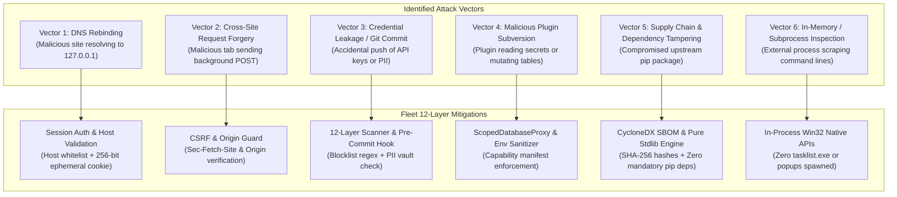

# 🛡️ Personal Agentic Fleet — Security Architecture, Threat Model & 12-Layer Defense Specification

This document details the complete **12-Layer Defense-in-Depth Security Architecture** of **Personal Agentic Fleet**, the threat model, cryptographic primitives, credential storage, and the automated verification pipelines running locally and in CI.

---

## 1. Security Philosophy & Invariants

Personal Agentic Fleet is designed around four foundational security invariants:
1. **Zero Secret Exposure**: Plaintext API keys, passwords, private keys, or personal health records must never be committed to Git, emitted in logs, or sent over unencrypted channels.
2. **Localhost Isolation by Default**: Fleet binds exclusively to `127.0.0.1` and actively rejects DNS-rebinding attacks, external origins, and unauthenticated cross-site requests.
3. **Least-Privilege Capability Sandboxing**: Plugins and agents operate inside restricted capability boundaries and cannot access unauthorized tables or environment secrets.
4. **Deterministic Cost & Zero-Token Governance**: Core operations must never trigger unmetered external LLM invocations or token consumption ($0.00 default).

---

## 2. Threat Model & Attack Surface Analysis

| Attack Vector | Threat Description | Fleet Mitigation Strategy |
| :--- | :--- | :--- |
| **DNS Rebinding** | An attacker configures a domain (e.g., `attacker.com`) with a low TTL that rebinds to `127.0.0.1`, attempting to read or manipulate local Fleet endpoints. | [`validate_request_security()`](../fleet/core/session_auth.py) strictly validates the HTTP `Host` header. Requests with host headers other than `127.0.0.1` or `localhost` are rejected with `403 Forbidden`. |
| **Cross-Site Request Forgery (CSRF)** | An external browser tab makes background HTTP `POST` requests to trigger task additions, deletions, or PC optimizations. | Ephemeral 256-bit session cookies with `SameSite=Strict`, `Sec-Fetch-Site: same-origin` checks, and strict `Origin` header validation block cross-site execution. |
| **Secret / Key Leakage** | Committing cloud API keys (`GEMINI_API_KEY`, `AZURE_OPENAI_API_KEY`, `AWS_SECRET_ACCESS_KEY`, `ANTHROPIC_API_KEY`) to public GitHub repositories. | Layer 1 & 2 of the Security Scanner audit all git-tracked files. Local Git `pre-commit` and `pre-push` hooks block commits containing secrets. |
| **Untrusted Plugin Execution** | A rogue agent script accesses sensitive tables (e.g., health logs, passwords) or leaks environment tokens. | [`ScopedDatabaseProxy`](../fleet/core/plugin_sandbox.py) enforces permission manifests (`manifest.json`), while `get_sanitized_plugin_env()` strips all secret environment variables before executing subprocesses. |
| **Supply Chain Poisoning** | Upstream pip packages contain malicious backdoors or dependency confusion packages. | The core Fleet microkernel has **zero mandatory pip dependencies** (built 100% on standard library). All 58+ modules are cryptographically hashed in a CycloneDX v1.5 SBOM (`fleet/data/sbom.cdx.json`). |
| **Process / Telemetry Snooping** | Spawning external CLI tools (`tasklist.exe`, `ipconfig.exe`) exposes command-line arguments to other local processes. | Uses in-process Win32 native APIs (`Kernel32` / `PSAPI`) with zero child processes in normal operation, and `CREATE_NO_WINDOW` flags for silent execution. |

---

## 3. The 12-Layer Defense-in-Depth Specification

The automated security scanner ([`fleet/tools/security_scanner.py`](../fleet/tools/security_scanner.py)) enforces 12 distinct validation layers:

| Layer | Check Name | What It Audits & Enforces |
| :---: | :--- | :--- |
| **1** | `secret_detection` | Regex pattern matching for Google API keys (`AIza...`), OpenAI keys (`sk-...`), GitHub personal tokens (`ghp_...`, `github_pat_...`), AWS credentials (`AKIA...`), Slack tokens, and PEM/OpenSSH private keys. |
| **2** | `pii_leak_scan` | Scans git-tracked files against the user's private, git-ignored `fleet/data/user/pii_blocklist.json` to prevent personal email addresses, phone numbers, or tokens from entering version control. |
| **3** | `git_hygiene` | Validates `.gitignore` rules and verifies that no `.db`, `.sqlite3`, `.env`, `*client_secret*.json`, or `master.dpapi` files are tracked in Git. |
| **4** | `sast_audit` | Static application security testing (SAST) auditing Python source code for insecure `subprocess(..., shell=True)`, wildcard CORS (`Access-Control-Allow-Origin: *`), and dangerous `eval()`/`exec()` calls. |
| **5** | `http_hardening` | Verifies presence of security headers (`X-Content-Type-Options: nosniff`, Content Security Policy, Permissions Policy) and enforces the 10 MB request payload ceiling (`MAX_PAYLOAD_BYTES`) to prevent denial-of-service memory exhaustion. |
| **6** | `user_vault_isolation` | Verifies `fleet/data/user/` exists, is git-ignored, and is hardened with OS-level access control lists (`icacls` on Windows / `chmod 0700` on POSIX). |
| **7** | `at_rest_encryption` | Validates that sensitive SQLite settings are encrypted using authenticated DPAPI encryption (`ENC:v1:...`) with HMAC-SHA256 integrity verification. |
| **8** | `session_auth_and_dns_rebinding` | Audits session cookie generation, Host header whitelisting (`127.0.0.1`, `localhost`), and cross-origin fetch protections. |
| **9** | `plugin_sandbox_audit` | Verifies that all agents in `fleet/agents/` have valid `manifest.json` capability declarations and that only permitted permissions are requested. |
| **10** | `supply_chain_sbom` | Verifies that `.github/dependabot.yml` is active and that `fleet/tools/sbom_generator.py` generates valid CycloneDX v1.5 SBOM manifests. |
| **11** | `zero_token_governance` | Verifies that background daemons and deterministic modules never invoke external paid LLM APIs, maintaining the `$0.00` Tier 0 baseline. |
| **12** | `runtime_and_acl_hardening` | Verifies that Python `>=3.10` runtime version pinning is active in `pyproject.toml`, `.python-version`, and runtime bootstrap scripts, with strict NTFS user ACL enforcement. |

---

## 4. Cryptographic Primitives & Credential Storage

### 4.1 Windows Data Protection API (DPAPI) + HMAC-SHA256 (`fleet/core/crypto_vault.py`)
- **Master Key Protection**: When running on Windows, the master key is bound to the logged-in Windows user's hardware credentials via `CryptProtectData` (`crypt32.dll`) using `CRYPTPROTECT_UI_FORBIDDEN`.
- **Authenticated Encryption Format**:
  $$\text{Payload} = \text{"ENC:v1:"} \parallel \text{Base64}(\text{Nonce}_{16} \parallel \text{Ciphertext} \parallel \text{HMAC-SHA256}_{32})$$
- **Tamper Detection**: If any byte of the ciphertext or nonce is modified, HMAC verification fails before decryption, preventing padding or bit-flipping attacks.

### 4.2 AWS SigV4 HMAC-SHA256 IAM Signing (`fleet/core/hyperscalers.py`)
- Standard AWS Signature Version 4 HMAC-SHA256 signing is implemented in pure Python stdlib:
  $$\text{kSigning} = \text{HMAC}(\text{HMAC}(\text{HMAC}(\text{HMAC}(\text{"AWS4" + SecretKey}, \text{DateStamp}), \text{Region}), \text{"bedrock"}), \text{"aws4\_request"})$$
- Generates canonical requests, signed headers, and authorization headers with zero third-party dependencies.

---

## 5. Continuous Security Pipeline & Cadence

Security is verified continuously across three automated tiers:

1. **Tier 1: Background Daemon (Every 60 Minutes)**:
   - `FleetDaemon` executes `run_security_scan()` every hour.
   - If a finding is detected, a native Windows Desktop Toast notification is triggered immediately.
2. **Tier 2: Local Git Hooks (`pre-commit` & `pre-push`)**:
   - Installed via `python -m fleet.tools.install_git_hooks`.
   - Blocks any git commit or push that introduces secrets, untracked database files, or failing security checks.
3. **Tier 3: GitHub Actions CI Matrix (`security.yml`)**:
   - Runs on every push and PR across Python 3.10, 3.11, and 3.12 on `ubuntu-latest`.
   - Runs on a daily cron schedule at `00:00 UTC` to audit repository integrity.
