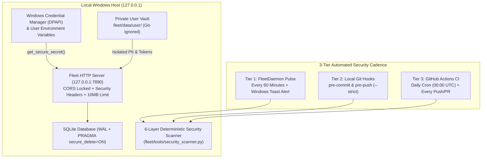

# Personal Agentic Fleet — Security Architecture, Enhancements & Automated Scanning Guide

This document details the multi-layered security architecture of **Personal Agentic Fleet**, the code-level security enhancements applied across the microkernel and plugins, the **3-Tier Automated Security Scanning Pipeline**, and the forward-looking security roadmap for open-source contributors.

---

## 1. Defense-in-Depth Architecture Overview



---

## 2. Implemented Codebase Security Enhancements (Phase 1 — Active)

Every enhancement below is active in the codebase and continuously verified by the automated scanner (`Score: 100/100 [PASS]`):

### 2.1 Localhost CORS Origin Lockdown (`fleet/server.py`)
- **Vulnerability Mitigated**: Cross-Site Request Forgery (CSRF) / Drive-by Localhost Exploitation from malicious websites opened in the user's browser when `Access-Control-Allow-Origin: *` was used.
- **Enhancement**: Replaced wildcard `*` with an explicit allowlist (`ALLOWED_ORIGINS = {"http://127.0.0.1:7890", "http://localhost:7890"}`). Only requests originating from the local dashboard origin receive CORS permission.

### 2.2 HTTP Security Headers (`fleet/server.py` & `fleet/core/registry.py`)
- **Vulnerability Mitigated**: MIME-type sniffing attacks, Clickjacking (`<iframe>` embedding), and Referrer leakage.
- **Enhancement**: Every JSON, HTML, CSS, and JS response automatically attaches:
  - `X-Content-Type-Options: nosniff`
  - `X-Frame-Options: DENY`
  - `Referrer-Policy: no-referrer`

### 2.3 Request Payload Size Ceiling / DoS Protection (`fleet/server.py`)
- **Vulnerability Mitigated**: Memory exhaustion Denial-of-Service (DoS) via oversized `POST` bodies.
- **Enhancement**: Enforced `MAX_PAYLOAD_BYTES = 10 * 1024 * 1024` (10 MB) in `FleetDashboardHandler._read_json()`. Payloads exceeding 10 MB or with invalid `Content-Length` are rejected before allocation.

### 2.4 PowerShell Command & Subexpression Injection Hardening (`fleet/tools/system_tools.py`)
- **Vulnerability Mitigated**: PowerShell subexpression execution (`$(...)` or backtick escaping) when constructing native Windows Toast notifications from external titles/messages (e.g., email subjects).
- **Enhancement**: `send_windows_notification()` now escapes backticks (`` ` `` $\rightarrow$ ```` `` ````), dollar signs (`$` $\rightarrow$ `` `$ ``), and double quotes (`"` $\rightarrow$ `` `" ``) prior to invoking `powershell -NoProfile`.

### 2.5 Dynamic Agent Asset Path-Traversal Guard (`fleet/core/registry.py`)
- **Vulnerability Mitigated**: Directory traversal (`../../`) via `/api/fleet/agents/<agent_id>/style.css` or `script.js`.
- **Enhancement**: Enforced strict regex validation (`^[a-zA-Z0-9_-]+$`) on `agent_id` and verified that `css_file.resolve()` and `js_file.resolve()` reside strictly inside `self.agents_dir.resolve()`.

### 2.6 SQLite Forensics Hygiene (`fleet/core/db/base.py`)
- **Vulnerability Mitigated**: Residual sensitive data (deleted tasks, health notes, or cached email snippets) remaining in unallocated SQLite freelist pages on disk.
- **Enhancement**: Enabled `PRAGMA secure_delete = ON` on database connections so SQLite overwrites deleted records with zeroes immediately upon deletion.

### 2.7 Scoped Personal Data Vault & Zero-Hardcoded PII (`fleet/config.py`)
- **Vulnerability Mitigated**: Accidental git commits of personal databases, OAuth tokens, or personal names.
- **Enhancement**:
  - Consolidated all user-specific files into `fleet/data/user/` (`fleet.db`, `client_secret.json`, `token.json`, `pii_blocklist.json`).
  - `get_secure_secret(key_name)` retrieves secrets from **Windows Credential Manager (DPAPI)** via `keyring`, falling back to Windows User Environment Variables.

---

## 3. The 6-Layer Automated Security & Privacy Scanner

Located at [`fleet/tools/security_scanner.py`](../fleet/tools/security_scanner.py), the scanner uses 100% deterministic Python standard library checks (`$0.00` LLM token cost) across 6 layers:

| Layer | Check ID | What It Audits | Severity on Failure |
| :--- | :--- | :--- | :--- |
| **1** | `secret_detection` | Regex entropy & pattern scan across all files for Google API keys (`AIza...`), OpenAI keys (`sk-...`), GitHub tokens (`ghp_...`, `github_pat_...`), AWS keys (`AKIA...`), Slack tokens (`xox...`), OAuth `client_secret`, and PEM private keys. | `CRITICAL` |
| **2** | `pii_leak_scan` | Scans all git-tracked files against your private, git-ignored `fleet/data/user/pii_blocklist.json` (auto-populated with your Windows username + custom terms) so personal identifiers never enter Git without hardcoding names in the repo. | `CRITICAL` |
| **3** | `git_hygiene` | Verifies `.gitignore` contains mandatory rules (`*.db`, `*client_secret*.json`, `.env`, `fleet.yaml`, `fleet/data/user/`) and inspects `git ls-files` to ensure no forbidden file extensions are tracked. | `CRITICAL` / `HIGH` |
| **4** | `sast_audit` | Static Application Security Testing across `.py` files for `subprocess(..., shell=True)`, wildcard CORS (`Access-Control-Allow-Origin: *`), and unsafe `eval()`/`exec()`. | `HIGH` / `MEDIUM` |
| **5** | `http_hardening` | Verifies `fleet/server.py` enforces `X-Content-Type-Options: nosniff` and `MAX_PAYLOAD_BYTES` payload limits. | `MEDIUM` / `LOW` |
| **6** | `user_vault_isolation` | Verifies `fleet/data/user/` exists and is actively excluded from Git tracking. | `HIGH` |

---

## 4. Automatic Security Scan Schedule (3-Tier Automation)

Security scans run automatically without manual intervention at three frequencies:

### Tier 1: Continuous Background Daemon (`Every 60 Minutes`)
- **Where**: [`fleet/daemon.py`](../fleet/daemon.py) (`FleetDaemon.run_scheduled_security_scan`)
- **Frequency**: Every **60 minutes** by default (configurable in `fleet.yaml` via `security.scan_interval_minutes`).
- **Action**: Writes the latest report to `fleet/data/latest_security_scan.json`, logs the score in the Fleet Activity Stream, and immediately dispatches a **Windows Toast Notification** (`🛡️ Security Alert`) if any finding is detected.

### Tier 2: Local Git Pre-Commit & Pre-Push Hooks (`Every Commit & Push`)
- **Where**: `.git/hooks/pre-commit` & `.git/hooks/pre-push` (installed via [`fleet/tools/install_git_hooks.py`](../fleet/tools/install_git_hooks.py))
- **Frequency**: Automatically triggered on every `git commit` and `git push`.
- **Action**: Runs `python -m fleet.tools.security_scanner --strict`. If any secret, PII term, or security regression is detected, the commit or push is **aborted immediately** with exit code `1`.

### Tier 3: Cloud GitHub Actions Cron & PR Gate (`Daily at 00:00 UTC + Every PR`)
- **Where**: [`.github/workflows/security.yml`](../.github/workflows/security.yml)
- **Frequency**:
  - Automatically every day at **00:00 UTC** (`cron: '0 0 * * *'`).
  - On every `push` and `pull_request` to `main`.
- **Action**: Audits the repository in a clean Ubuntu sandbox so external contributors cannot merge secrets or insecure code.

### On-Demand CLI & API Triggers
- **CLI**: `python -m fleet.tools.security_scanner --strict`
- **HTTP API**: `GET /api/security/scan` or `POST /api/security/scan`

---

## 5. Phase 2 Security Roadmap (Future Open-Source Enhancements)

Below is the planned roadmap for contributors looking to harden **Personal Agentic Fleet** further for enterprise and multi-user environments:

### 5.1 At-Rest Database Encryption with SQLCipher (AES-256)
- **Goal**: Encrypt `fleet/data/user/fleet.db` at rest using AES-256-CBC via `sqlcipher3` / `pysqlcipher3`.
- **Key Management**: Generate a 256-bit random master key on first launch and store it inside **Windows Credential Manager (DPAPI)** via `keyring.set_password("personal-agentic-fleet", "DB_MASTER_KEY", key)`.
- **Benefit**: Even if a physical disk or backup file is copied, the SQLite database cannot be read without the logged-in Windows user's DPAPI master key.

### 5.2 Localhost Session Token & WebAuthn Passkey Lock
- **Goal**: Protect `http://127.0.0.1:7890` on shared multi-user machines or when other local processes attempt HTTP calls.
- **Implementation**:
  - Generate an ephemeral `HttpOnly; SameSite=Strict` session cookie token on startup, or
  - Add optional Windows Hello / WebAuthn passkey lock for sensitive actions (such as viewing full email bodies or modifying agent settings).

### 5.3 Content-Security-Policy (CSP) Nonce Hardening
- **Goal**: Eliminate inline script execution risks (XSS) when rendering third-party agent UI plugins or email snippets.
- **Implementation**: Serve a strict `Content-Security-Policy: default-src 'self'; img-src 'self' data: https:; media-src 'self'; object-src 'none'; frame-ancestors 'none'` header and migrate remaining inline `onclick` handlers in agent HTML templates to delegated event listeners in `script.js`.

### 5.4 Plugin Capability Sandboxing & Permission Manifests
- **Goal**: As thousands of community contributors publish third-party agents under `fleet/agents/<agent_id>/`, restrict what resources each plugin can access.
- **Implementation**:
  - Require each agent's `manifest.json` to declare explicit capabilities (`permissions: ["db:read", "network:none", "filesystem:readonly"]`).
  - Run untrusted community plugins in isolated worker subprocesses with restricted environment variables (stripping `os.environ` secrets not explicitly granted to that plugin).

### 5.5 Supply-Chain Security, SBOM & Signed Releases
- **Goal**: Guarantee cryptographic provenance for open-source downloads.
- **Implementation**:
  - Enable **SSH Commit Signing** (`git config commit.gpgsign true` with the user's Ed25519 SSH key) so all commits on GitHub show a green `Verified` badge.
  - Add CycloneDX Software Bill of Materials (SBOM) generation and GitHub Dependabot alerts in `.github/dependabot.yml`.
