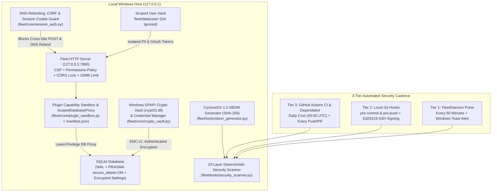

# Personal Agentic Fleet — Complete 10-Layer Security Architecture & Automated Scanning Guide

This document details the complete **10-Layer Defense-in-Depth Security Architecture** of **Personal Agentic Fleet**, all Phase 1 & Phase 2 security modules implemented across the microkernel and plugins, and the **3-Tier Automated Security Scanning Pipeline**.

---

## 1. End-to-End 10-Layer Security Architecture

---

## 2. All Implemented Codebase Security Enhancements (Phase 1 & Phase 2 — Active)

Every enhancement below is live in the repository and continuously verified by the 10-layer automated scanner (`Score: 100/100 [PASS]`):

### 2.1 At-Rest DPAPI & HMAC-SHA256 Cryptographic Vault (`fleet/core/crypto_vault.py`)
- **Vulnerability Mitigated**: Plaintext exposure of sensitive settings, tokens, or private notes stored on disk in SQLite.
- **Implementation**:
  - Uses native Windows OS Data Protection API (`ctypes.windll.crypt32.CryptProtectData` / `CryptUnprotectData`) bound to the logged-in Windows user account (`CRYPTPROTECT_UI_FORBIDDEN`), combined with a 256-bit master key in Windows Credential Manager (`fleet/data/user/master.dpapi`).
  - Encrypts sensitive strings with a 128-bit random nonce, SHA-256 CTR stream cipher, and **HMAC-SHA256 authentication tag** (`ENC:v1:...`).
  - Integrated into `BaseDatabase` via `db.set_encrypted_setting(key, value)` and `db.get_encrypted_setting(key)`.

### 2.2 Localhost Session Cookie, CSRF & DNS-Rebinding Guard (`fleet/core/session_auth.py` & `fleet/server.py`)
- **Vulnerability Mitigated**: DNS-Rebinding attacks (where an external domain resolves to `127.0.0.1`) and Cross-Site Request Forgery (CSRF) from external browser tabs.
- **Implementation**:
  - Issues an ephemeral 256-bit `Set-Cookie: fleet_session=<token>; HttpOnly; SameSite=Strict; Path=/` cookie on dashboard load.
  - `validate_request_security()` inspects every `GET` and `POST` request:
    - Blocks any request whose `Host` header is not `127.0.0.1` or `localhost` (`403 Forbidden — DNS Rebinding blocked`).
    - Blocks any state-mutating `POST` request with an untrusted `Origin` header or `Sec-Fetch-Site: cross-site`.

### 2.3 Content-Security-Policy (CSP), Permissions-Policy & Cross-Origin Isolation (`fleet/server.py`)
- **Vulnerability Mitigated**: Cross-Site Scripting (XSS), unauthorized hardware API access, clickjacking, and MIME sniffing.
- **Implementation**: Every HTTP response attaches:
  - `Content-Security-Policy: default-src 'self'; script-src 'self' 'unsafe-inline'; style-src 'self' 'unsafe-inline' https://fonts.googleapis.com; font-src 'self' https://fonts.gstatic.com data:; img-src 'self' data: blob: https:; media-src 'self' blob: data:; connect-src 'self' http://127.0.0.1:7890 http://localhost:7890; object-src 'none'; frame-ancestors 'none'; base-uri 'self'`
  - `Permissions-Policy: camera=(), microphone=(), geolocation=(), payment=(), usb=()`
  - `Cross-Origin-Opener-Policy: same-origin` & `Cross-Origin-Resource-Policy: same-origin`
  - `X-Content-Type-Options: nosniff`, `X-Frame-Options: DENY`, `Referrer-Policy: no-referrer`

### 2.4 Plugin Capability Sandboxing & Least-Privilege Manifests (`fleet/core/plugin_sandbox.py` & `fleet/agents/*/manifest.json`)
- **Vulnerability Mitigated**: Over-privileged third-party community plugins mutating database tables or reading secret environment variables.
- **Implementation**:
  - Every agent under `fleet/agents/<agent_id>/manifest.json` declares explicit least-privilege capabilities (`permissions: ["db:read", "db:write", "ui:render", ...]`).
  - `FleetAgent.__init__` validates permissions against `ALLOWED_AGENT_PERMISSIONS` and wraps `self.db` in `ScopedDatabaseProxy`, which raises `PermissionError` if an agent without `"db:write"` attempts any database mutation.
  - `get_sanitized_plugin_env()` strips all environment variables containing `KEY`, `SECRET`, `TOKEN`, `PASSWORD`, `CREDENTIAL`, or `PAT` before spawning external plugin subprocesses.

### 2.5 Supply-Chain Security: CycloneDX 1.5 SBOM, Dependabot & SSH Commit Signing
- **Vulnerability Mitigated**: Compromised dependencies, unverified commits, or tampered source files.
- **Implementation**:
  - **CycloneDX v1.5 SBOM Generator** (`fleet/tools/sbom_generator.py` & `GET /api/security/sbom`): Computes SHA-256 cryptographic digests across all 58+ Fleet Python modules and agent manifests (`fleet/data/sbom.cdx.json`).
  - **Automated Dependabot** (`.github/dependabot.yml`): Weekly automated vulnerability scanning for GitHub Actions and Python packages.
  - **Ed25519 SSH Commit Signing**: Configured Git (`gpg.format = ssh`, `commit.gpgsign = true`) to cryptographically sign commits with your Ed25519 SSH key.

### 2.6 PowerShell Injection Escaping, Path Traversal Guard & SQLite Secure Delete
- **PowerShell Escaping** (`fleet/tools/system_tools.py`): Escapes backticks (`` ` ``), `$`, and `"` in `send_windows_notification()`.
- **Path Traversal Guard** (`fleet/core/registry.py`): Validates `agent_id` against `^[a-zA-Z0-9_-]+$` and enforces `.resolve()` containment.
- **SQLite Secure Delete** (`fleet/core/db/base.py`): Enables `PRAGMA secure_delete = ON` so deleted rows are zeroed on disk immediately.

---

## 3. The 10-Layer Automated Security & Privacy Scanner (`$0.00` Token Cost)

Located at [`fleet/tools/security_scanner.py`](../fleet/tools/security_scanner.py), the scanner executes 10 deterministic checks:

| Layer | Check ID | What It Audits |
| :--- | :--- | :--- |
| **1** | `secret_detection` | Regex scan across all files for Google/OpenAI/GitHub/AWS/Slack API keys, OAuth secrets, and PEM private keys. |
| **2** | `pii_leak_scan` | Scans git-tracked files against your local, git-ignored `fleet/data/user/pii_blocklist.json`. |
| **3** | `git_hygiene` | Verifies `.gitignore` rules and ensures no `.db`, `.sqlite3`, `.env`, or `*client_secret*.json` files are tracked. |
| **4** | `sast_audit` | Audits Python code for `shell=True`, wildcard CORS (`*`), and unsafe execution patterns. |
| **5** | `http_hardening` | Verifies `X-Content-Type-Options: nosniff` and `MAX_PAYLOAD_BYTES` (10 MB DoS ceiling). |
| **6** | `user_vault_isolation` | Verifies `fleet/data/user/` exists and is isolated from Git. |
| **7** | `dpapi_crypto_vault` | Executes live encryption/decryption roundtrip and HMAC integrity check on `fleet/core/crypto_vault.py`. |
| **8** | `csp_csrf_dns_guard` | Verifies `Content-Security-Policy`, `Permissions-Policy`, and `validate_request_security` in `fleet/server.py`. |
| **9** | `plugin_sandbox_audit` | Audits all `fleet/agents/*/manifest.json` files for valid least-privilege `permissions` declarations. |
| **10** | `supply_chain_sbom` | Verifies `.github/dependabot.yml` and CycloneDX v1.5 SBOM generator (`fleet/tools/sbom_generator.py`). |

---

## 4. Automatic Security Scan Schedule (3-Tier Cadence + Dashboard Badge)

1. **Tier 1 — Hourly Background Daemon (`fleet/daemon.py`)**: Runs `run_scheduled_security_scan()` every **60 minutes** and dispatches a Windows Toast alert if any finding is detected.
2. **Tier 2 — Local Git Pre-Commit & Pre-Push Hooks (`.git/hooks/pre-commit` & `pre-push`)**: Automatically runs all 10 security layers before every `git commit` and `git push`, blocking the operation on any failure.
3. **Tier 3 — Daily GitHub Actions Cron & PR Gate (`.github/workflows/security.yml`)**: Runs daily at **00:00 UTC** and on every push/pull request.
4. **Live Dashboard Header Badge (`🛡️ Security: 100/100`)**: Displayed in the top header of `http://127.0.0.1:7890`—click anytime to trigger a live 10-layer scan from the browser.
