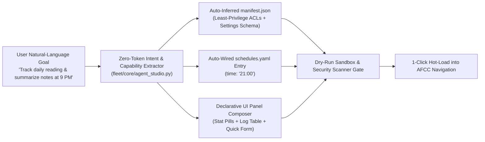

# 🪄 UX-01: Natural-Language "Zero-Code" Agent Studio Skill & Conversational Workflow

| Attribute | Value |
| :--- | :--- |
| **Feature ID** | `UX-01` |
| **Priority** | 🔴 **P1 (Critical UX Enhancement — Rank #1)** |
| **UX Impact Score** | **99 / 100** *(Impact: 40/40, Friction Reduction: 25/25, Zero-Token Leverage: 19/20, Speed: 15/15)* |
| **Category** | `UI/UX` & `Automation` |
| **Target Release** | `v2.8.9` |
| **Status** | `🟢 Completed` |
| **Affected Subsystems** | `.agents/skills/create-agent/SKILL.md`, `fleet/tools/create_agent.py`, `fleet/api/settings_api.py`, `fleet/web/templates/dashboard.html` |

---

## 1. Executive Summary & User Problem Statement

### Current Friction
Today, Personal Agentic Fleet provides a 4-step Visual Wizard (`+` button in the AFCC header), a CLI generator (`python -m fleet.tools.create_agent`), and a developer-oriented `.agents/skills/create-agent/SKILL.md`. However, a non-developer or busy power user still faces three hurdles:
1. They must manually decide low-level `manifest.json` permissions (`db:read`, `network:http`, `notifications:send`).
2. The generated `agent.py` and `ui/panel.html` start as generic "Hello World" boilerplate rather than a functional domain UI with charts, tables, checklists, and scheduled jobs.
3. Creating a customized agent requires editing Python and HTML files if the user wants more than a single button.

### Proposed UX Transformation
Transform agent creation into a **Zero-Code, Single-Prompt Conversational Workflow & Declarative UI Block Studio**:
- **In-Chat / Skill Creation**: The user types a single natural-language sentence—e.g., *"Create an agent that checks my local git repos every evening at 6 PM and alerts me if I have uncommitted changes"*—and the enhanced `create-agent` Skill + `AgentBlueprintSynthesizer` automatically infers the ID, icon, least-privilege permissions, settings schema, `schedules.yaml` cron entry, Python logic, and a polished UI panel.
- **Declarative UI Component Blocks (`ui_blocks` in `manifest.json`)**: Instead of writing raw HTML/JS, users (or the wizard) select from 6 pre-built, zero-dependency UI blocks (`stat_cards`, `action_table`, `checklist`, `log_feed`, `sparkline_chart`, `form_inputs`) that AFCC renders automatically.

---

## 2. Architecture & Workflow Design

### Key Capabilities to Deliver
1. **Natural-Language Intent-to-Agent Synthesizer (`fleet/core/agent_studio.py`)**:
   - Deterministically maps natural-language keywords (`"every morning"`, `"http/api"`, `"notify/alert"`, `"track/log"`, `"file/folder"`) to:
     - Exact `manifest.json` permissions (`db:read`, `db:write`, `notifications:send`, `network:http`).
     - Typed `settings_schema` fields.
     - Pre-configured `schedules.yaml` schedule expressions (`time`, `interval_hours`, `cron`).
2. **6 Pre-Built Declarative UI Widget Blocks**:
   - `kpi_row`: 3–5 metric stat pills with live values and status colors.
   - `quick_capture_bar`: Input fields + submit button wired automatically to `/api/agents/<id>/record`.
   - `history_table`: Sortable, filterable SQLite-backed data table with delete/export actions.
   - `habit_checklist`: Daily interactive checkboxes with streak counters.
   - `status_timeline`: Real-time activity stream for background tasks.
   - `alert_banner`: Conditional warning/success banner based on threshold rules.
3. **Enhanced Antigravity Skill & Workflow (`.agents/skills/create-agent/SKILL.md`)**:
   - Interactive interview mode (3 plain-English questions) + 1-command autonomous verification (`preflight_gate` + unit test generation).
   - Automatic generation of `tests/test_agent_<id>.py` so every user-created agent is immediately covered by automated regression tests.

---

## 3. User Experience Before vs. After

| Dimension | Current Experience (`v2.8.7`) | Enhanced Experience (`UX-01`) |
| :--- | :--- | :--- |
| **Input Required** | 4-step form + manual Python/HTML coding for custom logic | **1 natural-language sentence** or 3-click visual block picker |
| **Time to Working Agent** | `10–25 minutes` | **`< 15 seconds`** |
| **Schedule Wiring** | Manual edit in `schedules.yaml` or Settings | **Automatic** (`"every day at 8pm"` -> `time: "20:00"`) |
| **UI Quality** | Basic starter card | **Rich multi-widget dashboard** (KPIs, table, quick-add form) |
| **Cloud Token Cost** | `$0.00` | **`$0.00`** (Tier-0 template synthesis, optional LLM enrichment) |

---

## 4. Acceptance Criteria & Verification Plan
- [ ] `POST /api/studio/synthesize` accepts a natural-language description and returns a complete, previewable agent specification (`manifest.json`, `agent.py`, `ui/panel.html`, `schedules.yaml` diff, and `tests/test_<id>.py`).
- [ ] The `+` Create Agent Wizard in AFCC includes a **"✨ Describe in Plain English"** mode at the top of Step 1 that auto-populates all 4 wizard steps.
- [ ] Every synthesized agent passes `verify_agent_package_isolation()` and the 12-Layer Security Scanner (`100/100`) before activation.

