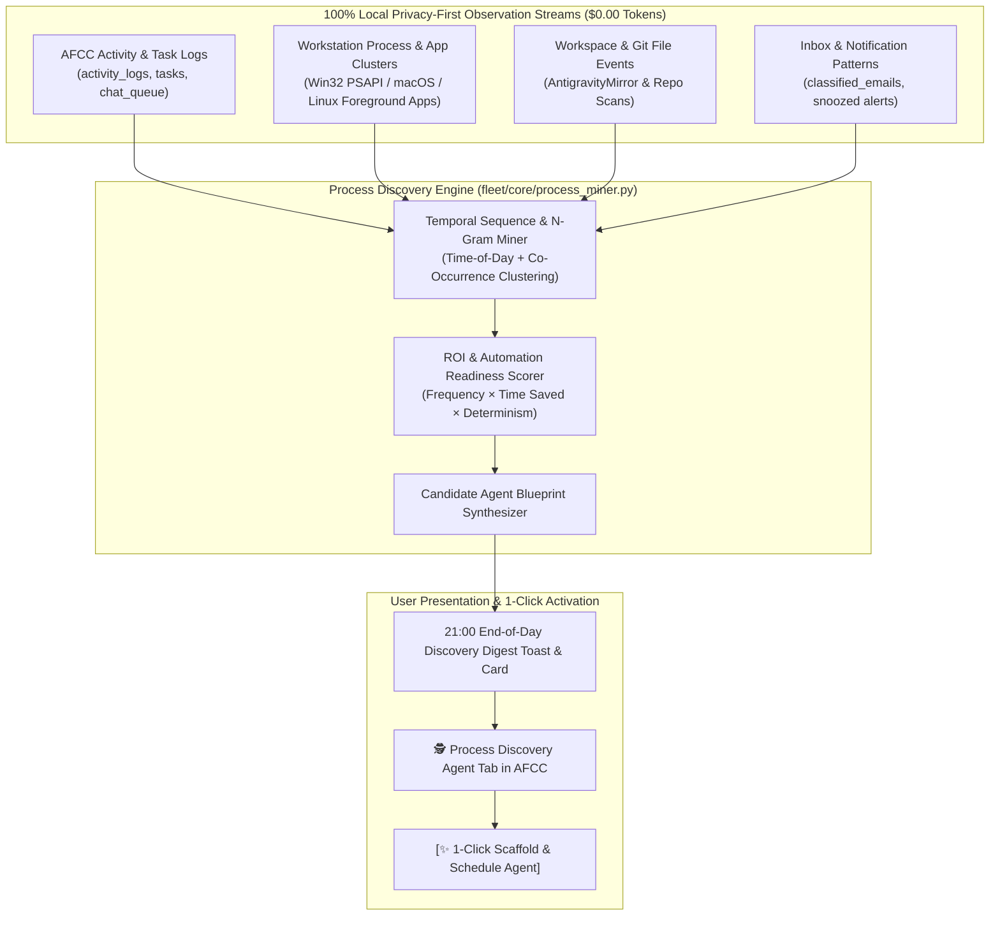

# 🕵️ UX-02: Autonomous Process Discovery & Agent Recommendation Engine (`process_discovery`)

| Attribute | Value |
| :--- | :--- |
| **Feature ID** | `UX-02` |
| **Priority** | 🔴 **P1 (Critical UX Enhancement — Rank #2)** |
| **UX Impact Score** | **97 / 100** *(Impact: 40/40, Friction Reduction: 24/25, Zero-Token Leverage: 20/20, Speed: 13/15)* |
| **Category** | `AI/LLM` & `Automation` |
| **Target Release** | `v2.8.9` |
| **Status** | `🟢 Completed` |
| **Affected Subsystems** | `fleet/agents/process_discovery/`, `fleet/core/process_miner.py`, `fleet/core/mind/subconsciousness.py`, `fleet/core/briefing.py` |

---

## 1. Executive Summary & User Problem Statement

### Current Friction
Users rarely sit down and think, *"Which of my daily habits or repetitive computer workflows should I turn into an autonomous agent today?"* Even when a user performs the exact same sequence of actions every day for two weeks—such as triaging specific emails, checking disk/RAM before a build, logging post-meal walks, or running git checks across multiple folders—the system does not proactively notice those patterns or offer to automate them.

### Proposed UX Transformation
Build a **100% Local, Privacy-Preserving Process Discovery & Workflow Mining Agent (`process_discovery`)** that passively observes workstation and dashboard telemetry over single-day and multi-day horizons (`1 day`, `7 days`, `14 days`) at **`$0.00` token cost**, detects repetitive routines or operational friction, and recommends **ready-to-spawn new agents** at the end of the day (`21:00` Evening Wrap-Up) or during the `SubconsciousMind` circadian dream cycle (`23:30`).

With **one click (`[🚀 Create Recommended Agent]`)**, the user turns a discovered behavioral pattern into an active, scheduled Fleet agent.

---

## 2. Multi-Source Local Telemetry & Pattern Mining Architecture

### 4 Local Observation Signals (Zero Cloud Transmission)
1. **Signal 1 — Dashboard & Task Repetition (`activity_logs` & `tasks`)**:
   - Detects manually created tasks with similar titles/categories across $\ge 3$ days (e.g., *"Review PRs"*, *"Check AWS billing"*, *"Backup notes"*) or manual agent task triggers executed at the same hour each day.
2. **Signal 2 — Workstation Process & Tool Co-Occurrence (`SystemOptimizer` Win32 PSAPI)**:
   - Samples running application names (never window keystrokes or private content) in-process to identify temporal work clusters—e.g., *"Every weekday between 09:00–09:30, `code.exe`, `docker.exe`, and `postgres.exe` launch together, consuming 88% RAM."*
   - **Recommendation Generated**: *"Create a **Morning Dev Stack Warmup & RAM Guard Agent** scheduled for 08:55 Mon–Fri."*
3. **Signal 3 — Developer & Workspace Friction (`AntigravityMirror` & Git Repos)**:
   - Detects recurring commands, test runs, or uncommitted branches across workspace directories.
   - **Recommendation Generated**: *"Create a **Daily 18:30 Git Uncommitted Work & Branch Hygiene Agent**."*
4. **Signal 4 — Communication & Triage Habits (`classified_emails`)**:
   - Detects high-volume sender domains or recurring invoice/newsletter patterns in `02-Paper-Trail` and `03-Read-Feed`.
   - **Recommendation Generated**: *"Create a **Weekly Vendor Invoice & Subscription Digest Agent**."*

---

## 3. Mathematical Automation Opportunity Score ($\mathcal{A}$)

Every discovered pattern $p$ is ranked deterministically using the **Automation Opportunity Score** ($\mathcal{A}_p \in [0, 100]$):

$$\mathcal{A}_p = \text{round}\Big(0.35 \cdot F_p + 0.30 \cdot T_p + 0.20 \cdot R_p + 0.15 \cdot D_p,\; 1\Big)$$

Where:
- $F_p$ (**Frequency Score**, $0\text{–}100$): Number of occurrences over the sliding 7-day window normalized against daily cadence.
- $T_p$ (**Temporal Regularity**, $0\text{–}100$): Inverse variance of the time-of-day ($100 - \min(100, \sigma_{\text{minutes}} / 2)$)—patterns that happen consistently around the same time of day score highest.
- $R_p$ (**Estimated Time / Friction Saved**, $0\text{–}100$): Estimated minutes saved per week if automated.
- $D_p$ (**Deterministic Feasibility**, $0\text{–}100$): How cleanly the pattern maps to existing Fleet capabilities (`db`, `system`, `network`, `notifications`) without requiring cloud tokens.

Patterns with $\mathcal{A}_p \ge 75.0$ are promoted to **High-Confidence Agent Recommendations**.

---

## 4. End-of-Day & Multi-Day Recommendation UX

1. **Daily 20:45 / 21:00 Discovery Digest**:
   - Runs automatically via `schedules.yaml` (`time: "20:45"`).
   - Surfaces a non-intrusive card in the **Overview** and **Process Discovery** tabs:
     > 💡 **We noticed 3 repetitive workflows over the last 5 days (Est. 45 mins/week saved):**
     > 1. **Evening Git Workspace Check** *(Observed 5/5 days around 18:15 — Score: 94/100)* — `[🚀 Create Agent in 1 Click]` `[Dismiss]`
     > 2. **Pre-Meeting RAM & DNS Optimizer** *(Observed 4/5 days around 09:50 — Score: 88/100)* — `[🚀 Create Agent in 1 Click]` `[Dismiss]`
2. **Privacy Guarantee**:
   - All observation histograms live strictly in `fleet_memory.db` (`process_observations` & `agent_recommendations` tables) inside the user's DPAPI-protected local environment.

---

## 5. Acceptance Criteria & Verification Plan
- [ ] `fleet/core/process_miner.py` mines `activity_logs`, `tasks`, and in-process PSAPI telemetry snapshots to produce ranked `AgentRecommendation` objects with $\mathcal{A}_p$ scores.
- [ ] Clicking **`[🚀 Create Agent in 1 Click]`** on any recommendation calls `UX-01` (`AgentStudio`) to scaffold, schedule, and hot-load the new agent immediately.
- [ ] Integrated with `SubconsciousMind.dream()` so multi-day patterns are consolidated nightly.

