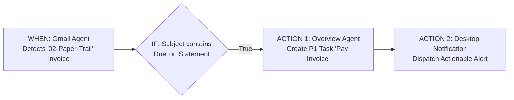

# 🔗 UX-03: Visual Multi-Agent Playbook & Event-Chain Composer (`IFTTT` for Fleet)

| Attribute | Value |
| :--- | :--- |
| **Feature ID** | `UX-03` |
| **Priority** | 🔴 **P1 (High UX Enhancement — Rank #3)** |
| **UX Impact Score** | **95 / 100** *(Impact: 38/40, Friction Reduction: 24/25, Zero-Token Leverage: 20/20, Speed: 13/15)* |
| **Category** | `Automation` & `Core` |
| **Target Release** | `v2.9.0` |
| **Status** | `Planned` |
| **Affected Subsystems** | `fleet/core/event_bus.py`, `fleet/core/playbook_engine.py`, `playbooks.yaml`, `fleet/web/templates/dashboard.html` |

---

## 1. Executive Summary & User Problem Statement

### Current Friction
Personal Agentic Fleet has a fast, deterministic `EventBus` (`fleet/core/event_bus.py`) and 7+ specialized agents, but each agent currently acts as a standalone silo. If a user wants **Agent A's output to trigger Agent B and Agent C**, they must write custom Python glue code.

### Proposed UX Transformation
Introduce a **Visual Multi-Agent Playbook & Event-Chain Composer** (`fleet/core/playbook_engine.py` + `playbooks.yaml`) that lets users connect any agent event to a sequence of cross-agent actions using a simple **`WHEN [Trigger] -> IF [Condition] -> THEN [Agent Actions]`** visual builder in AFCC.

---

## 2. Declarative Playbook Architecture (`playbooks.yaml`)



### Example `playbooks.yaml` Definition (Zero External Dependencies)
```yaml
playbooks:
  - id: morning_vitality_chain
    name: "Morning Vitality & Deep Work Launchpad"
    enabled: true
    trigger:
      type: schedule
      time: "08:00"
    steps:
      - agent: health
        task: morning_smoothie_and_workout
      - agent: optimizer
        task: periodic_ram_audit
      - agent: gmail
        task: inbox_classification
      - agent: overview
        task: morning_briefing

  - id: high_ram_autonomic_guard
    name: "High RAM Autonomic Relief Chain"
    enabled: true
    trigger:
      type: event
      topic: "optimizer.ram_threshold_exceeded"
    condition:
      field: "ram_percent"
      operator: ">="
      value: 88
    steps:
      - agent: optimizer
        task: daily_temp_cleanup
      - agent: overview
        task: log_note
        params:
          title: "Autonomic RAM Relief Triggered"
```

---

## 3. Built-In Starter Playbooks & UI Builder
1. **Visual 3-Column Playbook Builder in AFCC**:
   - **Column 1 (Trigger)**: Pick a Schedule (`08:00`), an Agent Event (`health.workout_logged`, `gmail.urgent_email`, `optimizer.high_ram`), or a Manual Hotkey.
   - **Column 2 (Optional Filter)**: Simple dropdown rule (`equals`, `contains`, `>=`, `<=`).
   - **Column 3 (Action Chain)**: Add 1 or more Agent Tasks in sequence with live **"▶ Test Playbook"** execution and step-by-step green checkmarks.
2. **8 Pre-Configured Starter Playbooks**:
   - *Morning Launchpad*, *Post-Workout Hydration & Streak Logger*, *Urgent Email -> Priority Task*, *Evening Shutdown & Dream Consolidation*, *Pre-Gaming / Pre-Call RAM Boost*.

---

## 4. Acceptance Criteria & Verification Plan
- [ ] `PlaybookEngine` subscribes to `EventBus` topics and executes multi-agent step chains with per-step timeout and circuit-breaker protection.
- [ ] `GET /api/playbooks`, `POST /api/playbooks`, and `POST /api/playbooks/run` expose full CRUD and instant test execution.
- [ ] 100% deterministic local execution (`$0.00` token spend).

