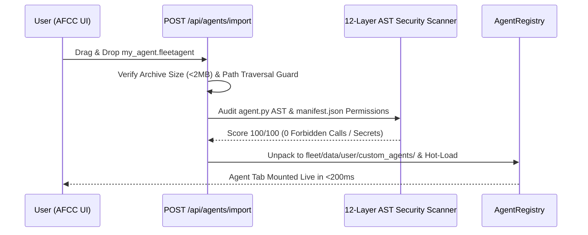

# 📦 UX-04: 1-Click Agent Blueprint Templates & Portable `.fleetagent` Share Packs

| Attribute | Value |
| :--- | :--- |
| **Feature ID** | `UX-04` |
| **Priority** | 🔴 **P1 (High UX Enhancement — Rank #4)** |
| **UX Impact Score** | **93 / 100** *(Impact: 37/40, Friction Reduction: 24/25, Zero-Token Leverage: 19/20, Speed: 13/15)* |
| **Category** | `Core` & `UI/UX` |
| **Target Release** | `v2.8.9` |
| **Status** | `🟢 Completed` |
| **Affected Subsystems** | `fleet/core/agent_catalog.py`, `fleet/tools/create_agent.py`, `fleet/api/settings_api.py` |

---

## 1. Executive Summary & User Problem Statement

### Current Friction
Most users prefer starting from a **working template** (like Notion templates or Raycast extensions) rather than designing an agent from scratch. Furthermore, once a user customizes a great agent on one machine, they want a 1-click way to export, back up, or share that agent package with another workstation.

### Proposed UX Transformation
1. **15+ Curated 1-Click Agent Blueprint Templates**: Expand the **Discover & Download** catalog and the **`+` Agent Wizard** with rich, domain-specific templates that install in `< 1 second` and immediately provide working charts, tables, and schedules.
2. **Portable `.fleetagent` Package Export / Import with SHA-256 & Security Scan Gate**: Allow any custom agent to be exported as a single `.fleetagent` archive (`manifest.json`, `agent.py`, `ui/panel.html`, default schedule) and imported via drag-and-drop into AFCC, automatically audited by the 12-Layer Security Scanner before mounting.

---

## 2. Curated 1-Click Blueprint Template Catalog

| Blueprint ID | Template Name | Icon | Category | Built-In Capabilities & UI Widgets |
| :--- | :--- | :---: | :--- | :--- |
| `deep_work_pomodoro` | **Deep Work & Pomodoro Guardian** | 🍅 | `Productivity` | 25/50-min focus timer, distraction blocker checklist, daily deep-work hours chart, Focus Mode toggle. |
| `expense_subscription_guard` | **Subscription & Expense Sentinel** | 💳 | `Finance` | Recurring renewal calendar, monthly burn-rate KPI cards, 3-day pre-charge desktop alert. |
| `git_repo_watcher` | **Multi-Repo Git & Release Watcher** | 🐙 | `DevOps` | Scans local workspace repos for dirty working trees, unpushed commits, and failing CI hooks at 18:00. |
| `cgm_glucose_analyzer` | **FFD Fasting & Post-Meal Glucose Log** | 🩸 | `Health` | Fasting / PP1 / PP2 blood sugar logger, HbA1c estimator, Rule-of-15 hypoglycemia alert, food correlation log. |
| `homelab_docker_sentinel` | **Docker & Homelab Port Sentinel** | 🐳 | `System` | Monitors local Docker containers & localhost ports, alerts on container restarts or high memory usage. |
| `reading_knowledge_vault` | **Reading List & Spaced Repetition** | 📚 | `Knowledge` | Book/article queue, key highlight capture, 1-7-30 day spaced-repetition review reminders in Morning Briefing. |

---

## 3. Safe `.fleetagent` Import & Sandbox Verification Pipeline

---

## 4. Acceptance Criteria & Verification Plan
- [ ] Users can browse and instantiate any of the 15+ Blueprint Templates in 1 click without network dependency.
- [ ] `GET /api/agents/<id>/export` downloads a signed `.fleetagent` package; `POST /api/agents/import` validates it through `security_scanner.py` before installation.

