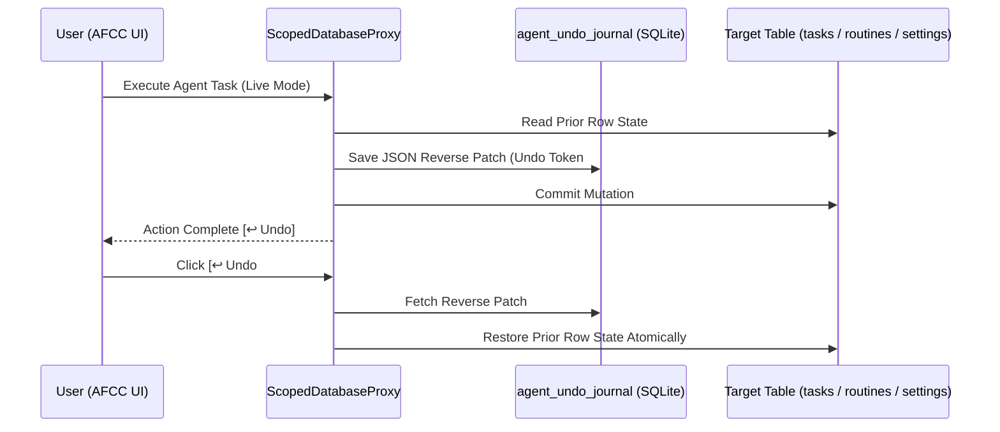

# ⏪ UX-08: Agent Time-Machine, 1-Click Undo Rollback & Safe Dry-Run Sandbox

| Attribute | Value |
| :--- | :--- |
| **Feature ID** | `UX-08` |
| **Priority** | 🟡 **P2 (Medium UX Enhancement — Rank #8)** |
| **UX Impact Score** | **85 / 100** *(Impact: 34/40, Friction Reduction: 21/25, Zero-Token Leverage: 18/20, Speed: 12/15)* |
| **Category** | `Security` & `Core` |
| **Target Release** | `v3.0.0` |
| **Status** | `Planned` |
| **Affected Subsystems** | `fleet/core/plugin_sandbox.py`, `fleet/core/db/base.py`, `fleet/api/router.py` |

---

## 1. Executive Summary & User Problem Statement

### Current Friction
When users install a new agent or configure an automated schedule/playbook (e.g., bulk-archiving promotional emails, purging temp caches, or auto-updating tasks/settings), they naturally worry:
1. *"What exactly will this agent do if I click Run right now?"*
2. *"If an agent modifies my tasks, routines, or settings and I don't like the result, how do I undo it?"*

### Proposed UX Transformation
1. **Universal `--dry-run` / Simulation Mode for Every Agent Task**:
   - Add a **"🧪 Simulate (Dry Run)"** button next to every **"▶ Run Now"** button in AFCC.
   - In Dry-Run mode, `ScopedDatabaseProxy` runs inside an in-memory savepoint (`SAVEPOINT dry_run_sp; ... ROLLBACK TO dry_run_sp;`), capturing every SQL insert/update/delete and outbound action the agent *would* perform and presenting a clean **"Proposed Changes Diff"** card to the user!
2. **1-Click Transactional Undo (`agent_undo_journal` Table)**:
   - Before any agent mutates rows via `ScopedDatabaseProxy`, the proxy records the pre-mutation row snapshot in `agent_undo_journal` (capped at the last 200 mutations).
   - An **"↩ Undo Last Action"** pill in the Activity Log and Agent Panel reverts the mutation in 1 click.

---

## 2. Architecture Diagram

---

## 3. Acceptance Criteria & Verification Plan
- [ ] `ScopedDatabaseProxy` supports `dry_run=True` context mode that records all attempted writes without persisting them to disk.
- [ ] `POST /api/agents/undo` restores the exact pre-action state for the specified `journal_id`.

