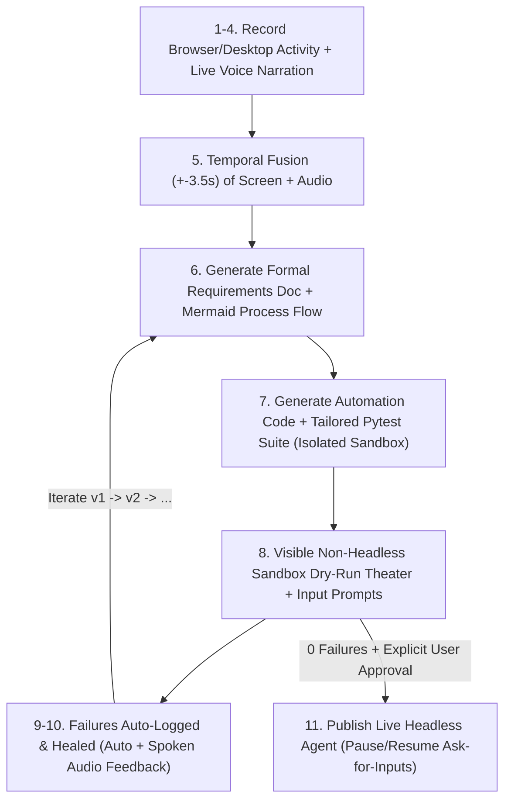
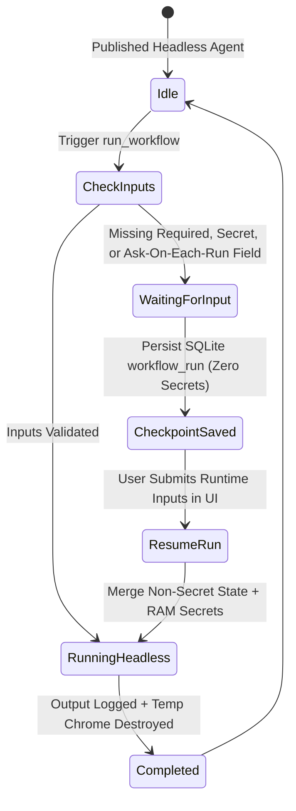

# 🎬 Multimodal Activity & Audio Recorder → Requirements Doc → Visible Sandbox → Live Headless Agent

> **Architecture Reference (`v2.21.0`)**: [High-Level Design (`docs/ACTIVITY_RECORDER_AGENT_HLD.md`)](https://github.com/macazaka/personal-agentic-fleet/blob/main/docs/ACTIVITY_RECORDER_AGENT_HLD.md) • [Low-Level Design (`docs/ACTIVITY_RECORDER_AGENT_LLD.md`)](https://github.com/macazaka/personal-agentic-fleet/blob/main/docs/ACTIVITY_RECORDER_AGENT_LLD.md)

AFCC enables users to build production **Headless Custom Agents** simply by **recording their Browser & Desktop activities while speaking aloud** explaining what they do, edge cases, and runtime inputs.

---

## 1. The 11-Step Multimodal Closed-Loop Lifecycle

1. **Record (Start/Stop)**: User chooses **Browser**, **Desktop**, or **Hybrid** mode with **Voice Narration** enabled inside `#studioActivityRecorderCard`.
2. **Screen Capture (`0` Third-Party Deps)**:
   - **Browser**: Managed isolated Chrome/Edge via pure-stdlib RFC 6455 WebSocket + CDP (`MinimalCDPClient`), or Zero-Launch Active-Tab Bookmarklet using per-session CSPRNG `capture_token`.
   - **Desktop**: Pure-stdlib Windows `ctypes` (`user32`/`kernel32`/`psapi`) with adaptive `250ms/750ms` polling, AFCC self-click exclusion, and zero `WH_KEYBOARD_LL` keylogging.
3. **Voice Narration + Temporal Fusion**: Continuous browser `SpeechRecognition` + `MediaRecorder` captures spoken constraints (*"ask me for..."*, *"wait 2 seconds"*, *"every morning"*) aligned within $\pm 3.5\text{s}$ of screen steps.
4. **Edge Privacy & AES-256-GCM Vault**: Passwords, OTPs, CVVs, cards, PAN, and Aadhaar numbers are redacted at capture edge before storage in `fleet/data/user/recordings/`.
5. **Requirements Document & Process Flow**: Generates `requirements_doc` with valid Mermaid `flowchart TD`, FR/NFR specifications, Screen↔Audio Traceability Matrix, and typed `input_schema`.
6. **Auto-Generated Unit Tests**: Compiles a tailored `pytest` suite covering AST safety, permission allowlist, secret scrubbing, and `waiting_for_input` pause/resume gates, running it in an isolated temporary directory.
7. **Visible Sandbox Dry-Run Theater**: Executes draft steps visibly on screen (non-headless highlighted Chrome/Edge overlay + AFCC step theater) and previews Ask-for-Inputs prompts.
8. **Self-Healing + Spoken Audio Iteration (`v1 -> v2`)**: Automatically promotes fallback selector tiers (6-tier browser / 4-tier desktop), injects retries/waits, and applies user-spoken corrections to regenerate Requirements Doc, Process Flow, IR, and Unit Tests.
9. **Approval Gate & Live Headless Agent**: Publishes only when `user_approved: true` into a headless `recorded_workflow` custom agent (`--headless=new` + SQLite `workflow_run` checkpoint/resume when inputs are required).

---

## 2. Live Headless Ask-for-Inputs State Machine

---

## 3. REST API Summary (`14` Endpoints)

- **Recorder & Multimodal Capture**: `POST /api/studio/recorder/start`, `POST /api/studio/recorder/stop`, `GET /api/studio/recorder/status`, `POST /api/studio/recorder/event`, `POST /api/studio/recorder/audio_segment`, `POST /api/studio/recorder/mark_input`, `GET /api/studio/recorder/sessions`
- **Brain Synthesis, Testing, Sandbox, Healing & Publish**: `POST /api/studio/recorder/convert`, `POST /api/studio/recorder/run_tests`, `POST /api/studio/recorder/sandbox_run`, `POST /api/studio/recorder/heal`, `POST /api/studio/recorder/publish`
- **Live Headless Execution & HITL Resume**: `POST /api/studio/workflows/run`, `POST /api/studio/workflows/resume`

---

## 4. Top-1% Principal Architect Hardening (`[REC-01]`–`[REC-12]`)

- **`[REC-01]` Pure-Stdlib RFC 6455 WebSocket + CDP & Win32 `ctypes`**: Zero external `pip` dependencies required (`usedforsecurity=False` on RFC 6455 SHA-1 handshake).
- **`[REC-02]` Edge PII/Secret Redaction (Screen + Spoken Audio)**: Zero keyboard hooks; password/OTP/card/PAN/Aadhaar scrubbed before leaving browser/audio boundary; secrets never written to SQLite checkpoints.
- **`[REC-03]` Isolated Chrome Profiles & `taskkill /F /T` Anti-Zombie Cleanup**: Prevents `ProcessSingleton` lock errors and guarantees zero orphaned headless Chrome RAM leaks.
- **`[REC-04]` AFCC Self-Click Exclusion & Event Coalescing**: Filters dashboard stop clicks and merges keystroke storms + rapid duplicate clicks inside a bounded 500-event ring buffer.
- **`[REC-05]` 6-Tier Browser / 4-Tier Desktop Self-Healing Selectors**: Resilient locator fallback ladder prevents UI churn breakage.
- **`[REC-06]` Non-Blocking HITL `waiting_for_input` Checkpoints**: Safely suspends headless runs for OTPs or dynamic parameters and resumes in-place from `step_index`.
- **`[REC-07]` $\pm 3.5\text{s}$ Multimodal Audio↔Screen Fusion**: Links spoken rules & parameter prompts directly to coinciding UI elements.
- **`[REC-08]` Formal Requirements Doc + Mermaid Process Flow + Isolated Pytest Gate**: Enforces specification & automated test verification prior to publishing.
- **`[REC-09]` Visible Sandbox Dry-Run Theater + Tier-1/Tier-2 Self-Healing Iteration**: Shows failures transparently on screen and fixes them autonomously + via spoken user corrections.
- **`[REC-10]` Strict Mic LED Release & Adaptive Laptop Polling**: Stops all `MediaStream` tracks immediately and adapts Win32 polling (`250ms/750ms`).
- **`[REC-11]` Per-Session CSPRNG `capture_token` & URL SSRF Guard**: Prevents spoofed localhost ingestion and blocks `file://` or `169.254.169.254` navigation.
- **`[REC-12]` Backward-Compatible Studio Runtime**: Preserves `len(SUPPORTED_UI_BLOCKS) == 12` while rendering interactive Headless Workflow Runner & Ask-for-Inputs controls automatically.
