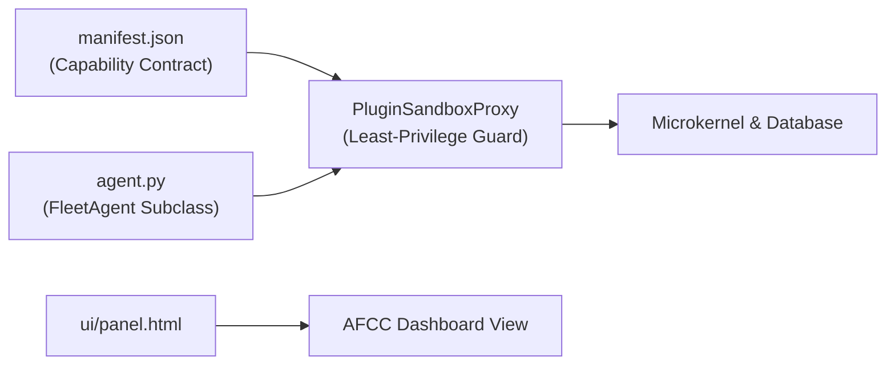

# Agent Development Guide

Building agents for Personal Agentic Fleet is simple, structured, and secure. Every agent is an isolated package located in `fleet/agents/<agent_id>/` that communicates through standardized lifecycle hooks and capability contracts.

---

## 1. Anatomy of an Agent Package

An agent package requires three core files:

```
fleet/agents/my_agent/
├── manifest.json       # Mandatory permission declarations & metadata
├── agent.py            # Main agent class subclassing FleetAgent
└── ui/
    └── panel.html      # Isolated UI template injected into AFCC
```



---

## 2. Four Ways to Create an Agent

Fleet supports **4 distinct creation workflows** depending on developer preference:

| Method | Target Persona | Interface | Generation Speed |
| :--- | :--- | :--- | :--- |
| **1. UI 4-Step Wizard** | Visual developers | AFCC Dashboard (**Settings -> Agents & Activation -> Create New Agent**) | 30 seconds |
| **2. Unified CLI** | Terminal power users | `fleet create-agent --name "..." --id "..."` | Instant |
| **3. Antigravity Skill** | AI-assisted developers | Chat prompt: *"Create a new Fleet agent for monitoring Docker containers"* | Autonomous |
| **4. Manual Coding** | Senior engineers | Create directory in `fleet/agents/<id>/` with code & tests | Full control |

---

## 3. Step 1: The Capability Contract (`manifest.json`)

Every agent must declare its permissions in `manifest.json`. The security sandbox strictly enforces these permissions at runtime.

```json
{
  "id": "docker_watcher",
  "name": "Docker Container Watcher",
  "version": "1.0.0",
  "icon": "🐳",
  "description": "Monitors local Docker container health and restart loops.",
  "permissions": [
    "db:read",
    "db:write",
    "ui:render",
    "system:read",
    "notifications:send"
  ],
  "author": "Fleet Engineer",
  "license": "Apache-2.0"
}
```

### Allowed Capability Permissions (`ALLOWED_AGENT_PERMISSIONS`)

| Permission String | Capability Granted |
| :--- | :--- |
| `db:read` | Query SQLite tables via the sandbox proxy (`get_task`, `list_tasks`, etc.). |
| `db:write` | Insert or modify records via the sandbox proxy (`add_task`, `complete_task`). |
| `ui:render` | Render an interactive HTML panel in the AFCC dashboard. |
| `network:http` | Make outbound HTTP/HTTPS requests (restricted to designated APIs). |
| `system:read` | Read OS metrics, system telemetry, and directory contents. |
| `system:execute` | Execute system maintenance commands through sanitized wrappers. |
| `notifications:send` | Dispatch desktop toast notifications or system alerts. |
| `secrets:read` | Access encrypted secrets from the DPAPI / Keychain vault. |

---

## 4. Step 2: The Agent Logic (`agent.py`)

Subclass `fleet.core.agent.FleetAgent` and implement lifecycle hooks:

```python
"""
Docker Container Watcher Agent for Personal Agentic Fleet.
"""

from typing import Any, Dict, List
from fleet.core.agent import FleetAgent


class DockerWatcherAgent(FleetAgent):
    """Monitors container health and logs anomalies."""

    def initialize(self) -> None:
        """Invoked when the agent is loaded into the registry."""
        self.logger.info("Docker Watcher initialized successfully.")

    def get_agent_settings_schema(self) -> List[Dict[str, Any]]:
        """Defines user-configurable settings rendered in the AFCC drawer."""
        return [
            {
                "id": "poll_interval_seconds",
                "label": "Poll Interval (Seconds)",
                "type": "number",
                "default": 30,
                "description": "Frequency of container status checks.",
            },
            {
                "id": "alert_on_restart",
                "label": "Alert on Container Restarts",
                "type": "boolean",
                "default": True,
                "description": "Send a desktop notification when a container restarts.",
            },
        ]

    def run_check(self) -> Dict[str, Any]:
        """Custom agent task execution."""
        poll_interval = self.get_setting("poll_interval_seconds", 30)
        # Business logic here...
        return {
            "status": "healthy",
            "containers_monitored": 4,
            "interval": poll_interval,
        }
```

---

## 5. Step 3: The Isolated UI Panel (`ui/panel.html`)

Every agent provides an HTML snippet embedded inside the AFCC dashboard. It must be scoped and responsive:

```html
<div class="agent-panel" id="panelDockerWatcher">
  <div class="panel-header">
    <div class="flex items-center gap-3">
      <span class="text-2xl">🐳</span>
      <div>
        <h2 class="text-lg font-bold text-slate-100">Docker Container Watcher</h2>
        <p class="text-xs text-slate-400">Local Container Health & Metrics</p>
      </div>
    </div>
    <button class="btn btn-primary" onclick="refreshDockerContainers()">Refresh</button>
  </div>

  <div class="grid grid-cols-1 md:grid-cols-2 gap-4 mt-4">
    <div class="metric-card">
      <span class="metric-label">Running Containers</span>
      <span class="metric-value text-emerald-400" id="dockerRunningCount">--</span>
    </div>
    <div class="metric-card">
      <span class="metric-label">Restart Anomalies</span>
      <span class="metric-value text-amber-400" id="dockerRestartCount">0</span>
    </div>
  </div>
</div>

<script>
function refreshDockerContainers() {
  fetch('/api/agents/docker_watcher/check')
    .then(res => res.json())
    .then(data => {
      document.getElementById('dockerRunningCount').textContent = data.containers_monitored || '0';
    })
    .catch(err => console.error('Docker check failed:', err));
}
</script>
```

---

## 6. Testing & Package Verification

Every new agent is automatically verified against the **Agent Package Isolation Quality Gate**:

```bash
# Run the strict agent isolation verifier
python -c "from fleet.tools.preflight_gate import verify_agent_package_isolation; print(verify_agent_package_isolation())"
```

The verifier confirms that:
1. `manifest.json` exists, is valid JSON, and matches the directory name.
2. All declared permissions belong to `ALLOWED_AGENT_PERMISSIONS`.
3. `agent.py` exists and subclasses `FleetAgent`.
4. `ui/panel.html` exists and contains no syntax errors.
