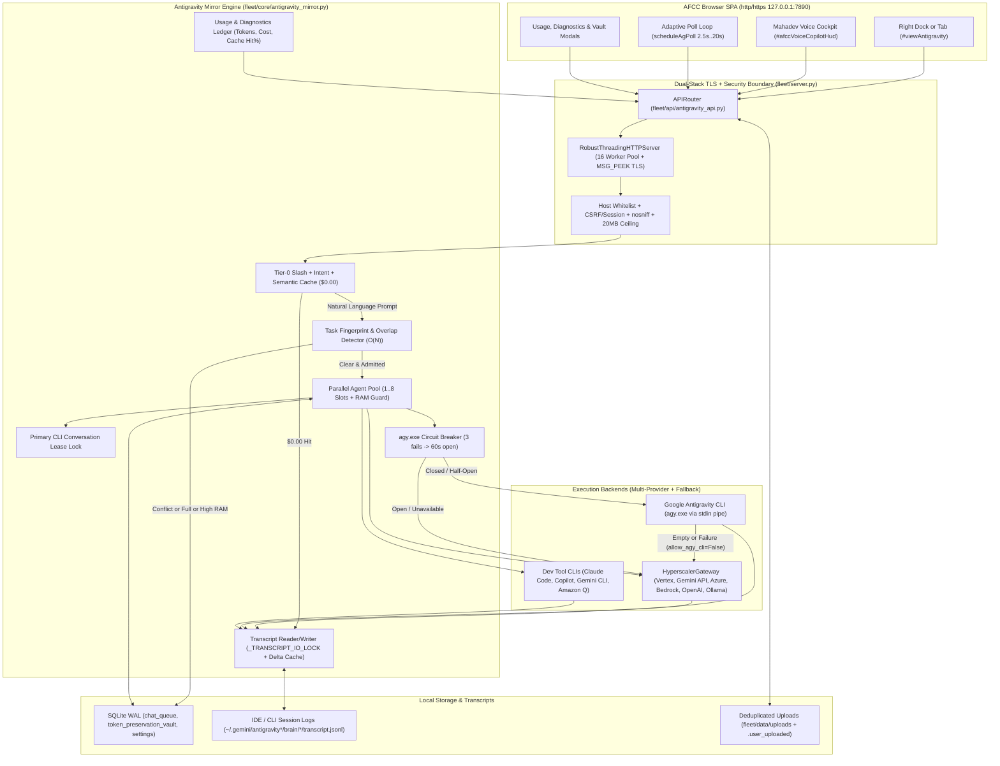
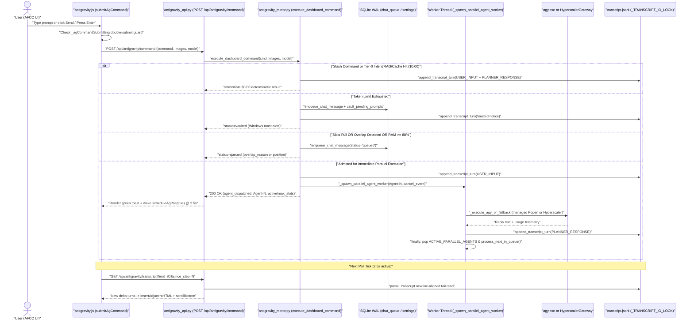
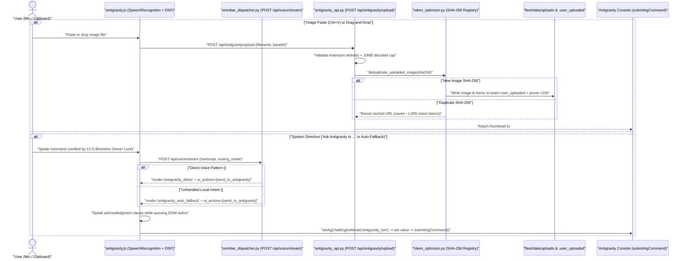
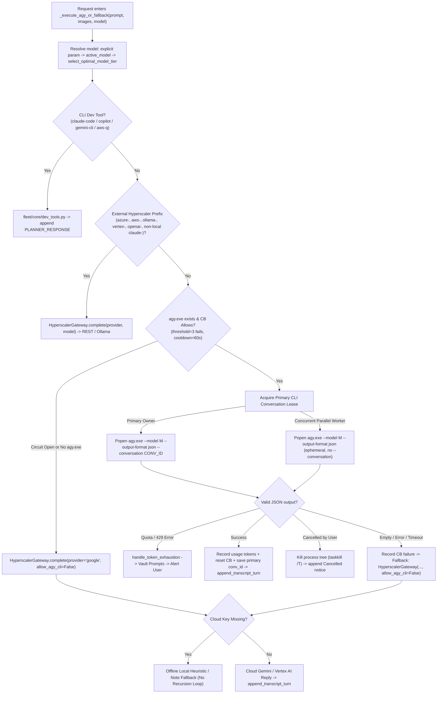
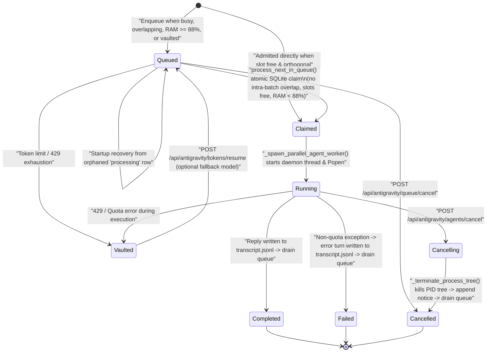
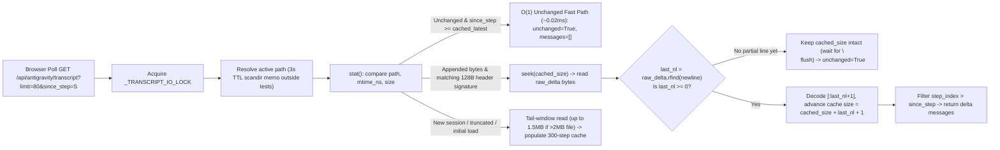
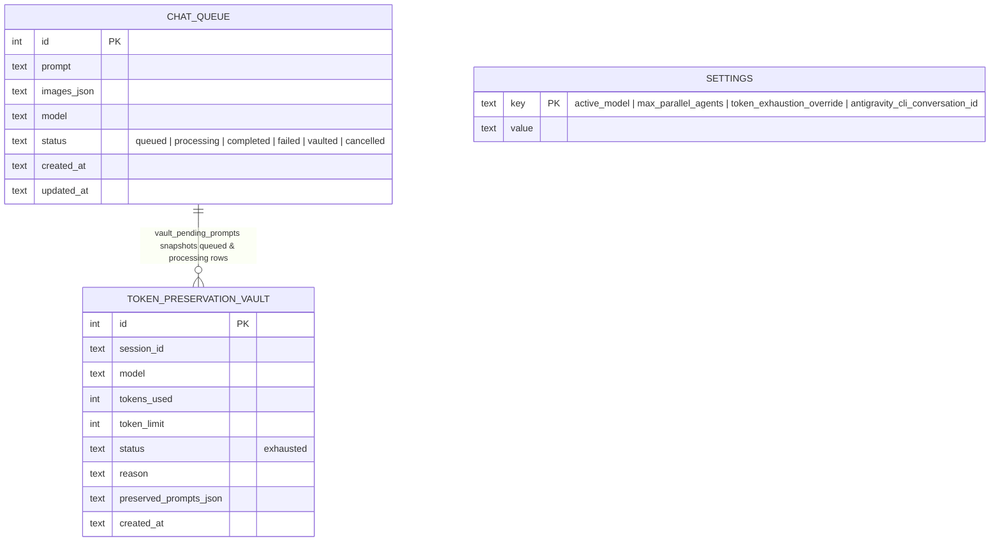

# ⚡ Antigravity Live via AFCC — Architecture, Diagrams & Principal Critique

This wiki page documents the full runtime architecture of **Antigravity Live via AFCC (Agentic Fleet Control Center)** — tracing every client keystroke, image paste, voice directive, parallel dispatch, incremental transcript sync, and crash recovery path under the resource envelope of a personal Windows laptop, alongside the 10 architectural hardenings (`[AGL-01]`–`[AGL-10]`).

See also the source manual: [Antigravity Live via AFCC Architecture (Docs)](https://github.com/macazaka/personal-agentic-fleet/blob/main/docs/ANTIGRAVITY_LIVE_AFCC_ARCHITECTURE.md) | [[Architecture]] | [[Hyperscalers-Token-Optimizer-and-Scheduler]] | [[API-Reference]]

---

## 1. Personal Laptop Operating Envelope & Constraints

| Constraint Dimension | Personal Laptop Reality | Design Implication |
| :--- | :--- | :--- |
| **Shared RAM Ceiling** | IDE (`Code.exe` / Antigravity LS), browser tabs, Python server, and child `agy.exe` CLI processes share `16–32 GB` physical RAM. | Bounded HTTP worker pools (`16`), capped DOM (`80`) & transcript caches (`300`), SHA-256 media deduplication, and `88%` RAM admission control. |
| **Shared CPU & Thermals** | Continuous polling timers and regex scans compete with IDE editing and trigger laptop fans. | Visibility-aware (`document.hidden`), adaptive (`2.5s` active -> `12–20s` idle), delta-indexed (`since_step`), and O(N) non-backtracking overlap checks. |
| **Windows Process Cost** | `CreateProcessW` + `agy.exe` Node runtime bootstrap uses `~150–400ms` and `80–250MB` RAM per subagent. | Non-recursive fallback (`allow_agy_cli=False`), `60s` circuit breaker, and Windows `taskkill /F /T` process-tree termination on cancel/timeout. |
| **Single-Writer SQLite WAL** | All HTTP/agent threads share local SQLite WAL. | Atomic `UPDATE ... WHERE status='queued'` claims, startup orphan recovery, and short connection scopes. |
| **Browser Battery & Layout** | Right-docked chat stream stays visible across all tabs. | Incremental appends (`insertAdjacentHTML`), single-flight fetch guards, and payload signature diffing (`_afccHasPayloadChanged`). |
| **Zero-Cloud Privacy Firewall** | Transcripts, uploads, and voiceprints stay strictly local and gitignored. | Safe extension allowlist (`10 MB` upload cap), `X-Content-Type-Options: nosniff` on `/media/`, and local encryption. |

---

## 2. End-to-End Architecture Diagrams

### 2.1 High-Level System Architecture & Process / Trust Topology

### 2.2 Typed Prompt & Natural Language End-to-End Dispatch Sequence

### 2.3 Voice-to-Antigravity Escalation & Image Upload Pipeline

### 2.4 Multi-Provider Model Routing & Non-Recursive Fallback Decision Tree

### 2.5 Parallel Agent Pool, Overlap, Cancellation, Vault & Recovery State Machine

### 2.6 Incremental Transcript Sync & SQLite Schema

---

## 3. Principal Architect Critique & Hardening Summary (`[AGL-01]`–`[AGL-10]`)

1. **`[AGL-01]` Transcript Concurrency & Partial-Line Safety**: Added `_TRANSCRIPT_IO_LOCK` and newline-aligned byte cursor advancement (`rfind(b"\n")`) in `parse_transcript()` and `append_transcript_turn()`.
2. **`[AGL-02]` Process Tree Control, Cancellation & Laptop RAM Guard**: Managed `Popen` subprocess registry, Windows `taskkill /F /T` termination, `POST /api/antigravity/agents/cancel`, `shutdown_all_parallel_agents()`, and >88% RAM admission queueing.
3. **`[AGL-03]` Crash-Safe Queue Recovery & Atomic Claims**: `recover_orphaned_queue_on_startup()`, atomic SQLite `claim_queued_chat_message()`, `_QUEUE_DRAIN_LOCK`, and intra-batch overlap checks.
4. **`[AGL-04]` Primary Conversation Lease & Parallel Isolation**: `_CLI_CONV_LOCK` grants persisted `antigravity_cli_conversation_id` exclusively to the primary lease holder while concurrent workers run ephemeral isolated turns.
5. **`[AGL-05]` True Token/Cost Telemetry & Post-Compaction Context**: Tracks real LLM vs Tier-0 turns, input/output tokens, and USD estimates; computes context usage from tail bytes after `<CONTEXT_SUMMARY>`.
6. **`[AGL-06]` Adaptive Polling & DOM Diffing**: `scheduleAgPoll()` (`2.5s` active -> `12s/20s` idle), startup deduplication in `app.js`, and `_afccHasPayloadChanged` DOM skipping.
7. **`[AGL-07]` Zero Silent Failures & Live Stop UI**: Error/cancel transcript turns, double-submit guard (`_agCommandSubmitting`), and `#agLiveWorkingIndicator` active-agent bar with 1-click Stop.
8. **`[AGL-08]` Memoized Transcript Discovery & Upload Hygiene**: `3s` `os.scandir` path cache, `10 MB` + safe extension whitelist on `/upload`, `200`-file / `250 MB` upload pruning, and `X-Content-Type-Options: nosniff` on `/media/`.
9. **`[AGL-09]` Non-Recursive `agy.exe` Fallback & Circuit Breaker**: `allow_agy_cli=False` prevents double CLI hangs, 3-failure `60s` circuit breaker fast-bypasses dead CLI binaries, and CLI runs deterministically at repository root.
10. **`[AGL-10]` Unified Live Diagnostics (`GET /api/antigravity/diagnostics`)**: Real-time engine health, cache hit rate, circuit breaker state, RAM guard, and LLM/Tier-0 telemetry surfaced directly inside `#usageModal`.
