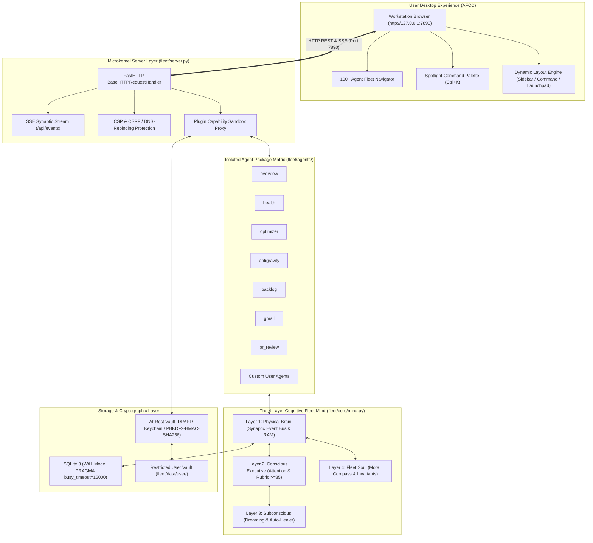
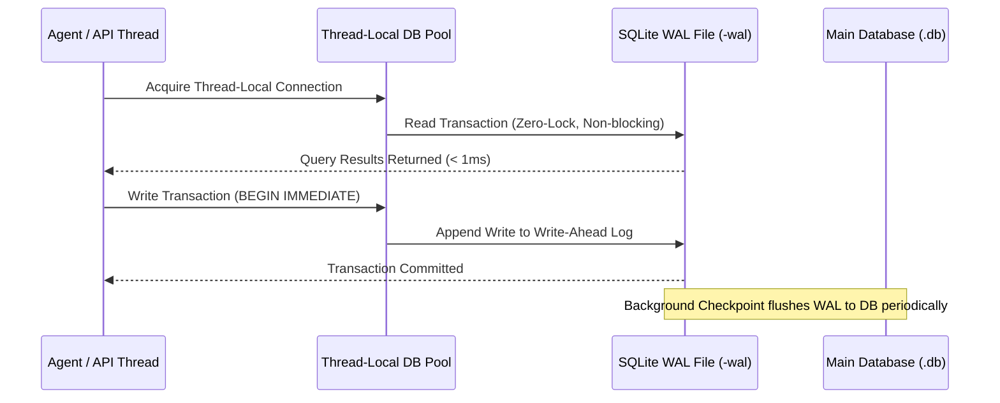

# System Architecture

The **Personal Agentic Fleet** is engineered as a resilient, privacy-first operations microkernel operating with 100% local determinism ($0.00 compute cost). It bridges a low-overhead FastHTTP web server, real-time Server-Sent Events (SSE) broadcasting, concurrent SQLite Write-Ahead Logging (WAL) memory, and an organic **4-Layer Cognitive Fleet Mind** (Brain, Consciousness, Subconsciousness, Soul).

---

## 1. High-Level Architectural Topology

---

## 2. Microkernel Server & Security Boundary

The server microkernel is implemented in Python's native standard library (`http.server`) without bloated third-party ASGI frameworks:
1. **FastHTTP Request Handling**: Threaded HTTP server handling request routing, payload size limits (`MAX_PAYLOAD_BYTES = 5MB` to prevent DoS attacks), and JSON serialization.
2. **Security Headers**:
   - `Content-Security-Policy`: Strictly restricts inline execution to trusted nonces and self origins.
   - `X-Content-Type-Options: nosniff`: Prevents MIME-confusion attacks.
   - `X-Frame-Options: DENY`: Blocks clickjacking.
   - `Permissions-Policy`: Restricts camera, microphone, and geolocation.
3. **DNS Rebinding & Host Validation**: Restricts accepted `Host` headers strictly to `localhost`, `127.0.0.1`, `[::1]`, and approved private workstation addresses.
4. **Path-Traversal Guard**: All static asset file paths are resolved and validated using `Path.resolve().is_relative_to(BASE_DIR)` to strictly prevent directory traversal attacks (`../`).

---

## 3. Storage Architecture & Concurrency Control

Fleet storage is architected for zero-lock, high-concurrency read/write operations:

### Key SQLite Pragma Configurations
- `PRAGMA journal_mode = WAL;`: Allows simultaneous concurrent readers while a single background writer commits transactions without locking readers.
- `PRAGMA busy_timeout = 15000;`: Waits up to 15 seconds for locks to clear before raising errors, eliminating database collision crashes.
- `PRAGMA synchronous = NORMAL;`: Delivers high write throughput while maintaining full crash resilience under WAL mode.
- `PRAGMA foreign_keys = ON;`: Enforces referential integrity across tasks, routines, and telemetry tables.
- `PRAGMA secure_delete = ON;`: Overwrites deleted database records with zeros to prevent forensic data recovery.

---

## 4. The 4-Layer Cognitive Fleet Mind

The Fleet operations model is grounded in cognitive science, organizing system behaviors into four distinct functional layers:

### Layer 1: Physical Brain (`fleet.core.mind.BrainLayer`)
- **Synaptic Event Bus**: High-throughput publish-subscribe bus for intra-agent communication.
- **Dual-Tier Memory**: Ephemeral RAM working memory combined with long-term SQLite epistemic storage.
- **Autonomic Reflex Arcs**: Immediate, zero-token autonomic reflexes (e.g. throttling processes when RAM > 90%, triggering crash reports on unhandled exceptions).

### Layer 2: Conscious Executive (`fleet.core.mind.ConsciousnessLayer`)
- **Real-Time Attention Focus**: Prioritizes urgent agent demands based on user context and workload severity.
- **Self-Critique Rubric**: Evaluates proposed actions against a 5-dimension rubric (Efficiency, Safety, Quality, Reversibility, Relevance), enforcing a minimum score of $\ge 85$ before high-impact changes are applied.

### Layer 3: Subconscious Mind & Dreaming (`fleet.core.mind.SubconsciousLayer`)
- **Background Log Mining**: Periodically scans `fleet_app.log` for recurring warnings, deprecations, or friction points.
- **Dream Cycles**: Runs during idle periods to consolidate memories, clean temporary tables, and update habit routines.
- **Immunological Self-Healing**: Triggers targeted remediation recipes to repair anomalies before they impact the user.

### Layer 4: Fleet Soul & Moral Compass (`fleet.core.mind.SoulLayer`)
- **Ethical Invariants**:
  1. *Sovereign Privacy*: Zero unencrypted personal data leaves the local workstation.
  2. *Zero-Token Discipline*: Deterministic rules must always be attempted before paid LLM APIs are invoked.
  3. *Metabolic System Care*: Background tasks must yield CPU and memory when user workstation workload spikes.
  4. *User-Choice Autonomy*: Destructive actions require explicit human confirmation.

---

## 5. Cognitive Harmony Index Formula

The health and alignment of the entire system is expressed as a single mathematical metric:

$$\text{Harmony Score} = (B \times 0.35) + (C \times 0.35) + (S \times 0.30)$$

Where:
- $B$ (**Brain Index**): Computed from event dispatch latency, database response times, and memory pressure.
- $C$ (**Consciousness Index**): Computed from attention stability and average self-critique rubric scores.
- $S$ (**Soul Index**): Computed from privacy boundary compliance, token frugality, and user intent alignment.
