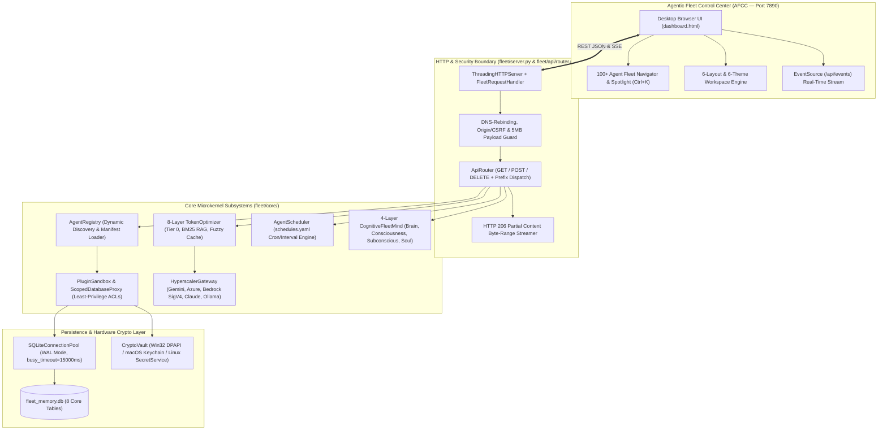

# 🏛️ System Architecture & Microkernel Internals

> **Release Version**: `v2.8.7` | **Core Modules**: `fleet/server.py`, `fleet/api/router.py`, `fleet/core/database.py`, `fleet/core/registry.py`, `fleet/core/plugin_sandbox.py`, `fleet/core/event_bus.py`

The **Personal Agentic Fleet** is engineered as a local-first, zero-dependency Python microkernel operating system. It combines a multi-threaded HTTP/1.1 + RFC 7233 byte-range server (`fleet/server.py`), a modular REST & SSE router (`fleet/api/router.py`), a capability-enforced plugin sandbox (`fleet/core/plugin_sandbox.py`), a thread-pooled SQLite 3 WAL storage engine (`fleet/core/database.py`), and the **4-Layer Cognitive Fleet Mind** (`fleet/core/mind/`).

---

## 1. End-to-End Microkernel Topology

---

## 2. HTTP Server & Modular API Router (`fleet/server.py` & `fleet/api/router.py`)

### 2.1 Zero-Dependency Multi-Threaded Server (`ThreadingHTTPServer`)
Instead of requiring external ASGI/WSGI servers (`uvicorn`, `gunicorn`, `fastapi`) that introduce transitive supply-chain vulnerabilities, Personal Agentic Fleet runs on Python's native `http.server.ThreadingHTTPServer` enhanced with:
1. **DNS-Rebinding & Host Allowlisting**: Rejects any HTTP request whose `Host` header is not in `{"127.0.0.1", "localhost", "[::1]"}` (or explicitly configured LAN bindings) with `HTTP 403 Forbidden`.
2. **CSRF Origin & Custom Header Verification**: Mutating requests (`POST`, `PUT`, `DELETE`) verify `Origin`/`Referer` loopback fidelity and session tokens via `fleet/core/session_auth.py`.
3. **Strict Payload & Path Traversal Guards**:
   - Caps request bodies at `MAX_PAYLOAD_BYTES = 5_242_880` (`5 MB`) to prevent memory exhaustion DoS.
   - Verifies all static asset paths via `Path.resolve().is_relative_to(STATIC_ROOT)` before opening files.
4. **Hardened Response Headers**:
   - `Content-Security-Policy: default-src 'self'; img-src 'self' data: blob:; media-src 'self' blob:; style-src 'self' 'unsafe-inline'; script-src 'self' 'unsafe-inline'`
   - `X-Content-Type-Options: nosniff`
   - `X-Frame-Options: DENY`
   - `Referrer-Policy: no-referrer`

### 2.2 Declarative `ApiRouter` Dispatch Pipeline (`fleet/api/router.py`)
`ApiRouter` decouples endpoint logic from `FleetRequestHandler` using three dispatch tiers:
1. **Exact Route Hash Table (`O(1)` lookup)**: Maps `(method, path)` tuples directly to bound handler methods (`_get_routes`, `_post_routes`, `_delete_routes`).
2. **Prefix Route Table**: Handles parameterized paths such as `/api/agents/<agent_id>/settings`, `/api/tasks/<task_id>`, and `/api/exercises/video`.
3. **Dynamic Agent Route Forwarding**: Automatically routes `/api/agents/<agent_id>/<subroute>` to the target agent's sandboxed `handle_api(method, subroute, payload)` method after verifying `manifest.json` permissions.

---

## 3. Plugin Capability Sandbox & `ScopedDatabaseProxy` (`fleet/core/plugin_sandbox.py`)

Every agent in `fleet/agents/<agent_id>/` declares its required permissions in `manifest.json`. At load time, `AgentRegistry` wraps the agent in a `PluginSandbox` and injects a `ScopedDatabaseProxy` rather than the raw `FleetDatabase` instance.

### 3.1 Capability Permission Matrix (`VALID_PERMISSIONS`)

| Permission Token | Capability Granted | Enforcement Mechanism |
| :--- | :--- | :--- |
| `db:read` | Read access to allowed SQLite tables | Enforced by `ScopedDatabaseProxy._check_read()` |
| `db:write` | Write/mutate access to allowed SQLite tables | Enforced by `ScopedDatabaseProxy._check_write()` |
| `ui:render` | Render isolated HTML/CSS/JS panel in AFCC | Verified by `AgentRegistry` during dashboard assembly |
| `notifications:send` | Dispatch OS desktop toast notifications | Gated by `ScopedNotificationProxy` |
| `network:http` | Outbound HTTPS requests via `EgressGate` | Checked against domain allowlist & circuit breaker |
| `secrets:read` | Decrypt agent-scoped keys from `CryptoVault` | Restricted to keys prefixed with `agent.<agent_id>.*` |
| `system:read` | Read OS memory/CPU/process telemetry | Audited by `security_scanner.py` AST inspection |
| `system:execute` | Execute approved maintenance commands | Restricted to built-in signed system agents (`optimizer`) |

---

## 4. SQLite 3 WAL Storage Engine & Complete Schema Reference (`fleet/core/database.py`)

`FleetDatabase` uses a thread-safe connection pool (`fleet/core/connection_pool.py`) with Write-Ahead Logging (`PRAGMA journal_mode=WAL`), `PRAGMA synchronous=NORMAL`, `PRAGMA busy_timeout=15000`, `PRAGMA foreign_keys=ON`, and `PRAGMA secure_delete=ON`.

### Complete 8-Table Relational Schema (`fleet_memory.db`)

| Table Name | Primary Key | Columns & Types | Purpose |
| :--- | :--- | :--- | :--- |
| **`tasks`** | `id INTEGER PRIMARY KEY AUTOINCREMENT` | `title TEXT`, `description TEXT`, `priority TEXT DEFAULT 'medium'`, `category TEXT DEFAULT 'general'`, `due_date TEXT`, `completed INTEGER DEFAULT 0`, `created_at TEXT`, `completed_at TEXT` | Personal & engineering task management board. |
| **`routines`** | `id INTEGER PRIMARY KEY AUTOINCREMENT` | `name TEXT UNIQUE`, `category TEXT`, `target_time TEXT`, `completed_today INTEGER DEFAULT 0`, `last_completed_date TEXT`, `streak_count INTEGER DEFAULT 0` | Daily habits with automatic midnight reset and streak tracking. |
| **`health_metrics`** | `id INTEGER PRIMARY KEY AUTOINCREMENT` | `date TEXT UNIQUE`, `water_glasses INTEGER DEFAULT 0`, `calories INTEGER DEFAULT 0`, `workout_completed INTEGER DEFAULT 0`, `workout_type TEXT`, `weight_kg REAL`, `fasting_bsl INTEGER`, `post_meal_bsl INTEGER`, `notes TEXT` | Daily hydration, FFD blood sugar levels (BSL), and 6-Day Strength Split logs. |
| **`memories`** | `id INTEGER PRIMARY KEY AUTOINCREMENT` | `key TEXT UNIQUE`, `value TEXT`, `category TEXT DEFAULT 'general'`, `importance INTEGER DEFAULT 5`, `created_at TEXT`, `updated_at TEXT` | Long-term epistemic key-value store & circadian dream insights. |
| **`notes`** | `id INTEGER PRIMARY KEY AUTOINCREMENT` | `title TEXT`, `content TEXT`, `tags TEXT`, `pinned INTEGER DEFAULT 0`, `created_at TEXT`, `updated_at TEXT` | Encrypted-capable markdown scratchpad and quick notes. |
| **`activity_logs`** | `id INTEGER PRIMARY KEY AUTOINCREMENT` | `timestamp TEXT`, `agent_id TEXT`, `action TEXT`, `details TEXT`, `status TEXT DEFAULT 'info'` | Immutable audit trail of agent operations, schedules, and reflex events. |
| **`backlog`** | `id INTEGER PRIMARY KEY AUTOINCREMENT` | `title TEXT`, `description TEXT`, `priority TEXT DEFAULT 'P2'`, `category TEXT DEFAULT 'Feature'`, `status TEXT DEFAULT 'pending'`, `created_at TEXT`, `completed_at TEXT` | Kanban feature roadmap and bug tracking tickets. |
| **`auto_improvements`** | `id INTEGER PRIMARY KEY AUTOINCREMENT` | `timestamp TEXT`, `category TEXT`, `issue_detected TEXT`, `action_taken TEXT`, `status TEXT`, `impact_score INTEGER DEFAULT 5` | Autonomous self-healing actions recorded by `AutoHealer` and `FleetSoul`. |
