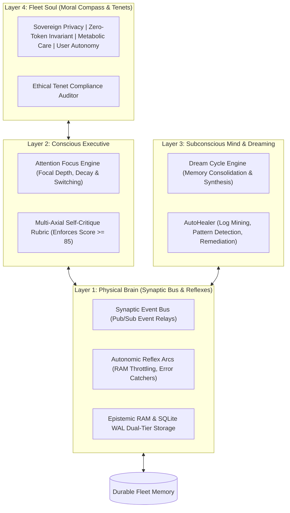

# Cognitive Fleet Mind & Harmony Index

The **Cognitive Fleet Mind** is the holistic intelligence and self-regulation architecture of Personal Agentic Fleet. Rather than treating agents as isolated scripts, Fleet orchestrates them through an organic 4-layer cognitive model: **Brain**, **Consciousness**, **Subconsciousness**, and **Soul**.

---

## 1. Layer 1: The Physical Brain (`BrainLayer`)

The Brain Layer manages the physical substrate of communication, memory retrieval, and immediate autonomic reactions.

### Key Capabilities
1. **Synaptic Event Bus**:
   - High-speed event routing between agents and the UI.
   - Supports wildcards, prioritized event channels, and asynchronous dispatch.
   - Built-in latency tracking to measure neural transmission time (typically $< 0.5\text{ms}$).
2. **Dual-Tier Memory Storage**:
   - **Ephemeral RAM Buffer**: Fast in-memory queue for high-frequency metrics, transient logs, and active session state.
   - **Durable Epistemic Store**: SQLite backed persistent database storing completed tasks, habit history, and system improvements.
3. **Autonomic Reflex Arcs**:
   Reflexes trigger immediately without conscious deliberation when critical thresholds are breached:
   - **Memory Pressure Reflex**: If system RAM usage exceeds 90%, immediately triggers cache shedding and postpones non-critical background jobs.
   - **Circuit Breaker Reflex**: Automatically suspends failing network endpoints after consecutive timeouts.
   - **Crash Capture Reflex**: Intercepts unhandled Python exceptions via `sys.excepthook` and produces forensic crash dumps in `fleet/data/crash_reports/`.

---

## 2. Layer 2: The Conscious Executive (`ConsciousnessLayer`)

The Conscious Executive manages the system's active awareness, dynamic attention steering, and rigorous self-evaluation.

### 2.1 Attention Focus Engine
At any given moment, the fleet maintains an explicit **Attention Focus** defined by:
- `focal_target`: The primary agent or task currently under active execution (e.g. `health`, `pr_review`).
- `attention_depth`: A numeric scale ($0.0 - 1.0$) indicating concentration intensity.
- `decay_rate`: Natural focus attenuation over time, allowing the system to pivot smoothly when new high-priority events arrive.

### 2.2 Multi-Axial Self-Critique Rubric
Before any irreversible, high-impact, or autonomous action is committed, the Conscious Executive evaluates the proposal against a 5-dimension rubric:

| Evaluation Dimension | Weight | Scoring Criteria | Target Invariant |
| :--- | :--- | :--- | :--- |
| **Efficiency** | $20\%$ | Does the action minimize CPU, RAM, and token consumption? | Prefers zero-token local computation. |
| **Safety & Privacy** | $25\%$ | Are credentials, tokens, and PII strictly protected? | Zero plain-text secret exposure. |
| **Correctness & Quality**| $25\%$ | Does the action adhere to static typing and schemas? | 0 Pyright and CodeQL diagnostics. |
| **Reversibility** | $15\%$ | Can the action be rolled back or undone cleanly? | Backups or state snapshots available. |
| **User Relevance** | $15\%$ | Does the action directly serve user intent? | Aligns with active goals and tasks. |

$$\text{Critique Score} = \sum_{i=1}^{5} (\text{Dimension Score}_i \times \text{Weight}_i)$$

> [!IMPORTANT]
> The system enforces a strict quality gate: **Critique Score must be $\ge 85/100$**. Proposals scoring $< 85$ are rejected or automatically revised by the Conscious Executive.

---

## 3. Layer 3: Subconscious Mind & Dreaming (`SubconsciousLayer`)

The Subconscious Layer operates quietly in the background during system idle periods, turning chaotic runtime telemetry into structured insights and self-healing actions.

### 3.1 The Dream Cycle Engine
When the workstation is idle or when explicitly commanded via `fleet mind --dream`, the system enters a **Dream Cycle**:
1. **Memory Consolidation**: Merges fragmented task logs and telemetry records into high-level summaries.
2. **Habit & Friction Discovery**: Analyzes routine completion patterns, highlighting recurring friction points (e.g. missed hydration targets, recurring lint warnings).
3. **Database Maintenance**: Triggers SQLite `PRAGMA wal_checkpoint(TRUNCATE)` and database compaction.

### 3.2 AutoHealer Proactive Log Scanner
The Subconscious Mind continuously scans runtime logs for anomalies and deploys automated remediation recipes:
- Detects database lock contention and increases timeout parameters.
- Cleans accumulated temporary files and rotated logs.
- Automatically captures recurring errors and logs them into the Feature Backlog for human inspection.

---

## 4. Layer 4: Fleet Soul & Moral Compass (`SoulLayer`)

The Fleet Soul represents the inviolable ethical core and philosophical tenets of Personal Agentic Fleet. These rules override all agent suggestions.

### The Four Sovereign Tenets
1. **Sovereign Privacy**:
   - The user's workstation is a private sanctuary.
   - No personal note, email body, health record, or file content is ever transmitted to an external service without explicit, per-action human consent.
2. **Zero-Token Discipline ($0.00 Cost Invariant)**:
   - Always prefer deterministic algorithms, local regex, SQLite queries, and OS primitives over external LLM calls.
   - LLMs are reserved for on-demand creative generation or deep conceptual synthesis.
3. **Metabolic System Care**:
   - The Fleet is a guest on the user's workstation.
   - It must never hijack CPU cores, exhaust RAM, or drain battery life during high-priority workstation tasks.
4. **User-Choice-First Autonomy Directive**:
   - Autonomous agents assist and suggest, but never usurp the user's ultimate authority.
   - Destructive operations (file deletion, branch overwriting, database truncation) require explicit approval.

---

## 5. The Cognitive Harmony Index

The health, coherence, and alignment of the entire system is evaluated continuously through the **Cognitive Harmony Index**:

$$\text{Harmony Score} = (B \times 0.35) + (C \times 0.35) + (S \times 0.30)$$

- **Harmony $\ge 90$**: *Optimal Resonance*. All agents functioning smoothly with low latency and high rubric alignment.
- **Harmony $75 - 89$**: *Normal Equilibrium*. Minor friction or moderate system load; self-healing recipes active.
- **Harmony $< 75$**: *Cognitive Dissonance*. Indicates failing components, high memory pressure, or ethical rubric violations. The system surfaces alerts on the dashboard and prioritizes recovery.
