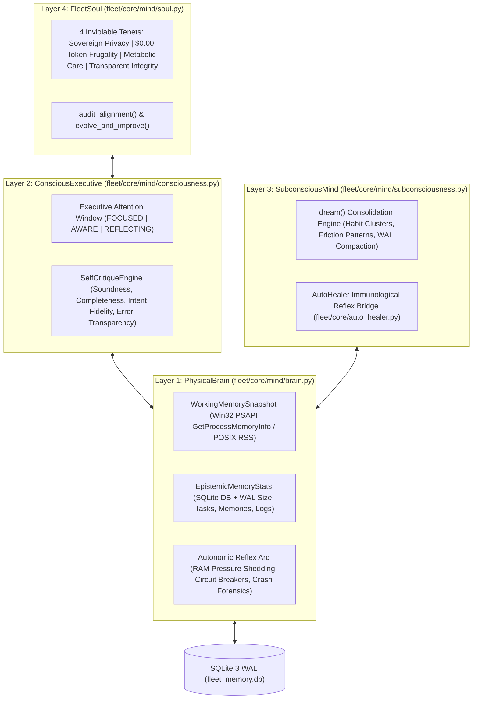

# 🧠 Cognitive Fleet Mind & Harmony Index Deep-Dive

> **Release Version**: `v2.11.1` | **Package Root**: `fleet/core/mind/` (`gestalt.py`, `brain.py`, `consciousness.py`, `subconsciousness.py`, `soul.py`) | **CLI Tool**: `python -m fleet.tools.fleet_mind`

The **Cognitive Fleet Mind** (`CognitiveFleetMind` in `fleet/core/mind/gestalt.py`) is the self-regulating neurological and ethical architecture of Personal Agentic Fleet. Instead of treating background daemons, SQLite storage, and plug-and-play agents as disconnected scripts, Fleet unifies them into a **4-Layer Cognitive Gestalt**:

1. **Layer 1: `PhysicalBrain` (`fleet/core/mind/brain.py`)** — Neurological substrate, Win32/POSIX working memory telemetry, epistemic SQLite WAL metrics, synaptic event bus, and autonomic reflex arc.
2. **Layer 2: `ConsciousExecutive` (`fleet/core/mind/consciousness.py`)** — Executive attention focus (`FOCUSED`, `AWARE`, `REFLECTING`) and the deterministic 4-axial `SelfCritiqueEngine`.
3. **Layer 3: `SubconsciousMind` (`fleet/core/mind/subconsciousness.py`)** — Circadian dreaming (23:00–06:00), memory consolidation, latent habit/friction discovery, and immunological pruning.
4. **Layer 4: `FleetSoul` (`fleet/core/mind/soul.py`)** — Teleological purpose, 4 inviolable ethical tenets, alignment auditing (`audit_alignment()`), and evolutionary generation ascent (`evolve_and_improve()`).



---

## 1. Layer 1: `PhysicalBrain` (`fleet/core/mind/brain.py`)

`PhysicalBrain` instruments the physical operating system process and SQLite persistence engine in real time without spawning external shell processes.

### 1.1 Data Structures & Telemetry Probes
- **`WorkingMemorySnapshot`**:
  - On Windows, calls `ctypes.windll.psapi.GetProcessMemoryInfo` with a native `PROCESS_MEMORY_COUNTERS` C-structure (`cb`, `PageFaultCount`, `PeakWorkingSetSize`, `WorkingSetSize`, `PagefileUsage`) on `kernel32.GetCurrentProcess()`.
  - Captures `working_set_mb`, `peak_working_set_mb`, `pagefile_mb`, and `active_threads` (`threading.active_count()`).
- **`EpistemicMemoryStats`**:
  - Inspects `fleet_memory.db` and `fleet_memory.db-wal` on disk plus row counts across `tasks`, `routines`, `memories`, `notes`, `activity_logs`, and `backlog`.
- **Synaptic Event Bus & Motor Cortex**:
  - Measures neural impulse propagation across `EventBus` subscribers and tracks scheduled motor tasks in `AgentScheduler`.

### 1.2 Exact `PhysicalBrain` Health Score Formula
`PhysicalBrain.get_state()` computes a deterministic `health_score` ($B \in [0, 100]$) penalizing excessive resident memory, uncheckpointed WAL growth, and unhandled runtime errors:

$$B = \max\left(0.0,\; 100.0 - \min\left(40.0,\; \frac{\text{WorkingSet}_{\text{MB}}}{20.0}\right) - \min\left(30.0,\; \text{WAL}_{\text{MB}} \times 5.0\right) - \min\left(30.0,\; N_{\text{UnhandledErrors}} \times 2.0\right)\right)$$

- At a typical microkernel footprint of `~36 MB` RSS, `0.1 MB` WAL, and `0` unhandled errors, $B \approx 97.7 / 100$.

---

## 2. Layer 2: `ConsciousExecutive` (`fleet/core/mind/consciousness.py`)

`ConsciousExecutive` governs real-time attention allocation and pre/post-execution meta-critique.

### 2.1 Attention States & Focus Window
- **`mode`**: Transitions dynamically between:
  - `FOCUSED` — Actively executing a high-priority user command or interactive agent workflow.
  - `AWARE` — Monitoring SSE streams, scheduled routines, and background telemetry.
  - `REFLECTING` — Evaluating completed actions through `SelfCritiqueEngine`.
- **Focus Stack**: Tracks `active_goal`, `focused_agent_id`, `cognitive_load_pct`, and recent conscious thoughts.

### 2.2 Deterministic 4-Axial `SelfCritiqueEngine`
Every major operation is audited by `SelfCritiqueEngine.critique(action, result)` across 4 weighted axes:

| Critique Axis | Weight | Verification Criteria |
| :--- | :---: | :--- |
| **1. Action Soundness** | `0.30` | Did the operation succeed without throwing exceptions, security violations, or schema errors? |
| **2. Completeness** | `0.25` | Were all expected output keys, database mutations, and UI notifications produced? |
| **3. Intent Fidelity** | `0.25` | Did the executed route/tool match the user's explicit request and agent capability scope? |
| **4. Error Transparency** | `0.20` | If degraded or blocked, was a structured diagnostic reason logged clearly without silent failure? |

$$\text{CritiqueScore} = 100 \times \left(0.30 \cdot S_{\text{sound}} + 0.25 \cdot S_{\text{complete}} + 0.25 \cdot S_{\text{intent}} + 0.20 \cdot S_{\text{transparent}}\right)$$

---

## 3. Layer 3: `SubconsciousMind` (`fleet/core/mind/subconsciousness.py`)

`SubconsciousMind` performs circadian memory consolidation (`dream()`), pattern mining, and immunological maintenance during off-peak hours (`23:00–06:00`) or when triggered on demand via `POST /api/mind/dream` / `python -m fleet.tools.fleet_mind --dream`.

### 3.1 The 4-Phase Dream Cycle (`SubconsciousMind.dream()`)
1. **Phase 1 — Episodic-to-Semantic Consolidation**: Scans recent `activity_logs` and completed `tasks`, distilling recurring user workflows into durable semantic entries in the `memories` table (`category='dream_insight'`).
2. **Phase 2 — Latent Habit & Friction Discovery**: Identifies habits with stalling streaks or tasks postponed repeatedly, generating proactive adjustment suggestions for the morning briefing.
3. **Phase 3 — Immunological Pruning & Compaction**: Prunes expired transient cache entries, rotates oversized log tails, and checkpoints the SQLite Write-Ahead Log (`PRAGMA wal_checkpoint(PASSIVE)`).
4. **Phase 4 — Autonomic Self-Healing Handshake**: Synchronizes with `AutoHealer.run_proactive_scan()` (`fleet/core/auto_healer.py`) to record self-healing actions in `auto_improvements`.

---

## 4. Layer 4: `FleetSoul` (`fleet/core/mind/soul.py`)

`FleetSoul` defines the teleological identity, ethical boundaries, and evolutionary trajectory of the agentic operating system.

### 4.1 The Four Inviolable Ethical Tenets (`SOUL_TENETS`)
1. **Tenet I — Sovereign Privacy (`privacy_sovereignty`)**:
   - All personal health metrics, tasks, emails, and credentials belong exclusively to the user on local disk (`fleet/data/user/`), protected by hardware-bound OS encryption (`DPAPI` / Keychain / SecretService).
2. **Tenet II — Zero-Token Frugality (`zero_token_frugality`)**:
   - Never spend cloud tokens on any task solvable by deterministic local Python, SQLite, regex, or BM25 RAG (`$0.00` baseline).
3. **Tenet III — Holistic Metabolic Care (`metabolic_care`)**:
   - Prioritize the user's physical vitality (FFD glucose stability, hydration, and 6-Day Mudgal/Samtola/Bhim Gadha conditioning) alongside workstation performance.
4. **Tenet IV — Transparent Integrity (`transparent_integrity`)**:
   - Maintain 100% deterministic auditability, zero hidden network calls, and strict human-in-the-loop authority over destructive actions.

### 4.2 Alignment Auditing & Evolutionary Ascent
- **`audit_alignment()`**: Evaluates runtime adherence across all 4 tenets (verifying DPAPI vault lock status, zero-token hit ratio, active health routines, and security scanner pass score) to compute `alignment_score` ($S \in [0, 100]$).
- **`evolve_and_improve()`**: Combines insights from `SubconsciousMind`, `AutoHealer`, and `SelfCritiqueEngine` to increment the Fleet's evolutionary generation counter and persist architectural self-improvements.

---

## 5. Composite Cognitive Harmony Index (`CognitiveFleetMind.get_gestalt_state`)

`CognitiveFleetMind` synthesizes all four layers into the **Cognitive Harmony Index** ($\mathcal{H} \in [0, 100]$):

$$\mathcal{H} = \text{round}\Big(0.30 \cdot B_{\text{Brain}} + 0.25 \cdot C_{\text{Consciousness}} + 0.20 \cdot U_{\text{Subconsciousness}} + 0.25 \cdot S_{\text{Soul}},\; 1\Big)$$

| Harmony Range | Gestalt Status | Operational Meaning |
| :---: | :--- | :--- |
| **`90.0 – 100.0`** | 🟢 **`TRANSCENDENT_HARMONY`** | Optimal neurological efficiency, 100% soul tenet alignment, zero errors, low WAL/RAM footprint. |
| **`75.0 – 89.9`** | 🔵 **`COHERENT_EQUILIBRIUM`** | Normal production operations; background tasks and self-healing reflexes operating nominally. |
| **`< 75.0`** | 🟠 **`COGNITIVE_STRAIN`** | Elevated memory pressure, pending error remediations, or degraded external provider circuit breakers; `AutoHealer` prioritized. |

### Terminal & API Introspection
```powershell
# Full 4-layer terminal introspection report
python -m fleet.tools.fleet_mind

# Trigger a circadian Dream Consolidation Cycle + Soul Alignment Audit
python -m fleet.tools.fleet_mind --dream --evolve
```
- **REST Endpoints**: `GET /api/mind/state`, `POST /api/mind/dream`, `POST /api/mind/critique`, `POST /api/mind/evolve`.
