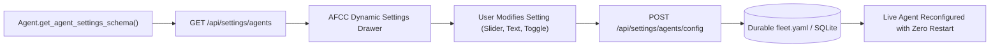

# Customizing & Installing Agents

Personal Agentic Fleet provides a flexible customization layer that allows users to modify agent behavior at runtime, activate or deactivate agents on demand, and discover and install new agents from the built-in catalog without restarting the server.

---

## 1. Dynamic Agent Activation & Deactivation

Fleet agents do not waste system resources when idle or unneeded. Any agent can be dynamically enabled or disabled in real time:

### Methods of Toggling Agents
1. **Via the AFCC Settings Modal**:
   - Navigate to **Settings (`Ctrl+,`) -> Agents & Activation**.
   - Toggle the switch next to any agent.
   - Disabled agents are immediately unloaded from the memory registry, their background tasks are paused, and their tabs are hidden from the navigation bar.
2. **Via REST API**:
   ```bash
   # Disable an agent
   curl -X POST http://127.0.0.1:7890/api/settings/agents/toggle \
     -H "Content-Type: application/json" \
     -d '{"id": "gmail", "enabled": false}'

   # Enable an agent
   curl -X POST http://127.0.0.1:7890/api/settings/agents/toggle \
     -H "Content-Type: application/json" \
     -d '{"id": "gmail", "enabled": true}'
   ```
3. **Via the Unified CLI**:
   ```bash
   fleet toggle-agent gmail --disable
   fleet toggle-agent gmail --enable
   ```

---

## 2. Dynamic Agent Settings Schema Drawer

Every agent exposes a strongly-typed settings schema via `get_agent_settings_schema()`. When you click the gear icon ($\text{⚙}$) next to an agent, AFCC dynamically renders a dedicated settings drawer:



### Supported Schema Field Types
- `string`: Single-line text input (e.g. branch names, URL endpoints).
- `number`: Numeric or floating-point input with min/max bounds (e.g. hydration targets, poll intervals).
- `boolean`: Clean toggle switch (e.g. enable notifications, auto-archive spam).
- `select`: Dropdown menu with predefined options (e.g. log levels, filter presets).

### Code Example: Implementing a Custom Schema
```python
def get_agent_settings_schema(self) -> List[Dict[str, Any]]:
    return [
        {
            "id": "target_calories",
            "label": "Daily Calorie Target",
            "type": "number",
            "default": 2400,
            "min": 1200,
            "max": 5000,
            "description": "Daily metabolic goal for calorie consumption.",
        },
        {
            "id": "notify_on_milestones",
            "label": "Milestone Notifications",
            "type": "boolean",
            "default": True,
            "description": "Send desktop notification when 50% and 100% of goal is reached.",
        }
    ]
```

---

## 3. Remote Catalog Discovery & One-Click Installation

The built-in **Agent Catalog** allows users to discover, preview, and install community and specialized agents with a single click:

### Discovering Catalog Agents
1. In AFCC, navigate to **Settings -> Discover & Download**.
2. Browse available specialized agents:
   - **`crypto_trader`**: Local crypto price ticker and DCA tracking.
   - **`home_assistant`**: Home Assistant bridge for local IoT lights and climate.
   - **`research_scholar`**: Academic paper fetcher and arXiv summarizer.
   - **`media_librarian`**: Local audio/video library organizer and metadata tagger.
3. Click **Install Agent**. The system automatically:
   - Validates the agent package structure.
   - Generates the isolated directory in `fleet/data/custom_agents/<id>/`.
   - Registers the agent with the live registry and mounts its UI panel.

### REST API Catalog Installation
```bash
# List available catalog agents
curl http://127.0.0.1:7890/api/settings/agents/catalog

# Install an agent from the catalog
curl -X POST http://127.0.0.1:7890/api/settings/agents/catalog/install \
  -H "Content-Type: application/json" \
  -d '{"id": "home_assistant"}'
```
