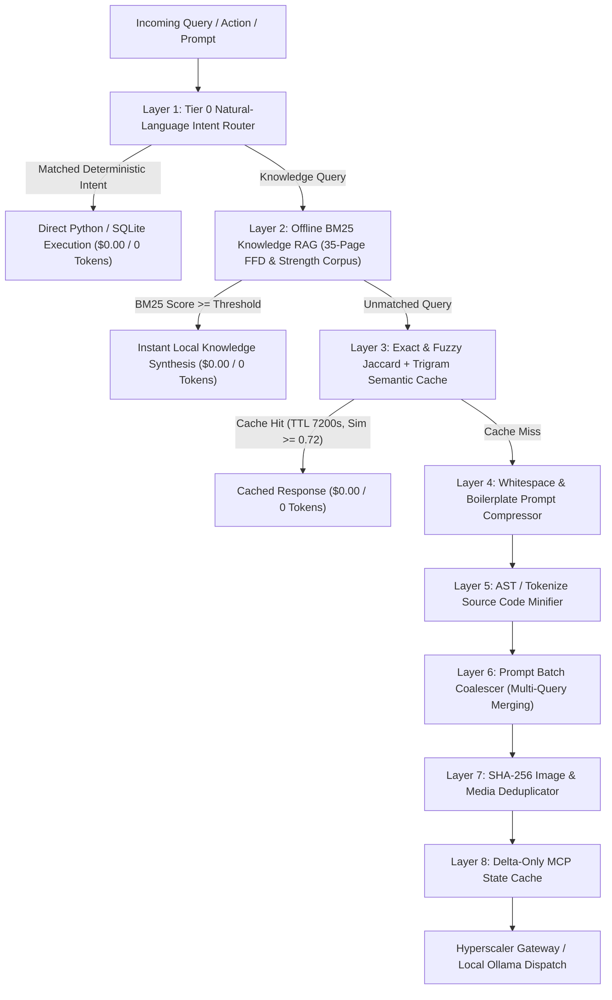

# 🌐 Hyperscalers, 8-Layer Zero-Token Optimizer & Scheduler Deep-Dive

> **Release Version**: `v2.10.0` | **Subsystems**: `fleet/core/token_optimizer.py`, `fleet/core/hyperscalers.py`, `fleet/core/dev_tools.py`, `fleet/core/scheduler.py`, `fleet/core/yaml_helper.py`

This guide provides an exhaustive architectural and algorithmic reference for Personal Agentic Fleet's **8-Layer Zero-Token & Cost Optimization Engine**, **Universal Hyperscaler Gateway (with pure-stdlib AWS SigV4 signing)**, **AI Developer Tools Bridge**, and **Deterministic Cron/Interval Scheduler**.

---

## 1. The 8-Layer Zero-Token & Cost Optimization Engine (`fleet/core/token_optimizer.py`)

Personal Agentic Fleet is engineered around a strict **Zero-Token (`$0.00`) First** philosophy. Before any user query, dashboard action, or MCP request ever reaches a cloud LLM, it passes through an **8-Layer Optimization Pipeline** implemented in `fleet/core/token_optimizer.py`:



### Layer 1: Tier 0 Natural-Language Intent Router (`route_local_intent`)
- **Mechanism**: Uses compiled regular expressions and keyword-intent scoring tables to intercept natural-language commands that map directly to deterministic local state mutations or telemetry queries.
- **Supported Intent Families**:
  - **Task Mutations**: `"add task ..."`, `"complete task #3"`, `"list pending tasks"` → invokes `FleetDatabase.add_task()` / `get_tasks()`.
  - **Health & Hydration Logging**: `"log 2 glasses of water"`, `"drank 500ml"`, `"log workout completed"` → mutates `health_metrics` in SQLite.
  - **System Diagnostics & Memory Optimization**: `"free up ram"`, `"flush dns"`, `"check memory"`, `"pc status"` → invokes `SystemOptimizer` in-process Win32 PSAPI routines.
  - **Email Classification**: `"classify emails"`, `"check inbox"` → triggers deterministic 5-folder rule engine (`fleet/integrations/gmail_classifier.py`).

### Layer 2: Offline BM25 Knowledge RAG (`LOCAL_KNOWLEDGE_CORPUS` & `bm25_search`)
- **Corpus Architecture**: Embeds a curated local knowledge base (`LOCAL_KNOWLEDGE_CORPUS` in `fleet/core/token_optimizer.py`) distilling the **35-Page Freedom From Diabetes (FFD) Protocol** and **Traditional Indian Akhada Conditioning Manual** into structured, tagged knowledge chunks:
  1. `ffd_smoothie`: Exact FFD Green Smoothie recipe (`1 handful Spinach/Palak or Methi`, `1/2 Cucumber`, `1 Tomato or 4-5 Amla pieces`, `1/2 Apple/Guava/Pear`, `fresh ginger, lemon, black salt, pinch of cinnamon & black pepper`, `250ml water`, blended—never strained—to preserve insoluble fiber).
  2. `ffd_hypoglycemia`: Emergency Rule of 15 protocol for blood sugar `< 70 mg/dL` (15g fast-acting carbohydrates, 15-minute re-check, complex carb + protein stabilizer, medication review).
  3. `ffd_exercise`: Antigravity Step Climbing (`15 mins` post-meal glucose sponge via GLUT-4 translocation) and **Nitric Oxide Dump (NOD)** (`4 movements × 10 reps × 3 sets`: Squats, Alternating Arm Raises, Non-Jumping Jacks, Shoulder Presses).
  4. `ffd_breakfast`: **25-25-50% Breakfast Formula** (25% sprouts/legumes, 25% raw salad, 50% cooked dal/besan chilla/moonglet; zero refined wheat/bread/cornflakes).
  5. `ffd_lunch_dinner`: **25% Quad Plate Rule** (25% raw salad eaten first, 25% cooked low-GI vegetables, 25% dal/plant protein, 25% khapli wheat/millets/brown rice).
  6. `ffd_oils_seeds`: Approved cold-pressed oils (coconut, sesame, groundnut, mustard), daily seed rotation (`1 tbsp` flax, pumpkin, sunflower, chia, watermelon), and strictly prohibited items (refined seed oils, milk/curd, white sugar, jaggery, honey).
  7. `strength_split`: Complete **6-Day Traditional Indian Strength Split** (**Mon**: Mudgal, **Tue**: Active FFD Reversal & Surya Namaskar, **Wed**: Samtola, **Thu**: NOD & Weighted Walking, **Fri**: Bhim Gadha, **Sat**: Triple Tool Akhada Flow, **Sun**: Rest).
- **BM25 Scoring Formula**:
  $$\text{Score}(D, Q) = \sum_{i=1}^{n} \text{IDF}(q_i) \cdot \frac{f(q_i, D) \cdot (k_1 + 1)}{f(q_i, D) + k_1 \cdot \left(1 - b + b \cdot \frac{|D|}{\text{avgdl}}\right)}$$
  where $k_1 = 1.5$ and $b = 0.75$, augmented by exact tag-match boosts (`+3.5` per matching domain tag).

### Layer 3: Exact & Fuzzy Jaccard + Character Trigram Cache
- **Parameters**:
  - `PROMPT_CACHE_TTL_SEC = 7200` (2-hour TTL).
  - `PROMPT_CACHE_MAX_ENTRIES = 256` (LRU eviction).
  - `FUZZY_SIMILARITY_THRESHOLD = 0.72` (72% combined similarity threshold).
- **Similarity Metric**: Combines token-level Jaccard similarity ($J(A, B) = \frac{|A \cap B|}{|A \cup B|}$) with character 3-gram overlap ($T(A, B)$):
  $$\text{Sim}(A, B) = 0.60 \cdot J_{\text{tokens}}(A, B) + 0.40 \cdot J_{\text{trigrams}}(A, B)$$
  Any paraphrased prompt scoring $\ge 0.72$ against a non-expired cache entry returns the cached completion immediately at `0` tokens.

### Layers 4–8: Context Compression, AST Minification & Delta State
- **Layer 4 (`compress_prompt`)**: Strips redundant filler phrases (`"please kindly"`, `"could you please"`), collapses multi-line whitespace, and normalizes markdown tables, reducing prompt tokens by **15%–25%**.
- **Layer 5 (`minify_code_context`)**: Uses Python's stdlib `tokenize` and `ast` modules to strip inline comments and docstrings from code snippets before attaching them to LLM context windows, saving **30%–55%** on code-heavy prompts while preserving 100% of executable semantics.
- **Layer 6 (`PromptCoalescer`)**: Batches concurrent sub-queries queued within a configurable debounce window into a single structured multi-part prompt, amortizing system-prompt overhead across $N$ requests.
- **Layer 7 (`MediaDeduplicator`)**: Computes `hashlib.sha256(image_bytes)` on every screenshot or attachment; if an identical image hash was already analyzed in the active session, injects the cached visual description instead of re-sending multi-megabyte base64 payloads.
- **Layer 8 (`DeltaMcpCache`)**: Tracks the last-sent state hash for each FastMCP resource (`fleet_get_daily_briefing`, `fleet_list_tasks`); if unchanged since the previous turn, returns a compact `[UNCHANGED_DELTA_HASH]` marker instead of repeating full JSON payloads.
- **Live Telemetry**: All token savings (`tokens_saved_estimate`, `dollars_saved_estimate`, `tier0_hits`, `rag_hits`, `fuzzy_cache_hits`) are persisted in `fleet/data/user/token_optimizer_stats.json` and surfaced in the **Antigravity Token Vault** tab.

---

## 2. Universal Hyperscaler Gateway (`fleet/core/hyperscalers.py`)

When an agent or workflow explicitly requires generative reasoning beyond Tier 0 / BM25 RAG, `fleet/core/hyperscalers.py` provides a **zero-SDK-bloat Universal LLM Gateway** supporting **6 major hyperscaler families** plus local inference:

| Provider ID | Hyperscaler Name | Auth Mechanism | Default / Supported Models |
| :--- | :--- | :--- | :--- |
| `google` | **Google Gemini (AI Studio)** | `GEMINI_API_KEY` | `gemini-2.5-pro`, `gemini-2.5-flash`, `gemini-2.0-flash` |
| `google_vertex` | **Google Cloud Vertex AI** | `GOOGLE_CLOUD_PROJECT`, `GOOGLE_CLOUD_LOCATION` | `gemini-2.5-pro`, `gemini-2.5-flash`, `claude-3-7-sonnet@20250219` |
| `microsoft` | **Microsoft Azure OpenAI / AI Foundry / GitHub Models** | `AZURE_OPENAI_API_KEY`, `AZURE_OPENAI_ENDPOINT`, `GITHUB_TOKEN` | `gpt-4o`, `gpt-4o-mini`, `o3-mini`, `DeepSeek-R1`, `Phi-4` |
| `aws` | **Amazon Web Services (AWS Bedrock)** | `AWS_ACCESS_KEY_ID`, `AWS_SECRET_ACCESS_KEY`, `AWS_REGION` | `anthropic.claude-3-7-sonnet-20250219-v1:0`, `amazon.nova-pro-v1:0`, `meta.llama3-3-70b-instruct-v1:0` |
| `anthropic` | **Anthropic Claude Direct** | `ANTHROPIC_API_KEY` | `claude-3-7-sonnet-latest`, `claude-3-5-haiku-latest`, `claude-3-opus-latest` |
| `openai` | **OpenAI Platform** | `OPENAI_API_KEY` | `gpt-4o`, `gpt-4o-mini`, `o3-mini`, `o1` |
| `ollama` | **Local Ollama (`$0.00` Offline)** | Local HTTP (`http://127.0.0.1:11434`) | `qwen2.5-coder:14b`, `llama3.2`, `deepseek-r1:14b`, `phi4`, `mistral` |

### Pure-Stdlib AWS SigV4 Cryptographic Signing (`_sign_aws_sigv4`)
Unlike heavy frameworks that require `boto3` and `botocore` (~80 MB of dependencies), `fleet/core/hyperscalers.py` implements **AWS Signature Version 4 (`AWS4-HMAC-SHA256`)** in ~65 lines of pure Python standard library (`hmac`, `hashlib`, `datetime`, `urllib.request`):
1. **Canonical Request Construction**: Normalizes HTTP method, URI path (`/model/{model_id}/converse`), sorted query string, canonical headers (`content-type`, `host`, `x-amz-date`, optional `x-amz-security-token`), and `SHA256(payload)`.
2. **String-to-Sign Generation**: Combines `AWS4-HMAC-SHA256`, ISO8601 timestamp (`YYYYMMDD'T'HHMMSS'Z'`), credential scope (`{datestamp}/{region}/bedrock/aws4_request`), and canonical request hash.
3. **4-Step HMAC-SHA256 Signing Key Derivation**:
   $$\begin{aligned}
   k_{\text{Date}} &= \text{HMAC-SHA256}(\text{"AWS4"} \parallel \text{SecretKey}, \text{DateStamp}) \\
   k_{\text{Region}} &= \text{HMAC-SHA256}(k_{\text{Date}}, \text{Region}) \\
   k_{\text{Service}} &= \text{HMAC-SHA256}(k_{\text{Region}}, \text{"bedrock"}) \\
   k_{\text{Signing}} &= \text{HMAC-SHA256}(k_{\text{Service}}, \text{"aws4_request"})
   \end{aligned}$$
4. **Authorization Header Injection**: Computes `signature = hmac.new(k_signing, string_to_sign, hashlib.sha256).hexdigest()` and dispatches directly to `https://bedrock-runtime.{region}.amazonaws.com`.

---

## 3. AI Developer Tools Bridge & Instruction Synchronizer (`fleet/core/dev_tools.py`)

`fleet/core/dev_tools.py` bridges Personal Agentic Fleet with local AI coding assistants and synchronizes architectural rules across all major agentic IDEs:

| Tool ID | AI Coding Assistant | Instruction File Synchronized | CLI Binary Probed |
| :--- | :--- | :--- | :--- |
| `github_copilot` | **GitHub Copilot (VS Code / JetBrains / CLI)** | `.github/copilot-instructions.md` | `gh copilot` / `code` |
| `claude_code` | **Anthropic Claude Code** | `CLAUDE.md` | `claude` |
| `gemini_cli` | **Google Gemini CLI & Antigravity** | `GEMINI.md` | `gemini` / `agy` |
| `amazon_q` | **AWS Amazon Q Developer** | `.amazonq/rules/fleet-instructions.md` | `q` |

- **One-Click Instruction Sync (`POST /api/devtools/sync-instructions`)**: Generates unified project instructions covering microkernel isolation, DPAPI security invariants, zero-token optimization rules, and preflight gate requirements, writing them atomically to `.github/copilot-instructions.md`, `CLAUDE.md`, and `GEMINI.md`.

---

## 4. Deterministic Cron & Interval Scheduler Engine (`fleet/core/scheduler.py`)

Personal Agentic Fleet includes a zero-dependency, deterministic scheduling engine (`AgentScheduler` in `fleet/core/scheduler.py`) backed by `schedules.yaml` and a pure-Python YAML parser (`fleet/core/yaml_helper.py`).

### Supported Schedule Expression Formats
Every task inside `schedules.yaml` (under `agents.<agent_id>.tasks.<task_id>`) supports 4 scheduling modalities evaluated by `is_task_due()`:

1. **Exact Daily Time (`time`)**:
   ```yaml
   time: "08:00"
   ```
   Triggers once per calendar day as soon as wall-clock time reaches `08:00` (with catch-up execution if the workstation wakes from sleep later that day).
2. **Multiple Daily Windows (`times`)**:
   ```yaml
   times: ["10:00", "12:00", "15:00", "18:00", "20:30"]
   ```
   Triggers once inside each specified time window per day (used by the Health agent's hydration reminder schedule).
3. **Recurring Hour/Minute Intervals (`interval_hours` / `every`)**:
   ```yaml
   interval_hours: 4
   # or shorthand string syntax:
   every: "30m"   # supports "30m", "2h", "1d"
   ```
   Triggers whenever `now_epoch - last_run_epoch >= interval_seconds`.
4. **Standard 5-Field Cron Expressions (`cron`)**:
   ```yaml
   cron: "0 9 * * 1-5"   # 09:00 AM Monday through Friday
   ```
   Parsed by `match_cron_field(field_expr, value)` and `match_cron_expr(cron_expr, dt)`, supporting wildcards (`*`), step intervals (`*/15`), inclusive ranges (`1-5`), and comma-separated lists (`1,3,5`).

### Default Built-in Agent Schedules (`DEFAULT_SCHEDULES`)

| Agent ID | Task ID | Default Schedule | Action Executed |
| :--- | :--- | :--- | :--- |
| `overview` | `morning_briefing` | `time: "08:00"` | Dispatches daily desktop toast notification with pending task count and active habits. |
| `overview` | `evening_wrapup` | `time: "21:00"` | Summarizes completed tasks and streaks for the day. |
| `health` | `morning_smoothie_and_workout` | `time: "07:30"` | Sends today's 6-Day Traditional Strength Split focus (Mudgal/Samtola/Bhim Gadha/FFD) + Green Smoothie reminder. |
| `health` | `hydration_check` | `times: ["10:00", "12:00", "15:00", "18:00", "20:30"]` | Checks water intake progress against the 8-glass daily target. |
| `optimizer` | `periodic_ram_audit` | `interval_hours: 4` | Runs silent Win32 PSAPI memory telemetry audit and alerts if RAM exceeds threshold (`85%`). |
| `optimizer` | `daily_temp_cleanup` | `time: "22:00"` | Purges stale OS temporary files and flushes DNS cache. |
| `gmail` | `inbox_classification` | `interval_hours: 2` | Runs deterministic 5-folder email classification (`01-Focus`, `02-Paper-Trail`, `03-Read-Feed`, `04-Promotions`, `05-Archive-Sweep`). |
| `antigravity` | `conversation_mirror_sync` | `interval_hours: 1` | Indexes latest `.gemini/antigravity/brain/*` transcripts and updates token savings statistics. |
| `backlog` | `weekly_backlog_digest` | `cron: "0 9 * * 1"` | Surfaces high-priority (`P0`/`P1`) backlog items every Monday at 09:00 AM. |
| `mind` | `circadian_dream_consolidation` | `time: "23:30"` | Triggers `SubconsciousMind.dream()` memory consolidation and `FleetSoul.audit_alignment()`. |

### REST API & FastMCP Controls
- `GET /api/schedules` — Returns all agent schedules, next/last run timestamps, and global scheduler state.
- `POST /api/schedules` — Updates schedule expressions, parameters, or enabled flags in `schedules.yaml`.
- `POST /api/schedules/run` — Immediately executes a scheduled task on demand (`{"agent_id": "health", "task_id": "morning_smoothie_and_workout"}`).
- **FastMCP Tools**: `fleet_list_schedules`, `fleet_toggle_schedule`, `fleet_update_schedule`, and `fleet_run_scheduled_task`.

