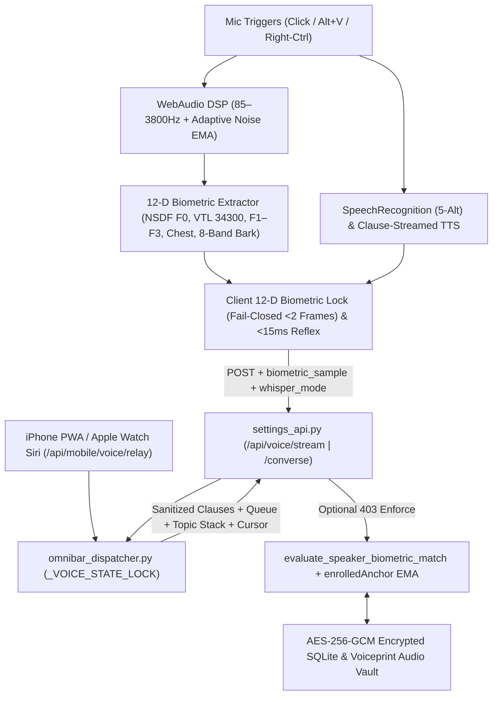
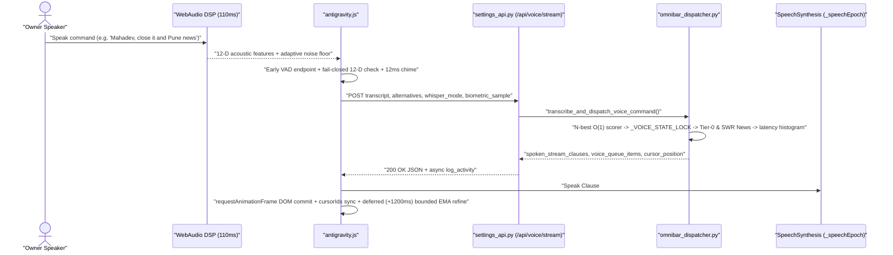
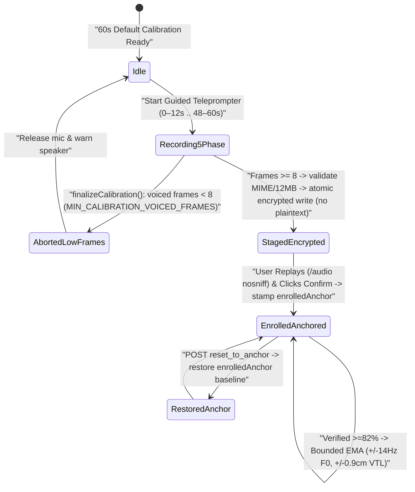

# 🔱 Mahadev Voice Command & Biometric Speaker Cockpit Architecture (`v2.21.0`)

Deep engineering reference and Top-1% Principal Systems Architect review of the **Mahadev Voice Command & Biometric Speaker Cockpit via AFCC** (`fleet/web/static/js/antigravity.js`, `fleet/api/settings_api.py`, `fleet/core/omnibar_dispatcher.py`, and `fleet/api/mobile_tri_device_api.py`).

For the full specification in the repository, see [docs/MAHADEV_VOICE_BIOMETRIC_ARCHITECTURE.md](https://github.com/macazaka/personal-agentic-fleet/blob/main/docs/MAHADEV_VOICE_BIOMETRIC_ARCHITECTURE.md).

---

## 1. Personal Laptop Hardware & Acoustic Envelope

* **Shared Mic & Thermal Constraints:** Laptop microphones pick up `50–60 Hz` hum and cooling fan noise (`85–3800 Hz` biquad bandpass + adaptive `ambientNoiseRms` EMA + `15s` idle `MediaStream` release so the hardware mic LED turns off).
* **Chromium Speech & Main-Thread Constraints:** Early-intent VAD endpointing (`40–260ms`), exponential ASR error backoff, `_speechEpoch`-guarded TTS watchdog + `10s` pause/resume keepalive, and offscreen-skipped 32-bit FNV spectrum canvas rendering.
* **Zero-Cloud Privacy & Anti-Impostor Defense:** DPAPI + AES-256-GCM encrypted SQLite vault, zero-plaintext atomic biometric audio storage (`<= 12 MB`, MIME-validated, `X-Content-Type-Options: nosniff`), harmonized `34300 cm/s` VTL physics, fail-closed live speaker lock, immutable `enrolledAnchor` anti-drift clamps, and thread-safe RLock isolation (`_VOICE_STATE_LOCK`, `_VOICEPRINT_CACHE_LOCK`).

---

## 2. Architecture Diagrams

### High-Level Mahadev Voice & Biometric Topology

### Live Spoken Command & Clause-Streaming Flow

### 60-Second 5-Phase Calibration & Anchor Enrollment State Machine

---

## 3. Executed Architectural Improvements (`[MV-01]`–`[MV-10]`)

1. **`[MV-01]` Zero-Plaintext Atomic Biometric Audio & Lightweight Boot**: Removed plaintext pre-write and JSON fallback in `_save_voiceprint_audio_data_url()`, added `12MB`/MIME validation (`400`/`413`), added `X-Content-Type-Options: nosniff` on `/api/voice/voiceprint/audio`, and added `?include_audio=0` boot hydration.
2. **`[MV-02]` Harmonized Physics & Fail-Closed Biometric Lock**: Aligned client VTL (`34300 cm/s`) with server, added `MIN_CALIBRATION_VOICED_FRAMES = 8`, made live Speaker Lock fail closed when `< 2` frames are captured, and added server-side `biometric_sample` verification + `enforce_biometric` HTTP `403`.
3. **`[MV-03]` Zero-Leak Hardware Mic & Memory Lifecycle**: Added `15s` idle mic auto-release (`stopJarvisAudioDspPipeline`), avoided double PCM+MediaRecorder RAM buffers, released mic post-calibration/sandbox, and added `visibilitychange`/`pagehide` guards.
4. **`[MV-04]` Epoch-Guarded TTS & Exponential ASR Backoff**: Added `_speechEpoch` cancellation safety on callbacks & `450ms` watchdog, `10s` Chromium `pause()`/`resume()` TTS keepalive, and exponential ASR error backoff (`150ms–4000ms`, pausing cleanly after 5 failures).
5. **`[MV-05]` Thread-Safe Locks & Cache Coherency**: Protected all shared dispatcher state under `_VOICE_STATE_LOCK` and decrypted voiceprint caches under `_VOICEPRINT_CACHE_LOCK`, fixing stale cache overwrites during sandbox updates.
6. **`[MV-06]` Real Dispatch Latency Histogram & Cursor Sync**: Replaced static latency placeholders with a 50-turn rolling latency histogram (`avg`/`p95`/`last`), per-channel counters (`stream`/`converse`/`mobile_relay`), stream activity logging, and `cursor_position -> cursorIdx` sync.
7. **`[MV-07]` Voiceprint-Aware Barge-In & Whisper Parity**: Scoped barge-in to the enrolled voiceprint's F0/VTL corridor, added server-side `whisper_mode` 1-clause clamping, and cleared client base64 audio after confirm.
8. **`[MV-08]` Adaptive Fan-Noise Floor & Mobile Relay Parity**: Added `ambientNoiseRms` EMA dynamic silence gating and refactored `/api/mobile/voice/relay` onto the shared wake-word regex cache & speech sanitizer.
9. **`[MV-09]` Immutable `enrolledAnchor` & Drift Recovery**: Attached `enrolledAnchor` at enrollment, clamped cumulative EMA drift (`±14 Hz` F0, `±0.9 cm` VTL, `±0.25` chest), and exposed `reset_to_anchor` API + Sandbox button.
10. **`[MV-10]` Enriched Engine Diagnostics & Sandbox Health Card**: Added `latency`, `channels`, and `biometric_security` metrics to `GET /api/voice/diagnostics` and rendered `#voiceEngineDiagnosticsBox` in Settings -> Voice Sandbox.
