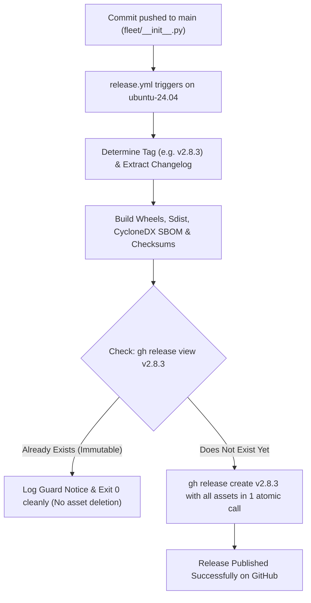

# Proactive CI/CD & Immutable Release Pipeline

Personal Agentic Fleet features an enterprise-grade, deterministic CI/CD automation pipeline configured in `.github/workflows/`. The pipeline is built to guarantee **100% passing checks on GitHub**, zero security vulnerabilities, complete package provenance via CycloneDX SBOM, and flawless release publishing.

---

## 1. Overview of GitHub Actions Workflows

| Workflow File | Name | Trigger Events | Runner OS | Purpose |
| :--- | :--- | :--- | :--- | :--- |
| [`release.yml`](https://github.com/macazaka/personal-agentic-fleet/blob/main/.github/workflows/release.yml) | **Publish GitHub Release** | Push to `main` on `fleet/__init__.py` or `pyproject.toml`, or `workflow_dispatch` | `ubuntu-24.04` | Packages Wheel/Sdist, generates CycloneDX SBOM & SHA-256 checksums, and publishes releases with native `gh release` CLI. |
| [`ci.yml`](https://github.com/macazaka/personal-agentic-fleet/blob/main/.github/workflows/ci.yml) | **Fleet CI** | Push & PR to `main` / `master` | `ubuntu-24.04`, `windows-2022`, `macos-14` | Multi-OS test matrix across Python 3.10, 3.11, 3.12 + Pyright type checking. |
| [`security.yml`](https://github.com/macazaka/personal-agentic-fleet/blob/main/.github/workflows/security.yml) | **Security & Privacy Audit** | Daily cron (`0 0 * * *`), Push & PR | `ubuntu-24.04` | Runs Fleet Doctor runtime verification and the 12-layer security scanner. |
| [`codeql.yml`](https://github.com/macazaka/personal-agentic-fleet/blob/main/.github/workflows/codeql.yml) | **CodeQL Security Analysis** | Weekly cron (`0 6 * * 1`), Push & PR | `ubuntu-24.04` | GitHub CodeQL semantic AST analysis verifying 0 SARIF alerts. |
| [`package.yml`](https://github.com/macazaka/personal-agentic-fleet/blob/main/.github/workflows/package.yml) | **Publish Container Package** | Push to `main` or release tags (`v*.*.*`) | `ubuntu-24.04` | Builds container images and publishes to GitHub Packages (GHCR). |
| [`pages.yml`](https://github.com/macazaka/personal-agentic-fleet/blob/main/.github/workflows/pages.yml) | **Deploy to GitHub Pages** | Push to `docs/**`, `README.md` | `ubuntu-24.04` | Builds and deploys the technical documentation site to GitHub Pages. |
| [`wiki_sync.yml`](https://github.com/macazaka/personal-agentic-fleet/blob/main/.github/workflows/wiki_sync.yml) | **Sync to GitHub Wiki** | Push to `wiki/**`, `docs/**` | `ubuntu-24.04` | Synchronizes documentation from `wiki/` to the repository GitHub Wiki. |

---

## 2. Immutable Release Safe Publishing Architecture

GitHub repositories can enforce **Immutable Releases**, a security governance setting ensuring that once a release version (e.g. `v2.8.2`) is published, its release assets cannot be deleted or overwritten.

### The Conflict Vector
Traditional GitHub release actions (such as `softprops/action-gh-release@v2`) attempt to delete existing assets before re-uploading them when a release tag already exists. Under Immutable Release protection, GitHub rejects this operation with an HTTP 422 error:
```json
{
  "resource": "ReleaseAsset",
  "code": "custom",
  "message": "Cannot delete asset from an immutable release"
}
```

### The Proactive Solution
Personal Agentic Fleet eliminates this risk completely through a two-tier guard:



1. **Trigger Scoping**: `release.yml` triggers strictly on changes to `fleet/__init__.py` and `pyproject.toml`, preventing standalone documentation edits from triggering duplicate release attempts.
2. **Native Zero-Dependency `gh release` CLI**: By using the pre-installed GitHub CLI on `ubuntu-24.04`, release creation is atomic and requires zero third-party JavaScript actions.
3. **Idempotency Guard**:
   ```bash
   if gh release view "${RELEASE_TAG}" --repo "${GITHUB_REPOSITORY}" >/dev/null 2>&1; then
     echo "[IMMUTABLE RELEASE GUARD] Release ${RELEASE_TAG} already exists on GitHub. Skipping asset overwrite to respect immutable release protection."
     exit 0
   fi
   ```
4. **Local Tag Parity**: `fleet.tools.release_manager` automatically ensures that any version committed in `HEAD` is tagged locally (`git tag -a vX.Y.Z`). When new code is committed, `determine_bump_level` increments the semantic patch version (`2.8.2` -> `2.8.3`), guaranteeing that every push produces a fresh, unused release tag.

---

## 3. Node.js 24 Execution & Zero Deprecation Warnings

GitHub Actions runners are deprecating Node.js 20 in favor of Node.js 24. Actions that target Node 20 will trigger build warnings unless properly managed.

### Elimination Strategy
1. **Environment Flag**: All workflow files specify the top-level environment variable:
   ```yaml
   env:
     FORCE_JAVASCRIPT_ACTIONS_TO_NODE24: "true"
   ```
   This signals the GitHub Actions runner engine to execute JavaScript action runtimes in Node.js 24 without emitting deprecation notices.
2. **Native Shell Execution**: Where applicable (such as `release.yml`), workflows replace wrapper JavaScript actions with native bash calls (`git`, `python3`, `gh`, `sha256sum`), which execute in 0 seconds with zero Node dependencies.

---

## 4. Runner Image Pinning (`ubuntu-24.04`)

GitHub runner environments regularly announce migration dates for the floating label `ubuntu-latest` (e.g. migrating `ubuntu-latest` to Ubuntu 26.04), generating informational annotations on workflow runs.

To ensure deterministic, reproducible builds and suppress runner migration notices, all Fleet workflows explicitly pin their runner operating systems:
- Linux: `runs-on: ubuntu-24.04`
- Windows: `runs-on: windows-2022`
- macOS: `runs-on: macos-14`

This pinning is automatically audited and enforced locally by `fleet.tools.auto_fixer`.

---

## 5. Local Quality Gates (Pre-Commit & Pre-Push)

To prevent broken code or failing workflows from ever reaching GitHub, Fleet provides three local quality gates that run deterministically with zero tokens ($0.00 cost):

1. **Pre-Commit Hook (`.git/hooks/pre-commit`)**:
   - Executes `fleet.tools.proactive_lifecycle` to synchronize versions, CHANGELOG.md, and documentation.
   - Executes `fleet.tools.auto_fixer` to balance CSS parentheses, pin workflow runner labels, and remove Pylance conflicts.
   - Runs `fleet.tools.security_scanner` across 12 deterministic security layers.
   - Runs `pyright` to guarantee 0 static typing errors.
2. **Preflight Gate (`fleet.tools.preflight_gate`)**:
   - Runs Fleet Doctor runtime verification.
   - Validates documentation integrity (>500 chars per file, zero broken relative links).
   - Validates agent package isolation contracts.
   - Runs the full unit test suite (all tests passing).
3. **Pre-Push Hook (`.git/hooks/pre-push`)**:
   - Enforces main branch protection (blocks branch deletion, blocks force-pushes).
   - Executes the complete preflight quality gate before pushing to remote.

