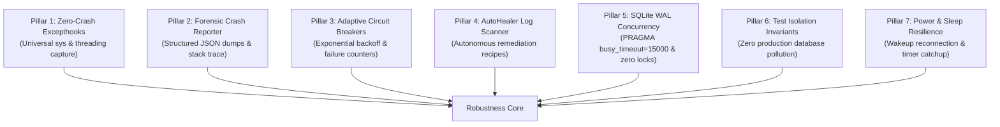

# 🛡️ Robustness, Self-Healing & Crash Recovery Deep-Dive

> **Release Version**: `v2.11.1` | **Core Modules**: `fleet/core/supervisor.py`, `fleet/core/connection_pool.py`, `fleet/core/resource_quota.py`, `fleet/core/circuit_breaker.py`, `fleet/core/auto_healer.py`, `fleet/core/crash_reporter.py`

Personal Agentic Fleet is engineered for non-stop, unattended operation. It treats failures, process terminations, database lock contention, and environment corruption as expected events, handling them through a structured **7-Pillar Native Robustness Architecture**.

---

## 1. The 7 Pillars of Native Robustness



| Pillar | Mechanism | Protection Scope |
| :--- | :--- | :--- |
| **1. Zero-Crash Excepthooks** | `sys.excepthook` + `threading.excepthook` | Catches unhandled exceptions on main and background worker threads, preventing silent daemon aborts. |
| **2. Forensic Crash Dumps** | Structured JSON logs in `fleet/data/crash_reports/` | Captures OS environment, Python build, active threads, memory state, and full stack trace. |
| **3. Adaptive Circuit Breakers** | Consecutive error counters with exponential cooldown | Halts traffic to failing remote endpoints (e.g. Gmail API, GitHub) to prevent cascade failures. |
| **4. AutoHealer Log Scanner** | Subconscious background log mining engine | Scans `fleet_app.log` every 15 minutes, identifies recurring anomalies, and applies healing recipes. |
| **5. SQLite WAL Concurrency** | Write-Ahead Logging + thread-local pools | Completely eliminates "database is locked" errors under concurrent multi-agent read/write load. |
| **6. Test Isolation Invariants** | `FLEET_TEST_MODE=1` & isolated DB fixtures | Guarantees that unit test suites run against in-memory or temp SQLite DBs and never modify real user data. |
| **7. Power & Sleep Resilience** | OS sleep & wake event listeners | Detects workstation sleep/resume cycles, flushes dirty WAL buffers before sleep, and catches up timers. |

---

## 2. Universal Crash Reporter (`fleet.crash_reporter`)

Whenever an unhandled exception occurs in any thread, the Universal Crash Reporter intercepts it before the interpreter can crash:
1. **Crash Report Generation**: A timestamped JSON report is generated in `fleet/data/crash_reports/crash_YYYYMMDD_HHMMSS.json`.
2. **Captured Context**:
   - `timestamp`: Precise ISO 8601 UTC timestamp.
   - `exception`: Type, message, and formatted traceback.
   - `thread_name`: Identifies which agent or background worker raised the error.
   - `system_metrics`: Snapshot of RAM usage, CPU load, and open file descriptors at time of crash.
   - `recent_logs`: The last 50 log lines emitted by the fleet.
3. **Automatic Log Rotation**: Retains the most recent 20 crash reports, purging older reports to conserve disk space.

---

## 3. AutoHealer Proactive Log Scanner (`fleet.auto_healer`)

The `AutoHealer` runs periodically as a background subconscious daemon (default interval: 15 minutes):

```mermaid
sequenceDiagram
    participant Daemon as Subconscious Daemon
    participant Log as fleet_app.log
    participant Healer as AutoHealer Engine
    participant Target as System / Database / Cache

    Daemon->>Healer: Trigger Proactive Scan (SCAN-YYYYMMDD)
    Healer->>Log: Parse New Log Lines Since Last Scan
    Healer->>Healer: Match Error Signatures (Regex & Anomaly Models)
    alt Lock Contention Detected
        Healer->>Target: Increase PRAGMA busy_timeout & Checkpoint WAL
    alt Missing SQLite Table
        Healer->>Target: Auto-Migrate Table Schema & Repair
    alt High Cache Volume
        Healer->>Target: Clear Expired Cache & Rotate Logs
    end
    Healer-->>Daemon: Scan Complete (Health Index: 100.0)
```

### Supported Autonomous Remediation Recipes
1. **Database Lock Mitigation**: If SQLite lock contention warnings appear in the log, AutoHealer executes a `PASSIVE` or `TRUNCATE` WAL checkpoint and increases the thread timeout buffer.
2. **Missing Schema Migration**: If a new agent version introduces an unmigrated table, AutoHealer automatically executes table creation DDL.
3. **PID File Reconciliation**: If a stale process ID (`.pid`) file remains after an abrupt system shutdown, AutoHealer reaps the dead reference and unlocks the subsystem.
4. **Log Rotation & Pruning**: If `fleet_app.log` exceeds 25MB, it automatically rotates to `fleet_app.log.1` and compresses older segments.

---

## 4. Test Isolation Invariant (Zero Production DB Pollution)

A common issue in agentic systems is unit tests inadvertently modifying real user databases, altering water intake counts, deleting backlog tasks, or modifying habit streaks.

Personal Agentic Fleet enforces strict **Production Database Isolation**:
- **Environment Guard**: When tests run, `FLEET_TEST_MODE="1"` is injected into `os.environ`.
- **In-Memory Fixtures**: The database factory dynamically overrides paths to `:memory:` or isolated temporary directories (`tmp_path`).
- **Connection Interception**: Any test attempting to open `fleet/data/fleet_memory.db` directly without an isolated test fixture raises an immediate assertion error.
- **Audit Verification**: Pre-commit and pre-push quality gates run verification queries confirming that the production database row count has not mutated during testing.
