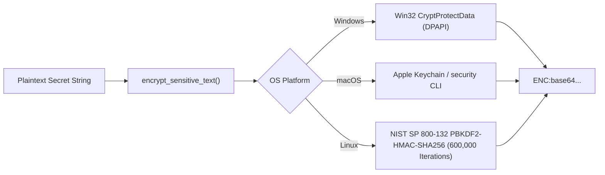

# 🛡️ Security Model & Cryptographic Vault Deep-Dive

> **Release Version**: `v2.10.0` | **Core Modules**: `fleet/tools/security_scanner.py`, `fleet/core/crypto_vault.py`, `fleet/core/session_auth.py`, `fleet/core/plugin_sandbox.py`

Personal Agentic Fleet treats security, privacy, and secret hygiene not as an afterthought, but as an inviolable foundational architecture. It achieves a **100/100 Grade A+** security rating verified continuously by an automated 12-layer deterministic scanner.

---

## 1. The 12-Layer Security & Privacy Scanner

The scanner (`python -m fleet.tools.security_scanner`) executes locally in $< 100\text{ms}$ with zero LLM tokens ($0.00 cost):

```mermaid
graph TD
    Scanner["12-Layer Deterministic Security Scanner"]
    Scanner --> L1["Layer 1: Secret & Signature Exposure (AIza, sk-, pat_, xoxb)"]
    Scanner --> L2["Layer 2: Forbidden Tracked Files (*.db, *.pem, client_secret*.json)"]
    Scanner --> L3["Layer 3: Mandatory .gitignore Hygiene"]
    Scanner --> L4["Layer 4: CodeQL SAST AST Audit (CWE-078, CWE-327, CWE-346, CWE-089)"]
    Scanner --> L5["Layer 5: Localhost HTTP & Boundary Hardening (nosniff, MAX_PAYLOAD)"]
    Scanner --> L6["Layer 6: Scoped User Data Vault Isolation (fleet/data/user/)"]
    Scanner --> L7["Layer 7: At-Rest DPAPI & HMAC-SHA256 Cryptographic Vault"]
    Scanner --> L8["Layer 8: CSP, Permissions-Policy & DNS-Rebinding / CSRF Guard"]
    Scanner --> L9["Layer 9: Plugin Sandboxing & Least-Privilege Manifest Audit"]
    Scanner --> L10["Layer 10: Supply-Chain Dependabot & CycloneDX SBOM Provenance"]
    Scanner --> L11["Layer 11: Zero-Token Determinism & Cost Governance Audit"]
    Scanner --> L12["Layer 12: Python >=3.10 Runtime Pinning & Vault ACL Hardening"]
```



### Detailed Layer Descriptions

| Layer | Verification Target | Protection Mechanism |
| :--- | :--- | :--- |
| **1. Secret Exposure** | High-entropy tokens, Google API keys, OpenAI keys, Slack tokens, private keys. | High-confidence regex pattern matcher auditing all tracked git files. |
| **2. Forbidden Files** | SQLite databases (`*.db`), `.env`, client secrets, private keys (`*.pem`). | Blocks tracking of runtime memory or credential files in git. |
| **3. .gitignore Rules** | Mandatory ignore entries in `.gitignore`. | Auto-appends missing rules to guarantee credentials never stage. |
| **4. CodeQL SAST AST** | CWE-078 (command injection), CWE-327 (weak hashes), CWE-346 (wildcard CORS), CWE-089 (SQL injection). | AST parser verifies `shell=False`, `usedforsecurity=False`, explicit origins, and parameterized SQL. |
| **5. HTTP Boundary** | `X-Content-Type-Options: nosniff`, `MAX_PAYLOAD_BYTES = 5MB`. | Defends against MIME sniffing and Denial-of-Service buffer exhaustion. |
| **6. Scoped User Vault** | `fleet/data/user/` directory isolation. | Personal tokens, notes, and blocklists reside in an isolated, git-ignored directory. |
| **7. Cryptographic Vault** | Native OS credential protection (DPAPI on Windows, Keychain on macOS, POSIX chmod 0700). | Master keys and sensitive tokens encrypted at rest via hardware-backed cryptographic APIs. |
| **8. Web Browser CSP** | `Content-Security-Policy`, `X-Frame-Options: DENY`, DNS rebinding guard. | Blocks inline script injection, clickjacking, and malicious intranet rebinding. |
| **9. Plugin Sandboxing** | `manifest.json` least-privilege verification. | Verifies all agents declare only recognized permissions from `ALLOWED_AGENT_PERMISSIONS`. |
| **10. Supply-Chain SBOM**| Dependabot vulnerability scanning & CycloneDX 1.5 SBOM generation. | Tracks every dependency and produces cryptographically hashed software bills of materials. |
| **11. Cost Governance** | Zero-token determinism invariant. | Prohibits background daemons from invoking paid LLM APIs behind the user's back. |
| **12. Runtime Pinning** | Minimum Python >= 3.10 requirement and OS ACL enforcement. | Validates 64-bit runtime, OpenSSL 1.1.1+, and sets restrictive NTFS ACLs / POSIX 0700 permissions. |

---

## 2. At-Rest Cryptographic Vault (`fleet.core.crypto_vault`)

Sensitive values—such as Gmail OAuth client secrets, API tokens, and private user identifiers—are never stored in plain text:



1. **Windows Native DPAPI**: Uses Win32 `CryptProtectData` (via `ctypes.windll.crypt32`), encrypting data directly against the logged-in user's hardware-backed Windows credentials.
2. **macOS Native Keychain**: Interfaces with the system Keychain Services API, storing keys in the user's secure enclave.
3. **Linux PBKDF2-HMAC-SHA256**: Generates a 256-bit AES master key derived through 600,000 iterations of PBKDF2 with a hardware-seeded salt, protected by POSIX `0700` user permissions.

---

## 3. Scoped User Vault Filesystem ACLs

The directory `fleet/data/user/` houses personal data that must never be accessible to other users or unprivileged accounts on the same machine:
- **Windows (NTFS ACL Hardening)**: Fleet Doctor runs `icacls` to disable inheritance and restrict permissions exclusively to the current logged-in user, `SYSTEM`, and `Administrators`:
  ```cmd
  icacls "fleet\data\user" /inheritance:r /grant:r "%USERNAME%:(OI)(CI)F" /grant:r "SYSTEM:(OI)(CI)F"
  ```
- **POSIX (macOS / Linux)**: Applies octal permissions `0700` (`rwx------`), guaranteeing that other local users on the workstation cannot read directory contents.

---

## 4. Supply-Chain Security & CycloneDX SBOM

To guarantee software provenance and supply-chain integrity, Personal Agentic Fleet:
1. Maintains automated weekly dependency audits via `.github/dependabot.yml`.
2. Generates an automated **CycloneDX 1.5 Software Bill of Materials (SBOM)** at `fleet/data/sbom.cdx.json` on every build and release.
3. Generates cryptographic SHA-256 checksums (`checksums.sha256`) for all distribution wheels and source distributions.
