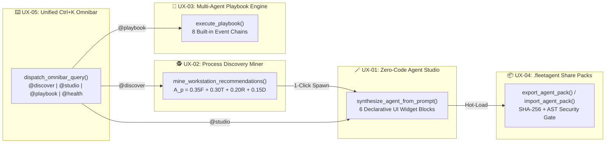

# 🌟 UX & Agent-Simplicity Roadmap & Prioritized Feature Backlog

> **Release Version**: `v2.13.0` | **Detailed Specifications**: [`docs/backlog/`](https://github.com/macazaka/personal-agentic-fleet/tree/main/docs/backlog) | **Live AFCC Tab**: `📋 Feature Backlog`

This page documents the **10-Point UX & Agent-Simplicity Roadmap (`UX-01` – `UX-10`)** designed to make creating, discovering, chaining, and interacting with agents effortless for every user while maintaining Personal Agentic Fleet's **100% Local-First (`$0.00` Zero-Token)** architecture.

---

## 1. Quantitative UX Prioritization Matrix

$$\text{UX Score} = \text{UX Impact (40)} + \text{Friction Reduction (25)} + \text{Zero-Token Leverage (20)} + \text{Time-to-Value (15)}$$

| Rank | ID | Priority & Status | Score | Feature Title | Detailed Spec Link | Release |
| :---: | :---: | :---: | :---: | :--- | :--- | :---: |
| **#1** | **`UX-01`** | 🟢 **Completed (P1)** | **99/100** | **Natural-Language "Zero-Code" Agent Studio Skill & Conversational Workflow** | [`docs/backlog/UX-01-natural-language-agent-studio-skill.md`](https://github.com/macazaka/personal-agentic-fleet/blob/main/docs/backlog/UX-01-natural-language-agent-studio-skill.md) | `v2.9.0` |
| **#2** | **`UX-02`** | 🟢 **Completed (P1)** | **97/100** | **Autonomous Process Discovery & Agent Recommendation Engine (`process_discovery`)** | [`docs/backlog/UX-02-process-discovery-and-recommendation-agent.md`](https://github.com/macazaka/personal-agentic-fleet/blob/main/docs/backlog/UX-02-process-discovery-and-recommendation-agent.md) | `v2.9.0` |
| **#3** | **`UX-03`** | 🟢 **Completed (P1)** | **95/100** | **Visual Multi-Agent Playbook & Event-Chain Composer (`IFTTT` for Fleet)** | [`docs/backlog/UX-03-multi-agent-playbook-and-workflow-chaining.md`](https://github.com/macazaka/personal-agentic-fleet/blob/main/docs/backlog/UX-03-multi-agent-playbook-and-workflow-chaining.md) | `v2.9.0` |
| **#4** | **`UX-04`** | 🟢 **Completed (P1)** | **93/100** | **1-Click Agent Blueprint Templates & Portable `.fleetagent` Share Packs** | [`docs/backlog/UX-04-agent-blueprint-templates-and-share-packs.md`](https://github.com/macazaka/personal-agentic-fleet/blob/main/docs/backlog/UX-04-agent-blueprint-templates-and-share-packs.md) | `v2.9.0` |
| **#5** | **`UX-05`** | 🟢 **Completed (P1)** | **91/100** | **Unified "Ask Fleet Anything" Omnibar & Cross-Agent Dispatcher (`Ctrl+K`)** | [`docs/backlog/UX-05-unified-ask-fleet-omnibar-and-nl-dispatcher.md`](https://github.com/macazaka/personal-agentic-fleet/blob/main/docs/backlog/UX-05-unified-ask-fleet-omnibar-and-nl-dispatcher.md) | `v2.9.0` |
| **#6** | **`UX-06`** | 🟡 **P2** | **89/100** | **Interactive First-Run Persona Onboarding & Goal-Driven Auto-Setup** | [`docs/backlog/UX-06-interactive-persona-onboarding-and-auto-setup.md`](https://github.com/macazaka/personal-agentic-fleet/blob/main/docs/backlog/UX-06-interactive-persona-onboarding-and-auto-setup.md) | `v3.0.0` |
| **#7** | **`UX-07`** | 🟡 **P2** | **87/100** | **Focus-Aware Smart Nudges & Actionable Notification Cards** | [`docs/backlog/UX-07-context-aware-smart-nudges-and-interactive-toasts.md`](https://github.com/macazaka/personal-agentic-fleet/blob/main/docs/backlog/UX-07-context-aware-smart-nudges-and-interactive-toasts.md) | `v3.0.0` |
| **#8** | **`UX-08`** | 🟡 **P2** | **85/100** | **Agent Time-Machine, 1-Click Undo Rollback & Safe Dry-Run Sandbox** | [`docs/backlog/UX-08-agent-time-machine-undo-and-dry-run-sandbox.md`](https://github.com/macazaka/personal-agentic-fleet/blob/main/docs/backlog/UX-08-agent-time-machine-undo-and-dry-run-sandbox.md) | `v3.0.0` |
| **#9** | **`UX-09`** | 🟡 **P2** | **83/100** | **Pin-to-Overview Micro-Widgets & Customizable Executive Bento Grid** | [`docs/backlog/UX-09-pin-to-overview-micro-widgets-and-bento-grid.md`](https://github.com/macazaka/personal-agentic-fleet/blob/main/docs/backlog/UX-09-pin-to-overview-micro-widgets-and-bento-grid.md) | `v3.0.0` |
| **#10** | **`UX-10`** | 🟢 **P3** | **80/100** | **Ambient System Tray Companion, Global Hotkey (`Alt+Space`) & Voice Capture** | [`docs/backlog/UX-10-system-tray-companion-global-hotkey-and-voice-capture.md`](https://github.com/macazaka/personal-agentic-fleet/blob/main/docs/backlog/UX-10-system-tray-companion-global-hotkey-and-voice-capture.md) | `v3.1.0` |

---

## 2. Deep-Dive: Delivered P1 Architecture (`UX-01` – `UX-05`)

### 2.1 `UX-01`: Natural-Language "Zero-Code" Agent Studio (`fleet/core/agent_studio.py`)
- **Zero-Token Synthesis (`synthesize_agent_from_prompt`)**: Extracts domain category (`DevOps`, `Knowledge`, `Finance`, `Productivity`, `Health`, `System`), least-privilege sandbox permissions (`ALLOWED_AGENT_PERMISSIONS`), schedule cadence (`interval_hours`, `time`, `cron`), and UI widget blocks from a single plain-English sentence in `< 5 ms`.
- **6 Declarative UI Widget Blocks (`SUPPORTED_UI_BLOCKS`)**:
  - `alert_banner`: Contextual status callout highlighting SLA compliance and active schedule.
  - `kpi_row`: 3-column responsive metric cards (`Status`, `Schedule Cadence`, `Scoped ACLs`).
  - `quick_capture_bar`: Input field + primary `▶ Run <task>` action trigger.
  - `habit_checklist`: Interactive daily action checklist.
  - `history_table`: Execution & activity log container.
  - `status_timeline`: Monospace autonomic event timeline.
- **REST Endpoints**: `POST /api/studio/synthesize` and `POST /api/settings/agents/create` (accepting `nl_prompt` and `ui_blocks`).

### 2.2 `UX-02`: Autonomous Process Discovery & Agent Recommendation Engine (`fleet/core/process_miner.py`)
- **Mathematical Scoring Model**:
  $$\mathcal{A}_p = \text{round}\!\left(0.35 F_p + 0.30 T_p + 0.20 R_p + 0.15 D_p,\; 1\right)$$
  where $F_p$ is repetition frequency (`0–100`), $T_p$ is temporal regularity (`0–100`), $R_p$ is estimated weekly time saved (`0–100`), and $D_p$ is deterministic zero-token feasibility (`0–100`).
- **4 Local Telemetry Streams (`$0.00` Cloud Spend)**:
  1. SQLite `tasks` & `activity_logs` repetition mining
  2. Win32 PSAPI process co-occurrence & memory pressure patterns
  3. Workspace & Git uncommitted/unpushed repository state
  4. `02-Paper-Trail` inbox billing & subscription patterns
- **REST Endpoints**: `GET /api/discovery/recommendations` and `POST /api/discovery/spawn` (1-click bridge into `UX-01` Agent Studio).

### 2.3 `UX-03`: Visual Multi-Agent Playbook & Event-Chain Composer (`fleet/core/playbook_engine.py`)
- **8 Built-in Cross-Agent Playbooks (`DEFAULT_PLAYBOOKS`)**:
  1. `morning_vitality_launchpad` (*Health -> Optimizer -> Gmail -> Overview*)
  2. `high_ram_autonomic_relief` (*Optimizer -> Overview*)
  3. `invoice_to_priority_task` (*Gmail -> Backlog*)
  4. `evening_shutdown_and_dream` (*Overview -> Backlog*)
  5. `post_workout_hydration_boost` (*Health -> Overview*)
  6. `pre_commit_security_sentinel` (*PR Review -> Antigravity*)
  7. `afternoon_glucose_walk_nudge` (*Health -> Optimizer*)
  8. `weekly_roadmap_grooming` (*Backlog -> Overview*)
- **REST Endpoints**: `GET /api/playbooks`, `POST /api/playbooks`, and `POST /api/playbooks/run`.

### 2.4 `UX-04`: Portable `.fleetagent` Share Packs (`fleet/core/agent_catalog.py`)
- **Cryptographic Export (`export_agent_pack`)**: Packages `manifest.json`, `agent.py`, and `ui/panel.html` into a `fleetagent-v1` JSON bundle signed with a SHA-256 digest (`GET /api/agents/export?id=<agent_id>`).
- **3-Stage Import Security Gate (`import_agent_pack`, `POST /api/agents/import`)**:
  1. Verifies the cryptographic `sha256_digest`.
  2. Validates all declared permissions against `ALLOWED_AGENT_PERMISSIONS`.
  3. Parses `agent_code` via `ast.parse()` and blocks unsafe calls (`eval`, `exec`, `compile`, `__import__`, `os.system`).

### 2.5 `UX-05`: Unified "Ask Fleet Anything" Omnibar (`fleet/core/omnibar_dispatcher.py`)
- **Universal `Ctrl+K` Dispatcher**: Aggregates `FleetAgent.get_omnibar_commands()` across all active agents (`GET /api/omnibar/commands`) and executes `@discover`, `@studio <prompt>`, `@playbook <id>`, `@health water +N`, `@<agent_id> <task>`, and Tier-0 natural-language queries in `< 30 ms` (`POST /api/omnibar/execute`).
